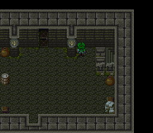
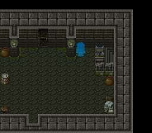
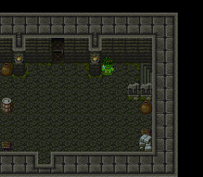

taro, on 2026-11-20, translated (66 captures, one a frame, frames 3672 to
3737, in `/shared/bug-reports-etc/zounds-flash-palette-breaks/`):

> It's Zounds, map 114, "Cueva". The event `EV0013` has:
>
> ```
> Play Sound: NAU_Mslash
> Wait: 1.0s
> Show Battle Animation: Dispel 2 (!), EV0011 (Wait)
> Control Switches: S[0206:D2-SeFuePuerta 1] ON
> ```
>
> I _think_ that `Show Battle Animation: Dispel 2 (!), EV0011 (Wait)` is
> what we see in the captures, and what causes the bug.
>
> The bug itself I can split in two:
>
> * Uname gets tinted, from `frame-3706.png` on
> * When the animation ends, his palette stays wrong until leaving the
>   map

The event, in the dump: [`EV0013` in `zounds/data/maps/Map0114.json`](https://github.com/lautarodragan/the-advocate-ports/blob/5d77d08fbe627e3c2706023e78c061272b705c0f/zounds/data/maps/Map0114.json#L1031-L1063)
(the ports are private: the link opens for taro and the agents).

Before, during (the hero tinted blue) and after (his colours wrong):





Maybe related, taro says, to
[`flashing-hero-shares-a-palette-with-an-npc`](flashing-hero-shares-a-palette-with-an-npc.md):
there the converter stops when a flash on the hero would reach an NPC
that shares his palette. Here the animation targets `EV0011`, not the
hero, and it is the hero who changes: a palette shared or borrowed by the
animation is the first thing to look at.
