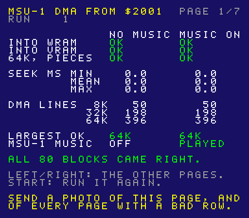

Found by Chajá on 2026-11-22, in
[`maps-uncompressed-in-the-msu`](maps-uncompressed-in-the-msu.md), with
the-advocate `ec672f4c`. Read, not run: there is no FX Pak here.

**What is in doubt**: the FX Pak's FPGA serves the data port from a
16 KB buffer in two 8 KB halves, and the MCU refills the half the read
left behind from the SD card (`msu1_loop` and `prepare_data` in
sd2snes's `src/msu1.c`, `cf7e21d`). A DMA from `$2001` reads a byte
every 8 master cycles, so it drains 8 KB in about 3 ms. If the card does
not refill a half in that time, the DMA reads stale bytes. It would show
as broken tiles, not as lag, and **no emulator models it**: they all read
the file directly.

**Who does it today**: `scn_dma_msu` in `runtime/battle_scene.s`, the
battle backdrop's 32 KB into each WRAM buffer, in one DMA. Its task,
[`msu-1-the-backgrounds-through-the-data-port`](msu-1-the-backgrounds-through-the-data-port.md),
left "the risk of the 32 KB read in a single DMA" untested on 2026-09-26.
The battle shows the `.msu`'s backdrop only with the MSU-1, so on the FX
Pak a battle in Sector 27 or 30 would show it.

**Why it matters now**: loading a map's background and grid raw from the
`.msu` saves 5 to 25 frames a load (measured in the task above), with
DMAs of up to 64 KB from the port. That should not be built before this
is known.

**How to answer it**: a test ROM like the SRAM one in
[`the-sram-as-slow-wram`](the-sram-as-slow-wram.md), for taro to run on
the FX Pak: seek far-apart places of a `.msu` of known bytes, DMA 8, 32
and 64 KB from each in one go, and show each block's checksum against the
expected one, with and without an MSU-1 track playing, plus how long each
seek waited. If big blocks come out wrong, the DMAs go in pieces with a
wait between them, and the same test finds the largest piece that holds.

taro, 2026-11-22, asked whether to start with the FX Pak test ROM:

> Go ahead

## Log

### 2026-11-22, Hornero: taken for Aguará, the test ROM

### 2026-11-22, Aguará: the test ROM, run in six emulators and delivered

From the-advocate `1b8825d8` and the ports `544f9bc` (branch
`aguara-msu-dma`, with main `74152d7` merged). Nothing of the-advocate
changed: the ROM is its own, in the ports' `abl/experiments/msu-dma/`
(`build.py`, `dma.s`, `measure.py`), and `just msu-dma` in `abl/` builds it
and runs it in the emulators. What it does is in the header of `dma.s`.

#### The ROM

A 512 KB HiROM **with no SRAM**, so that the FX Pak's save check before a
silent seek (`msu_savecheck`) has nothing to checksum and the seeks are the
card's alone; an 8 MB `.msu` whose every 32-bit word is a hash of its
offset; a `-1.pcm`, a soft hum. At power on, and again with START, two
passes —no track, then the track playing on repeat— of forty blocks: at four
places megabytes apart (`$0A1235`, `$2C0000`, `$5A01FF`, `$7D7FFE`: an odd
byte, an 8 KB boundary, a sector's last byte, near the end), taken in turn
so that every seek jumps,

* one DMA of 8, 32 and 64 KB from `$2001`, fixed source, into WRAM through
  `$2180`;
* the same into VRAM through `$2118`, read back by DMA from `$2139` to be
  checked, with the screen off;
* 64 KB into WRAM in pieces of 16, 8, 4 and 2 KB, 64 lines (~4 ms) apart:
  if the big ones fail, the largest piece that holds.

Each block is compared word for word against the ROM's copy of the place
(banks `$C1-$C4`): the word sum got and expected, OK or BAD, the offset of
the first byte that differs; and the seek's wait (bit 7 of `$2000`) and the
DMA's lines. A 64 KB DMA lasts a frame and a half, so the single DMAs start
at line 0 and the V-IRQ flag (`$4211`, set at line 200 with the IRQ masked)
says whether they went into the next frame; `RDNMI` would not, it clears
itself at the end of the vblank. Seven pages: a summary (bad blocks per
group and pass, seeks min/mean/max in ms, DMA lines for 8/32/64 KB, the
largest DMA that came right, whether the track played) and the forty blocks
of each pass in three.

The garbage background of the SRAM test ROM: this one sets every PPU
register and clears VRAM, CGRAM and OAM by DMA before drawing. Not seen on
the console yet; my guess is that the old one's garbage came from a register
left as the console powered on (colour math, a subscreen), since it did
upload its whole tilemap.

Two things the emulators caught on the way: reading VRAM back by DMA gives
word 0 twice unless a read is thrown away first (`$213A` reloads the latch
from the address before incrementing it, fullsnes "2139h"); and the pieces'
count started one short.

#### Measured in the emulators

`just msu-dma` (exit 0): snes9x, bsnes, mesen-s, bsnes's accurate PPU (the
audit core), Mesen2 and Mednafen's `snes_faust` —this one unthrottled, read
from the save state it writes on exit—. In all six, the 80 blocks right and
the track played throughout; DMAs of 8, 32 and 64 KB in 49-50, 198 and 396
lines (8 master cycles a byte plus the refresh: 8192 x 8 / 1324 = 49.5);
the pieces 396-416 lines in all, a line of rounding each. Seeks: at once in
the libretro cores; 30.8-33.3 ms in Mednafen, its fixed model. snes9x also
runs it again with START: the same, run 2. A run is 1,568 frames, ~26 s on
the console before the FX Pak's seeks.

The check checks: a copy of the `.msu` with one byte changed at B + `$3001`
and C + `$4000` given the 8 KB from 16 KB earlier —a stale half—, in
snes9x: BAD on exactly the 32 blocks that read them (the 8 KB ones do not
reach), first bytes `3001` and `4000`, LARGEST OK `NONE`.

No test in ABL's suite: its folders are about the game (`tooling/` runs no
ROM), and the other hardware experiments (`exhirom`, `msu-port`,
`sram-dma`) have their recipe only. `measure.py` exits 1 on any wrong
block, wrong DMA timing or a seek at the cap, so `just msu-dma` is the
check; it takes about a minute.

`msu-port` (2026-10) asked part of this —32 KB DMAs from a 1 MB `.msu`— and
was never run on the console; the recipe's comment says this one goes
further. It was left as it is.

#### Delivered

`/shared/builds/msu-dma-test/`: `msu-dma-test.sfc` (sha1 `a5908a44…`), its
`.msu` (`b65a71ab…`) and `-1.pcm` (`902d3dd7…`), `emulator-summary.png`
and a `README.txt` with the commits, what to look at and what to send.
Built from the ports' `512ef02`.

**What taro has to do**: run it on the FX Pak and send a photo of page 1,
and of every page with a red row; START two or three times, and whether the
hum played and stuttered. The answer decides whether a map's background can
be read raw from the `.msu` in one DMA of up to 64 KB, or in pieces of the
largest size that held; and whether the battle backdrop's 32 KB DMA is safe.

**What has to be installed when merging**: nothing. Not run: ABL's suite
(nothing it builds changed), the console.

### 2026-11-22, Hurón: what to look at

Aguará's `emulator-summary.png`, from `/shared/builds/msu-dma-test/`, at
2x: what page 1 looks like when big DMAs from the data port hold. On the
FX Pak, compare row by row. The seek times will differ and that is not a
failure: snes9x seeks at once (0.0), the card takes milliseconds, and how
many is part of the answer. What does decide it is any red "n BAD", a
LARGEST OK below 64K, DMA lines other than 49-50/198/396, or a last line
in red. The `README.txt` next to the ROM explains every row.

**How to test it**: copy the three `msu-dma-test` files (`.sfc`, `.msu`,
`-1.pcm`) to the card together and run it. It runs on its own for about
half a minute (the screen goes black for a few seconds while it reads
into VRAM) and then shows page 1. Photograph page 1 and every page with a
red row; press START two or three times for more runs, and note whether
the hum played and whether it stuttered.
