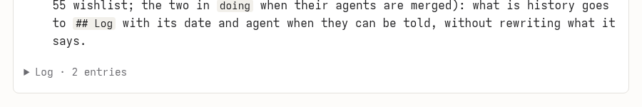
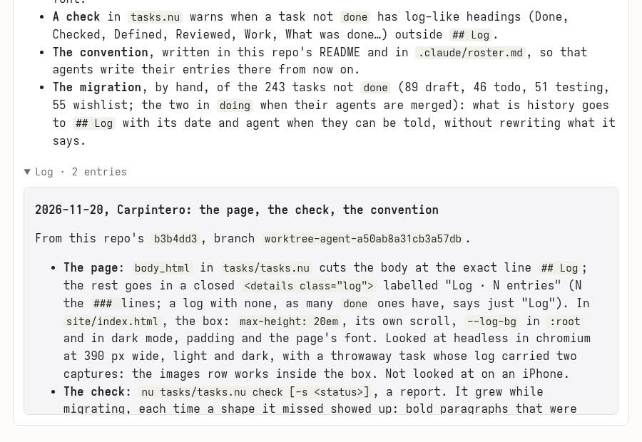

taro, on 2026-11-20, translated:

> I've been thinking I'd like to minimise the tasks' UI a bit, or make
> them more navigable, by introducing more structured/typed sections.
>
> Today, tasks have a log of the work, by convention. It is usually a
> heading that says `Done`. I'm thinking I'd like that to be collapsed by
> default, and to be able to expand it, and I think I'd like it to have a
> maximum height, and the scroll to happen inside its little box. [...]
>
> Maybe that box with the work log should also be told apart visually,
> and not only given a scroll. It could have a slightly different
> background, some padding... something similar to what we already do for
> code, but without monospaced fonts, among other things.
>
> I'd like this to be retroactive, but clearly we can't identify the work
> log blocks deterministically, so maybe it's better for an agent to do
> it, judging each task by hand.
>
> To reduce the load, I'd ignore the ones already `done`.

Agreed the same day: the log goes **in the same file**, as **a final
`## Log` section** —a separate `<task>.log.md` would break "one file per
task" and the `tasks/*.md` glob, and split the task from its history on
GitHub—, with one entry per step, `### <date>, <who>: <what>`. Above it,
what defines the task —what, why, taro's words, images— stays always
visible.

- **The page** (`tasks/tasks.nu html`, `site/index.html`) cuts the body at
  the exact line `## Log`; what follows goes in a `
` closed by
  default, labelled with how many entries it has ("Log · 4 entries"), in
  a box with a maximum height (about 20em) and its own scroll, a slightly
  different background and padding, in the normal font.
- **A check** in `tasks.nu` warns when a task not `done` has log-like
  headings (Done, Checked, Defined, Reviewed, Work, What was done…)
  outside `## Log`.
- **The convention**, written in this repo's README and in
  `.claude/roster.md`, so that agents write their entries there from now
  on.
- **The migration**, by hand, of the 243 tasks not `done` (89 draft, 46
  todo, 51 testing, 55 wishlist; the two in `doing` when their agents are
  merged): what is history goes to `## Log` with its date and agent when
  they can be told, without rewriting what it says.

## Log

### 2026-11-20, Carpintero: the page, the check, the convention

From this repo's `b3b4dd3`, branch `worktree-agent-a50ab8a31cb3a57db`.

- **The page**: `body_html` in `tasks/tasks.nu` cuts the body at the
  exact line `## Log`; the rest goes in a closed `
`
  labelled "Log · N entries" (N the `### ` lines; a log with none, as
  many `done` ones have, says just "Log"). In `site/index.html`, the box:
  `max-height: 20em`, its own scroll, `--log-bg` in `:root` and in dark
  mode, padding and the page's font. Looked at headless in chromium at
  390 px wide, light and dark, with a throwaway task whose log carried
  two captures: the images row works inside the box. Not looked at on an
  iPhone.
- **The check**: `nu tasks/tasks.nu check [-s <status>]`, a report. It
  grew while migrating, each time a shape it missed showed up: bold
  paragraphs that were entries (`**Checked on 2026-10-16** by Cardón`,
  `**Hurón, 2026-10-15**`, `**Not in the test game** (Aguará,
  2026-11-16)`), the older tasks' `#` headings. Left alone on purpose: a
  bare `## Defined` and the dated first paragraph under it, `## Done
  means` and `**Done** means`, `**Measured**`, `**Since <date>**`,
  `# Status`, and any heading that names taro.
- **The convention**: "A task's log" in the README, before the
  frontmatter section, and a line in `.claude/roster.md`.

### 2026-11-20, Carpintero: the migration

One commit per status, the check empty after each. What went where is in
each commit's message; the text was moved and not reworded —a script
compared each file's non-heading lines before and after—, but for the
headings, turned to `### <date>, <who>: <what>`, and a `Defined (date,
agent)` kept above, which lost its date to a line, `On <date>, by
<agent>.`. Tasks with a `## Log` now: draft 15 of 89, todo 33 of 46,
testing 51 of 51, wishlist 25 of 55; the rest had no history to move.
The two in `doing` and this one were not touched.

Judged, and could be judged the other way:

- `invisible-walls-lost-when-trimming-events`: its "**Checked today**",
  with the table of maps that lose walls, went to the log as an undated
  `### Checked`; Aguará's later measurement is there too.
- `the-menu-shows-the-partys-conditions`: "First step: what RPG_RT
  shows" stays above, as the research the plan stands on, though it
  opens with Tijereta's start line.
- `the-partys-conditions`: `## Done` (what done means) retitled `## Done
  means`; its inventory stays above.
- `monster-conditions-and-flashscreen-in-battle`: Chajá's plan went to
  the log with the start line it followed, so that it does not read as
  part of taro's decision.
- `zounds-menu-pictures-on-map-136-need-512-tiles` (draft): Calandria's
  second finding stays above, as part of what the draft is.
- `the-zoom-baked-at-run-time`: taro's words were an entry of its log;
  they went above it.
- Entries without a date in the text carry none, and some without an
  agent carry none either.

### 2026-11-22, Hurón: what to look at

Rendered from this repo's main (`dc5e74b`) with `nu tasks/tasks.nu html`,
this task alone, in headless chromium at 900 px, light mode. Not a game
screen: it is the tasks page.

**How to test it**: open the published tasks page (or `_site/index.html`
after `nu tasks/tasks.nu html`), open any task in `testing` and look for
the "Log · N entries" line at its end: closed by default, and opened, a
box that scrolls inside itself. Try it in dark mode and on the phone,
which were not looked at here. `nu tasks/tasks.nu check` is the other
half: it should report nothing on the tasks already migrated.
