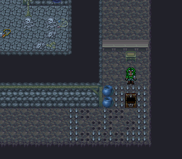
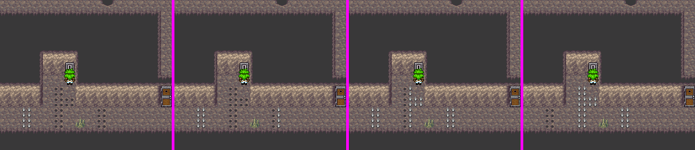
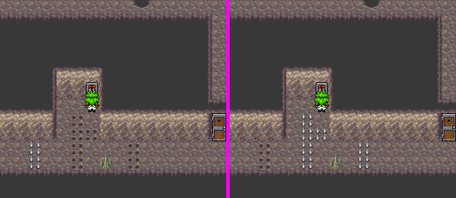

taro, on 2026-11-20, translated (15 captures, one a frame, frames 61756
to 61770, taken with the Mesen2 script that names each file by its frame,
in `/shared/bug-reports-etc/zounds-swap-tiles/`):

> Here's a possible optimisation. Seen in Zounds, but it applies in
> general, I imagine.
>
> The map's tile swap runs as a sweep, right to left. I saw it on other
> maps too. [...] Indeed what we see is that on each frame one column of
> 8x8 tiles changes. It's 15 files, ergo, 15 frames. That swap should
> happen all at once, in a single frame.

The first, the eighth and the last of them —the spikes under the hero
going down, column by column—:

The suite already plays the switch:
`test_zounds_tile_substitutions.py::test_the_switch_swaps_the_spikes_up_and_down`
in the ports.

## Log

### 2026-11-20, Chajá: the whole screen in one frame

**Where it comes from: on purpose, and measured.** `git blame` and `git
log -S sub_refresco` in the-advocate lead to `5c5e5f1e` (2026-09-21), the
commit that brought `TileSubstitution` in. Its message says it outright:
the VRAM tilemap does not rewrite itself, so the window is redone one
column a frame and takes `WINDOW_COLS` frames to catch up, "against RM2k's
on the spot"; two columns a frame did not fit because `push_strips`
uploads one. The column redone is `win_col - MARGIN_COLS + sub_refresh`,
counting `sub_refresh` down from 64: right to left, the off-screen right
part first, the screen's 33 columns on frames 28 to 60 after the
substitution. It is not the camera's edge refresh: it is a counter of its
own in `stream_map`, which only goes on frames the camera built no column.

**Who uses it** (a throwaway script over the nine dumps, code 11750):
10 maps in 3 games —El Dorado 2, 7, 9 and 12; Sunset Over Imdahl 60;
Zounds 17, 59, 75, 96 and 102—, none in a common event. Zounds 75 and
102 do it from a **parallel** event every second (`Wait 1.0`, then the
three-step rotate): with 64 frames to catch up and 60 between swaps,
the window there never catches up. `ChangeMapTileset` (11710: Frozen
World 5 maps, Vampire's Dawn 5) is dropped by the compiler and is not
this.

**What was measured** (2026-11-20, A Blurred Line's map 6, the cases of
`test_substitution.py`; the line counter read with `SLHV` around the
code, in a throwaway build, in snes9x and bsnes alike):

- A calm frame's vblank work ends on line 235; the vblank is lines 225
  to 261, so ~26 lines are free, about 4.4 KB of DMA at best.
- `build_column` costs ~19 lines of CPU a column: the screen's 33 that
  way would be ~620 lines, two and a half frames.
- One layer of the screen's columns is 34 x 64 bytes = 2,176; both
  layers, 4,352. Uploaded as 34 DMAs down the columns, one layer took the
  vblank from line 232 to 252 (20 lines), and that vblank's work ended on
  257. Both layers would be ~40 lines: they do not fit in one vblank.
- Built a block at a time straight into a buffer (grid and table read
  once a block, not four times), one layer is ~277 lines of CPU: the tick
  that substitutes lasts one frame more.
- RAM: far RAM had 109 bytes left and the BSS 61, so the buffer is the
  start of the load buffer, `LZ2_BUFFER`, free on the map below the
  carried bytecode at `+$1100`.

**What was done** (the-advocate, `chaja-tile-swap`): `op_tile_sub` marks
which layers change —it compares the four words of each layer of the
outgoing and the incoming block—, the same tick's `stream_map` builds the
screen's 34 columns of one layer into the load buffer (`sub_bulk`), and
the next vblank uploads them all (`sub_upload`), with no poses, no
ChipSet step and no battle-animation frame that vblank: they wait with
their flags set. A substitution that changes both layers does the
background first and the upper layer on the next tick, so one frame
shows the background changed and the layer above not yet. The margins
the screen shake uncovers follow by the old one-column-a-frame path, over
the 41 columns of the window's range. It waits while a battle animation
or a big picture holds the load buffer; a map that loops keeps the sweep.

Zounds' map 59, frames counted from pressing A on the switch. Before
(main's runtime): nothing changes until frame 41, and the spikes then
swap column by column until frame 56 —frames 40, 41, 49 and 56—:

After: every spike swaps on frame 2, the frame after the page runs
—frames 1 and 2—:

**The test**: `test_the_whole_screen_changes_on_one_frame` in ABL's
`tests/rpgmaker/test_substitution.py`, for the background (`tile-sub`)
and the upper layer (`tile-sub-high`): against the control, the first
tick that differs has to differ in exactly the pixels it differs in once
the window caught up. Red before the fix: tick 93 showed 825 of 5,813
pixels; tick 89, 64 of 1,600. ABL's whole suite is green with it, no
golden moved, and Zounds' tests too.

On Zounds' map 75, whose parallel event swaps its spikes every second,
each swap changes 6,352 pixels across the whole screen on one frame, 61
frames apart (60 and the one the build adds). On another game it was not
seen: El Dorado's map 12 vine (`Lianentext`, behind switch 190) did not
run when pressed from (1, 4) facing up, and map 2's came out black under
a timer —not looked into further—.

**What no test covers**: a substitution that changes both layers (one
frame with the background changed and the upper layer not yet); one on a
painted map (only the upper layer is built), under a panorama on BG2
(only the background), on a looping map (the old sweep), or while a
battle animation or a big picture holds the load buffer (it waits); the
margins after it under a screen shake; and the one-frame lag of the
substituting tick on a map heavier than A Blurred Line's map 6, which was
measured on that map only. None of the ten maps that substitute loops.

**When merging**: only the runtime changed, no Rust: nothing to
reinstall, the installed tools assemble `~/the-advocate`'s runtime. The book's
`optimizations/lossless/the-map.md` changed in `chaja-tile-swap` of
the-advocate-docs.
