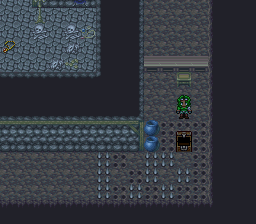
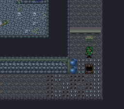

taro, on 2026-11-20, translated (15 captures, one a frame, frames 61756
to 61770, taken with the Mesen2 script that names each file by its frame,
in `/shared/bug-reports-etc/zounds-swap-tiles/`):

> Here's a possible optimisation. Seen in Zounds, but it applies in
> general, I imagine.
>
> The map's tile swap runs as a sweep, right to left. I saw it on other
> maps too. [...] Indeed what we see is that on each frame one column of
> 8x8 tiles changes. It's 15 files, ergo, 15 frames. That swap should
> happen all at once, in a single frame.

The first, the eighth and the last of them —the spikes under the hero
going down, column by column—:

The suite already plays the switch:
`test_zounds_tile_substitutions.py::test_the_switch_swaps_the_spikes_up_and_down`
in the ports.
