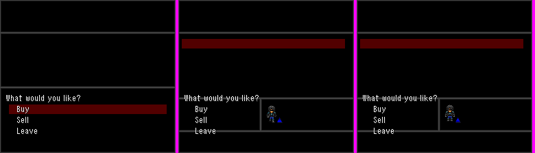
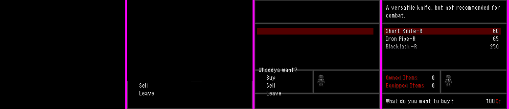

taro, 2026-11-22, frames in
`/shared/bug-reports-etc/abl-shop-text-composition-lag/`, on the build of
the ports `e886c7e` and the-advocate `7e8da728`:

> It has two subfolders, with two examples.
>
> In `A`, frames 11165-11168 are "broken" (half composed, mixing the text
> of one screen with the windows of the other). 11210-11214, the same.
>
> In `B`, 8992, 9024-9035, 9083-9086

RM2k switches a shop's screens from one frame to the next.

## Log

### 2026-11-22, Hornero: taken for Aguará

### 2026-11-22, Aguará: the cause

Read at the-advocate `7e8da728` and the ports `769676f`, in worktrees under
`~/scratch/aguara/shop-switch/`, branches `aguara-shop-switch` in both.

#### Two defects, not one

* **The switches** (A 11165–11168 and 11210–11214, B 9024–9035 and
  9083–9086). `shop_screen`'s loop, after a key, recomposes the text
  —`ti_compose` writes the text layer's records— and in the next vblank
  `ti_windows` uploads the new mode's windows and bar, and
  `ti_party_vblank` turns the party's objects on or off and moves its
  arrows. The text layer, instead, typesets the changed rows while the
  frames wait for the vblank —`tl_idle`— and switches its tilemap only when
  everything is typeset (`text_layer.s`, "The tilemap switches when
  everything is typeset"). So for as many frames as the typesetting takes,
  the screen showed the new windows, bar and party over the old text: twelve
  frames from the choice to the buy list, whose list and description are
  the most letters. It is not the vblank's budget: the windows are uploaded
  whole in one vblank; it is that they do not wait for the text.
  The equipment screen had the same and was fixed on 2026-11-17
  (`8b9eb121`, Calandria) with `tl_settled`, which says whether the text
  has nothing left to change and the tilemap goes up in this vblank; the
  shop never asked it.
* **The opening** (B 8990–8992). `screen_ppu_on`, which the shop, the items
  and the equipment screens end their opening with, writes `INIDISP` with
  the screen on wherever the uploads ended: in B, on line 166 —the frame is
  black down to it and the shop from there—. The skills screen, the custom
  menu and the debug screen wait for the vblank first; these three did not.

### 2026-11-22, Aguará: the tests, red

#### ABL: `tests/rpgmaker/test_shop_frames_drawing.py`

The weapons seller of `test_shop_drawing.py` —whose `enter` takes
`opened=False` now, to stop before the A that opens the shop—, frame by
frame after each press against `screens.shop` before and after, drawn with
the party's step that each frame has up. Red at the-advocate `7e8da728`
(the global tools), both cores the same; each list is what each frame
after the press showed —a number is how many pixels it differs from the
screen after—:

| Switch | Frames |
|---|---|
| choice → buy list | before, 12 × 3972, after |
| buy list, down | before, 4 × 1185, after |
| buy list → quantity | before, 3 × 1537, after |
| quantity → buy list | before, 6 × 1537, after |
| buy list → choice (B) | before, 4 × 3754, after |
| choice, down | before, after |
| choice → sell list | before, 4 × 1212, after |
| sell list → choice (B) | before, 3 × 1231, after |
| opening, from the A | black, black, 5828 (black down to line 166), after |

The twelve of the first one are taro's B 9024–9035.

#### The test game: `test-game/tests/test_shop_switch.py`

The tester's `screen-letters-shop`. No reference renderer there, so a
screen is every picture it shows standing —the party walks on the buy
list—, sixty frames before the press and sixty after, and each frame in
between has to be one of the before or one of the after. Red at
`7e8da728`, in both cores: to the buy list, 4 frames neither; back to the
choice, 1. Down the list was whole.

### 2026-11-22, Aguará: the fix

The least costly path is the one the equipment screen took: keep the old
picture until the new text is whole, and put the windows up in the same
vblank as the text's tilemap. Nothing new is uploaded; what moved is when.

* **`shop.s`**: the loop's vblank uploads moved to `ti_upload`, which asks
  `tl_settled` once —before `tl_vblank`, which empties `TL_UP_N` and would
  answer yes in a vblank whose tilemap did not go up— and only then puts
  up `ti_windows` and `ti_party_vblank`. Moved out of the loop because the
  loop's branches back to `wait` ran out of range.
* **`shop_party.s`**: with the gate, the first time a buy layer shows the
  party its member's step (384 bytes) did not fit after the windows and
  the tilemap, and the member came one frame late —one frame of 320
  pixels in the test—. `ti_party_open` now uploads each member's first
  step and its colour palette with the screen off.
* **The opening**: `screen_ppu_on` and `target_ppu_on` wait for a vblank's
  start before turning the screen on; the pause menu (`menu_exp_paint`,
  which turns on through `slot_ppu_on`) and End Game call `ba_t_vblank`
  first. `slot_ppu_on` itself is left alone: the battle calls it inside a
  vblank already.

#### Measured after

Each switch's after screen arrives in **the same frame as before** —it is
the text's typesetting that sets it, and that did not change—, and every
frame before it is the old screen whole (snes9x and bsnes the same):

| Switch | Before the fix | After |
|---|---|---|
| choice → buy list | 12 mixed, whole at 13 | 12 old, whole at 13 |
| buy list, down | 4 mixed, whole at 5 | 4 old, whole at 5 |
| buy list → quantity | 3 mixed, whole at 4 | 3 old, whole at 4 |
| quantity → buy list | 6 mixed, whole at 7 | 6 old, whole at 7 |
| buy list → choice (B) | 4 mixed, whole at 5 | 4 old, whole at 5 |
| choice, down | whole at 1 | whole at 1 |
| choice → sell list | 4 mixed, whole at 5 | 4 old, whole at 5 |
| sell list → choice (B) | 3 mixed, whole at 4 | 3 old, whole at 4 |
| opening | black, black, split, whole | black, black, whole |

The test game's: green in both cores.

#### The other text screens

Looked at frame by frame with a throwaway script on ABL, after the fix:

* **The pause menu's opening, and its return from the items screen**,
  were split frames too —black down to some line, the menu below—: fixed
  with the rest of the opening, now black and then whole. Not covered by
  a test.
* **The items screen's opening**: black, then whole (`screen_ppu_on`).
* **The items screen's cursor**: the bar is on the next item with the old
  description for three frames, five on a third step. Its own code
  (`items.s`'s `move`), not the shop's path: it was already a draft,
  Calandria's `the-items-screen-s-bar-runs-ahead-of-its-text`, and I added
  the measurement there. Its line is in ABL's "Known issues" already.
* **The skills screen and a custom menu** upload their bar the same early
  way in their own code; not seen —the party tried had one skill—. Draft:
  `the-skills-screen-s-and-a-custom-menu-s-bar-may-run-ahead-of-their-text`.

### 2026-11-22, Aguará: what was run, and what to merge

Branches `aguara-shop-switch`: the-advocate `ba782dbd` (two commits on
`7e8da728`: the shop's gate and the party's first step, with the test
game's test; the screens coming on at a vblank's start) and the ports
`e9bd915` (two on `769676f`: the shop's way in to `tests/harness/shop.py`,
mechanical; the new test). `main` had not moved in either.

With `.local-tools` of `project` and `cartridge` from the branch —no Rust
was changed; they only point the build at the branch's runtime—:

* the-advocate `just test`: 29 passed.
* `SOUNDFONT=…/FluidR3_GM.sf2 just test-game`: 210 passed, 6 skipped.
* ABL `just tests`: 1691 passed, 2 skipped. **No golden moved.** Goombario
  flagged the `pla`/`beq` in `ti_upload` on the first round; it branches
  on what it pulled on purpose, and the line says so now.
* The ports' `just boot`: 201 passed.

`abl.sfc` of the branch's `release`: sha256 `a21fc96496b4d291…`.

**To install when merging: nothing.** Only `runtime/` changed, which the
cartridges assemble from the checkout the tools were installed from.

**What no test covers**: the pause menu's opening and its return from the
items screen, the items and equipment screens' opening, the slot screen,
the actor choice and End Game coming on at a vblank's start. The menu's
and the items screen's were looked at frame by frame with a throwaway
script, once; the rest only share the routine the shop's test covers
(`screen_ppu_on`) or the same two lines (`target_ppu_on`, End Game).

### 2026-11-23, Hornero: done

taro closed it, with eight others:

> podemos cerrar estas, no?

(taro: "we can close these, right?")
