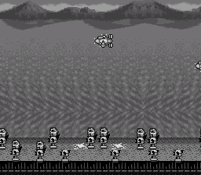
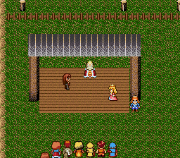

Seen by Mulita on 2026-11-17 with the ports' `just objects-per-line`, at
the-advocate `7dab7d82` and the ports `e87e936` (branch
`mulita-objects-per-line`), from
[`maps-with-more-objects-on-a-line-than-the-ppu-draws`](maps-with-more-objects-on-a-line-than-the-ppu-draws.md).

The console fetches at most 34 slivers of 8 pixels per line; every
character is a 32x32 object, four slivers, so **nine characters on a line
go over** and the ones with the highest OAM index —the ones further back—
are cut, a column or whole. The worst line of each map, under the camera
that shows the most, on a new game with every switch off, after entering
with a teleport:

Map 13, the Hover-Tram, is
[`abl-the-hover-tram-s-crowd-is-cut`](abl-the-hover-tram-s-crowd-is-cut.md),
which taro found playing; Cardón is baking its still people, and its
numbers here are from before that merge. The rest were not reported.

* map 267: 30 characters and 116 slivers on cell row 12 (events 3, 4, 5, 6, 7, 8, 9, 13, 14, 15, 16, 17, 18, 19, 20, 26, 27, 28, 29, 30, 31, 32, 33, 34, 35, 36, 37, 38, 39, 40); at the entrance too
* map 13: 14 characters and 56 slivers on cell row 8 (events 10, 11, 12, 13, 14, 15, 16, 17, 18, 19, 20, 21 Leave2, 22, 24); at the entrance too
* map 318: 14 characters and 56 slivers on cell row 13 (events 5, 6, 7, 8, 9, 10, 11, 12, 13, 14, 15, 16, 17, 18); at the entrance too
* map 3: 14 characters and 55 slivers on cell row 44 (events 8 Talan, 18 Broke1, 19 Broke2, 20 Broke3, 21 Broke4, 22 CoreBlood, 27 Black1a, 28 Black1b, 29 Black2a, 30 Black2b, 31 Black3a, 32 Black3b, 33 Black4a, 34 Black4b)
* map 52: 10 characters and 39 slivers on cell row 23 (events 6, 11, 14, 16, 17, 20, 21, 33, 36, 37)
* map 54: 10 characters and 36 slivers on cell row 23 (events 4, 6, 16, 18, 19, 20, 21, 25, 27, 33)
* map 199: 9 characters and 36 slivers on cell row 1 (events 1, 2, 3, 8, 9, 10, 13, 15, 16); at the entrance too
* map 20: 9 characters and 35 slivers on cell row 0 (events 6 Slum30Chest1o, 8 Slum30Chest2o, 10 Slum30Chest3o, 12 Slum30Chest4o, 14 Slum30Chest5o, 16 Slum30Chest6o, 18 Slum30Chest7o, 20 Slum30Chest8o, 25 Slum30Chest9o)

How to reproduce: `tests/objects_per_line.py abl` at the root of the ports,
which prints each map's worst lines and the camera X that shows them; the
full report of that day, with captures of a few maps in both cores, is in
`/shared/captures/2026-11-17-objects-per-line/`. Playing, the debug
screen's last page counts the map's frames in `Time over`.

What the report cannot say: whether a line is one the player sees with
everyone on it —a page another switch turns off, people a first scene
sends away—, and what a scene adds later.

## Log

### 2026-11-22, Tijereta: still so, to todo

`just objects-per-line abl` in a worktree of the ports at `89f77b4`, with
the-advocate `0ae40e0a`'s global tools (its `abl.sfc` byte for byte the
main checkout's): every map of the list but one is still over, with the
same events on the same rows —3, 20, 52, 54, 199, 267 and 318—, and 267,
318 and 199 already at the entrance. **Map 13 is no longer over**: its
still crowd is baked into the background since
[`abl-the-hover-tram-s-crowd-is-cut`](abl-the-hover-tram-s-crowd-is-cut.md).
Map 49, Escape Lashe City LV1, goes over only with the hero on the line.
Moved to `todo`; `description` no longer counts the maps.

The two captures above are snes9x, entering the map as the sweep does (a
door's teleport to its start cell, 30 ticks), with the camera where the
entrance leaves it.
