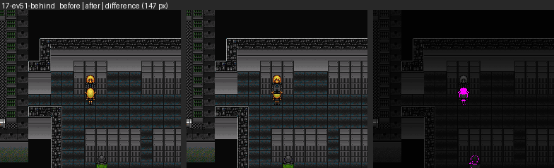
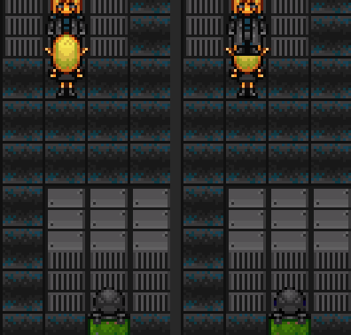

taro, on 2026-11-22, translated, on taking the cases out:

> Go ahead! I like it. And I'd take it on right now.

What
[`the-test-game-takes-the-harness-and-the-first-ten-tests`](the-test-game-takes-the-harness-and-the-first-ten-tests.md)
left: its ten tests left ABL's suite, but their 16 cases stayed, because
taking them out moved what the converter decides for other maps
—`test_the_versioned_patches_are_what_the_converter_decides` red, with
maps 17, 199, 307 and 315 keeping more colours (53 to 75, 59 to 74, 15
to 18, 18 to 45), and `test_delcentric_pump[17]`, 9 of 57,344 pixels—.

**Done** is the 16 cases out of ABL, its versioned patches regenerated,
the moved goldens shown to taro side by side and approved before the
merge, and ABL's suite and the ports' `just boot` green. And the why of
each map's change measured: whether the cases sit on those maps or reach
them through graphics they share.

## Log

### 2026-11-22, Tijereta: the cases out, and why four maps moved

Taken at the-advocate `6a8f4162`, ports `97e4d50`, docs `5763340`, global
tools at `6a8f4162`; branches `tijereta-abl-cases-out` in the ports and
the book.

The sixteen are the files `abad94c` deleted and `4dd91b0` put back:
`branch-300`, `camera-fast`, `camera-fast-x`, `event-common-45`, the three
`key-wait-for-*`, `labels`, `screen-of-character`, `terrain`, `variables`
and its five `variables-*`. They live only in `tests/cases/`: `release`
takes them through `cases = "all"`, and nothing else in ABL names them
—no patch, no cartridge list, no test—. Out, and `just patches`.

#### Why maps 17, 199, 307 and 315

**Neither**: no case sits on those maps —all sixteen teleport to map 5—,
and none sets a graphic or a palette. They reach them through the
converter's arrivals, `reach.rs` in the-advocate's `convert`, which walks
the test cases' commands along with the game's:

* maps 60 and 62 `RecallToLocation` to variables 45/46 (map), 43, 44.
  The game writes 43 and 44 from the hero's position, so the recall can
  land anywhere one can step on; but 45 and 46 it only ever **sets to a
  number** —61 and 60, and the case `place-absent`, which stays, sets
  999, a map that does not exist—, so the arrivals narrow that "anywhere"
  to those maps: `of maps 60 61 999`, says the log now.
* `variables-arithmetic` writes 45 with a **division** (`ControlVars
  [0, 45, 45, 4, 0, 0, 0]`, the case's integer-division-by-zero check),
  which is not a number: with it in the cartridge the recall's map was
  any map, and the log's second line said "the hero can be on any cell
  one can step on", on every map.
* On every map, then, a still event drawn past its cell could have
  someone standing behind it, so it stayed an object —a sprite—. Without
  the case, nobody can stand there, and Wally draws it into the
  background, a block per pose: its colours join the lower layer.

So the patches' change is `colors`, the distinct colours the lower layer
brings, **not a colour lost before**: 0 merged before and after, of a
budget of 99. Map 17 bakes events 50 and 51 (and lends the raindrops
palette 6 instead of 7), 199 bakes 18, 19 and 20, 307 and 315 bake their
event 1. Maps 77, 112, 288, 291 and 295 moved too —the reason an event stays an
object, or one more event baked— without a change of colour count, so
their patches do not record it.

Measured, not read: with `variables-arithmetic` alone back, the
converter's log is the old one for every map —only map 4's page count and
the packed sizes differ—; without it, the diff is the one above.

### 2026-11-22, Tijereta: the goldens, the book, to testing

#### The goldens that moved: not approved

Only the two of `test_delcentric_pump[17]` —the suite run again until no
new red—, 9 of 57,344 pixels each, the same spot: the foot of the pump
that is down. Its red cable was blue-grey: the tile
(`@tile:ChipSet1:138`) had no sprite palette of its own on map 17 and
borrowed someone's nearest colours, as the log said. With events 50 and
51 in the background there is one character fewer among the sprites and
room for it, and it is red now, like the middle pump's foot. To my eye
the after is the right one; **taro approves before the merge**. Before,
after, difference, a zoom and a README in
`/shared/captures/2026-11-22-abl-cases-out/`. Map 83, the factory's copy,
did not move; nothing of maps 199, 307 and 315 has a golden.

#### The book

No page or decision named the cases. `internals/maps.md` still said a
worked-out recall puts the hero on any map, which stopped being true with
the-advocate's `703333fc`; it now says when it narrows, and that test
pages count, with this task as the example.

#### Commits

* the ports, `tijereta-abl-cases-out`: `764625c` the cases out,
  `5ce4017` the patches regenerated (mechanical), `d4b35ac` the goldens
  (not approved).
* the book, `tijereta-abl-cases-out`: `bef3e61`.

#### Verified

On the ports' branch, global tools at the-advocate `6a8f4162`, main not
moved since the start: ABL's `just tests` **1686 passed, 2 skipped** —the
same count as before—; the ports' `just boot` **199 passed**. `abl.sfc`
sha256 `fcff9c9c5847d4d2…`.

What no test sees: maps 199, 307 and 315, and map 17 away from the
pumps, now draw still events into the background; the patches' check
holds their colour counts, not what they look like.

#### When merging

Nothing to install: no tool changed. The CI's cores cache key changes
(the cases and patches moved).

### 2026-11-22, Hornero: the pump goldens approved, merged

taro looked at the two `test_delcentric_pump[17]` goldens and approved them:

> I agree! They look better. Approved!

Merged in the ports (001cfb7) and the book (00f515a). taro asked for
before/after captures of what no test covers —maps 199, 307, 315 and 17
away from the pumps—, which Tijereta is taking.

### 2026-11-22, Hornero: map 17's egg, to check by hand

The one to confirm by playing: on map 17, the cell (60,61), right above
event 51's egg (Future1, at (60,62)), looks like the factory's floor. The
converter says no entrance reaches it, so the egg is drawn into the
background; if the hero can stand there, the egg stays behind him instead
of in front, and that is a bug of the reach analysis. In these captures the
test placed the hero there, he did not walk: before (the egg a sprite, in
front), after (in the background, behind), and the difference.

taro will try it by hand:

> Nah, it's fine. I'll test it by hand.
