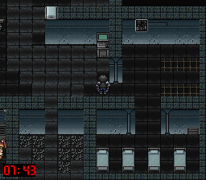
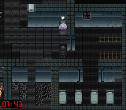

taro, 2026-11-22, frames in
`/shared/bug-reports-etc/abl-shine-hero-computer-lag/`, on the build of
the ports `e886c7e` and the-advocate `7e8da728`:

> It's in the Lazer Teeth HQ. When throwing a rock at the computer, on
> impact, instead of the computer flashing red, Talan flashes.
>
> 17687: I throw the rock upwards
> 17713: the rock hits, the hit animation starts over the computer
> 17717: Talan turns red
>
> The rest of the frames are the repetition of the tint and the
> animation, and the rock moving. Nothing unusual.

The same scene as
[`abl-lazer-teeth-s-rock-lags`](abl-lazer-teeth-s-rock-lags.md).

## Log

### 2026-11-22, Hornero: taken for Calandria
