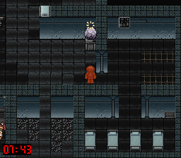

taro, 2026-11-22, frames in
`/shared/bug-reports-etc/abl-shine-hero-computer-lag/`, on the build of
the ports `e886c7e` and the-advocate `7e8da728`:

> It's in the Lazer Teeth HQ. When throwing a rock at the computer, on
> impact, instead of the computer flashing red, Talan flashes.
>
> 17687: I throw the rock upwards
> 17713: the rock hits, the hit animation starts over the computer
> 17717: Talan turns red
>
> The rest of the frames are the repetition of the tint and the
> animation, and the rock moving. Nothing unusual.

The same scene as
[`abl-lazer-teeth-s-rock-lags`](abl-lazer-teeth-s-rock-lags.md).

## Log

### 2026-11-22, Hornero: taken for Calandria

### 2026-11-22, Calandria: the computer is drawn into the background, and the flash falls on palette 0

From the-advocate `7e8da728` and the ports `769676f`, on branches
`calandria-rock-flash`.

#### The cause

`LTComputer` (event 35, at (19,44)) has a parallel page whose
`ShowBattleAnimation 1` ("Hit A") targets "this event". The animation
flashes its target three times (frames 2, 7 and 12), and the flash is a
tint of the target **object's** palette: `flash_start`, then
`target_palette` in `runtime/character_flash.s`, which reads the palette
bits of the row's attribute byte.

But since 2026-11-02 (`07de4003`, "Still events that change pose, drawn
into the background") the computer is not an object: Wally's `posed`
draws it into the background, a block per pose —the converter's log says
`map 11: 5 still event(s) drawn into the background, a block per pose:
10, 13, 17, 33, 35`—. On such a row the palette bits are not a palette:
they say which of its characters it shows (`runtime/posed.s`), 0 for the
computer. So the flash tinted sprite palette 0, the hero's.

`posed`'s `named` —the events a command moves or flashes, which stay
objects— counts `FlashSprite`, `SetEventLocation` and
`SwapEventLocations`, but not `ShowBattleAnimation`. Wally's `baking` —a
tile event painted into the upper layer, its row hidden— has the same
gap. `decor` does count it.

Lamps 3 and 6 (events 10 and 13) are posed too and animate "this event"
the same way: hitting them would flash Talan too. Lamps 1, 2, 4 and 5 stay
objects for another reason (a command moves them).

#### The fix

The faithful option, which costs no colour: the events a battle animation
falls on stay objects, as they were before `07de4003`. In
`rm2k-snes/wally/src/posed.rs` (`named`) and `baking.rs`
(`MOVING_COMMANDS`, with the target in the second parameter). Wally
tests: `posed::tests::an_event_a_battle_animation_falls_on_stays_an_object`
and two more cases in `an_event_a_page_moves_is_not_baked`, both shown
red before.

RM2k, read in easyrpg-player: `BattleAnimationMap::FlashTargets` is
`target->Flash(...)`, the target character's own flash, whatever it is
drawn with. So the computer flashes and Talan does not.

#### The tests

* ABL, the ports' `tests/abl/test_stones.py`:
  `test_the_stone_s_hit_flashes_the_pc_and_not_the_hero` throws at the PC
  from (19,52) and compares the hero's 24x32 on screen from when the stone
  has left him to the end of the round; and that the PC's row is an
  object, not drawn into the background.
* The test game: a new map, the anvil (15), with a crate (on the hero's
  layer, a second page on switch 1460 with another tile: drawn into the
  background, with `baked_events = [15]`) that plays animation 1 on itself,
  and a slab (below the hero, one page: baked into the layer above) that
  a graphic-less lever names by id. Animation 1, "Red flash", has no sheet
  and only a target flash. `tests/test_animation_flash.py` compares the
  hero's own cell and the target's while it plays. The guide's "Anvil"
  lands below the crate.

Seen red before the fix: ABL's test with the global tools (the-advocate
`7e8da728`), "27 ticks changed, from tick 23"; in a throwaway capture of
the same throw Talan turns red three times, as in taro's frames. The test
game's, with Wally as it was: the crate's test with the hero's cell
tinted; the slab's with the slab not flashing (the baked row has no
object either, but its palette bits did not land on the hero's).

#### What else it touched

The converter's log of `release`, map 11, before and after: `5 still
event(s) drawn into the background ...: 10, 13, 17, 33, 35` becomes `2
...: 17, 33`, and 10, 13 and 35 join the ones "a command moves or flashes
it". Map 153 has the same thing: its two `Nest`s play animation 77 on
themselves, and the second one was drawn into the background; it is an
object again. The versioned patches of both maps changed —map 11's lower
layer brings 66 colours instead of 69, map 153's merges are the same four
in another order—, in their own commit. **No golden moved**, and no slot
or palette was traded: these events were objects until 2026-11-02.

#### Verified

With `PATH=<the-advocate worktree>/.local-tools/bin:$PATH` —only `wally`,
`just install-local .local-tools wally`; the runtime did not change—:

* the-advocate `just test`: 29 passed; `just crate-test wally`: green.
* `SOUNDFONT=…/FluidR3_GM.sf2 just test-game`: 214 passed, 6 skipped.
* ABL's `just tests`: 1686 passed, 2 skipped, and one red,
  `test_the_versioned_patches_are_what_the_converter_decides` (maps 11
  and 153, above); with the patches regenerated (`just patches`) it
  passes.
* The ports' root `just boot`: 201 passed.

Branches `calandria-rock-flash`: the-advocate `642e204b` (two commits:
Wally, the test game), the ports `dda29ac` (the test, the patches), the
book `6bfb30c`. `main` had not moved in any of the three. **To install
when merging**: `just install wally`.

Not covered by any test: a battle animation named from a common event on
"this event" —`posed` already turns itself off for the whole map then,
and no game has one—, and `baking` still reads only the map's own pages,
not the common events, for every command it looks at.

### 2026-11-23, Hornero: done

taro closed it, with eight others:

> podemos cerrar estas, no?

(taro: "we can close these, right?")
