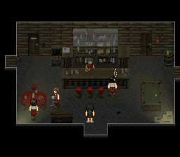

taro, on 2026-11-21, translated (frames in
`/shared/bug-reports-etc/dn-bar/`, repeated ones trimmed, with
`runs.txt`):

> the scene after escaping the first monster and entering the bar. what
> to look at:
>
> * up to 71700, all normal
> * 71701: one of the people sitting, smoking, is duplicated — a copy
>   shows up about two tiles higher. I think it's `EV0005`, which seems
>   to be the top part of his head and the cigarette smoke, and it changes
>   graphic wrongly, possibly related to `0282: Leute schauen` and its
>   second page
> * 72499: it gets fixed

Like
[`desert-nightmare-the-warehouse-safe-turns-into-something-else`](desert-nightmare-the-warehouse-safe-turns-into-something-else.md),
an event whose page changes and shows a graphic it should not; the two
may share a cause.
