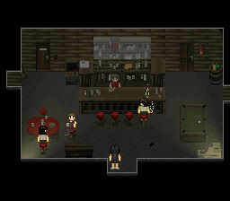
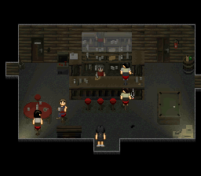
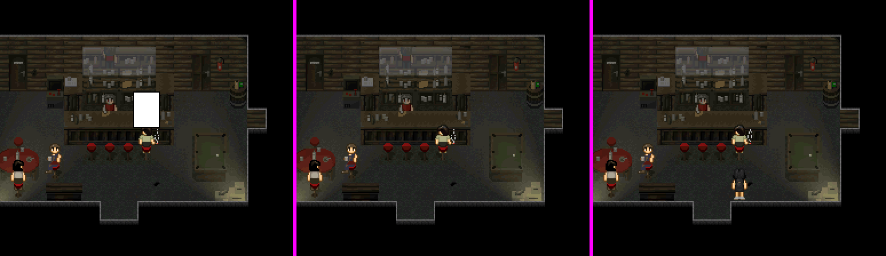
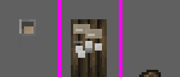

taro, on 2026-11-21, translated (frames in
`/shared/bug-reports-etc/dn-bar/`, repeated ones trimmed, with
`runs.txt`):

> the scene after escaping the first monster and entering the bar. what
> to look at:
>
> * up to 71700, all normal
> * 71701: one of the people sitting, smoking, is duplicated — a copy
>   shows up about two tiles higher. I think it's `EV0005`, which seems
>   to be the top part of his head and the cigarette smoke, and it changes
>   graphic wrongly, possibly related to `0282: Leute schauen` and its
>   second page
> * 72499: it gets fixed

Like
[`desert-nightmare-the-warehouse-safe-turns-into-something-else`](desert-nightmare-the-warehouse-safe-turns-into-something-else.md),
an event whose page changes and shows a graphic it should not; the two
may share a cause.

## Log

### 2026-11-21, Cardón: the smoke's next page kept the spin's pose

Same cause as
[`desert-nightmare-the-warehouse-safe-turns-into-something-else`](desert-nightmare-the-warehouse-safe-turns-into-something-else.md),
where the cause and the fix are told in full.

**The map is 31, "Bar Nacht"**, not 19 (the bar by day, which has no
switch 282). taro was right about the event:

* **EV0005 at (11, 7)** is the smoke over the smoker's head: page 1 is
  `Charakter2` #7 pattern 2, **spinning**. Page 2, with switch 282 "Leute
  schauen", is #2 facing down, pattern 2, fixed: **a cell of the CharSet
  with nothing in it**, so in RM2k it disappears.
* **EV0030 at (11, 9)** is the smoker: page 1 is #6 seen from behind on
  his stool; page 2, with 282, is #7 pattern 1 spinning, the smoker who
  turns his head and smokes. That is what everyone does with 282: they
  look.

On the console EV0005's page 2 kept its slot's facing and column, the
spin's, and drew another pose of #2: a white cell where I turned the switch
on, and taro's copy of the smoker two cells above him —#7's poses are the
smoker, and before `6ec2fad8` #2 had no pose bank and the row drew #7's—.
It lasts until 282 goes off, or until the map loads again with it on, which
sets the page up from scratch: taro's frame 72499.

Tested in `tests/test_desert_nightmare_page_after_a_spin.py` in the ports,
the `bar smoke` case: red before the fix (145 of 768 pixels), green with it.

The third cell is what RM2k draws for EV0005's page 2 (the first two are
the other task's):

In my captures the hero is not drawn on the first load of map 31 straight
from the new game, and is after the reload: not looked into, it is a jump
into the map that skips how the game gets there.

### 2026-11-21, Cardón: verified, to testing

See the last entry of the warehouse safe's task: the same branches and the
same runs (ABL's suite, the ports' `just boot`, `just test`, `just lint`),
all green, and nothing to reinstall. To play: the bar at night after
escaping the first monster, from frame 71701 on in taro's run: no copy of
the smoker two cells above him.
