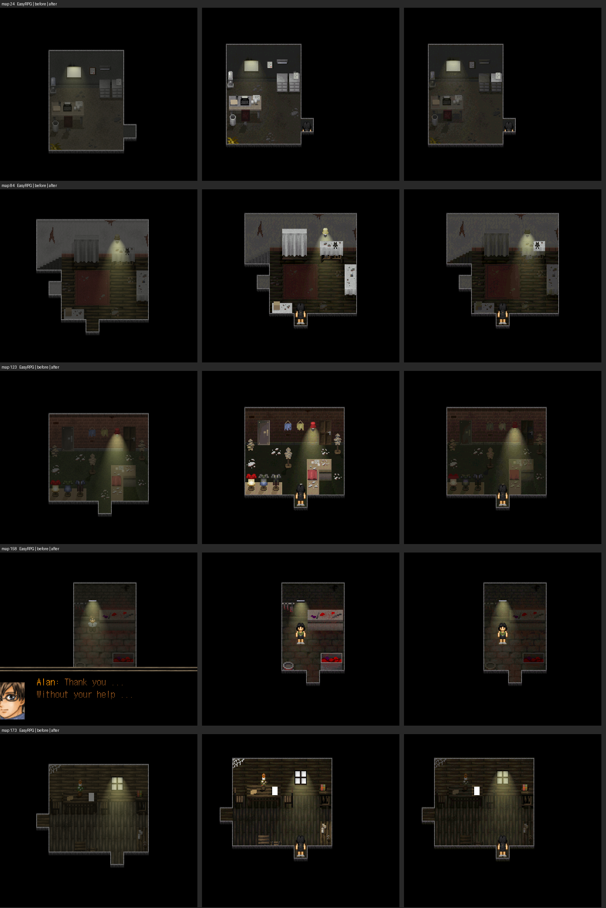

Seen by Hurón on 2026-11-21, doing
[`desert-nightmare-own-message-frame`](desert-nightmare-own-message-frame.md),
with the-advocate at `a537d967` and the ports' branch `huron-dn-frame`
(from `a36d80b`).

**What changed**: `painted_events`, in Desert Nightmare's `advocate.toml`,
leaves out 42 one-screen interiors because painting them made the message
box's two pictures, `TextboxInnen` and `TextboxRahmen`, not fit —measured
on 2026-11-19 in
[`still-pieces-painted-into-a-painted-map`](still-pieces-painted-into-a-painted-map.md)—.
Since that branch common event 2 no longer shows them: the box is the
message window. So that reason is gone, and the 42 may now be painted at
no cost, or at another one.

**How to see it**: add the 42 to `painted_events`, `just cartridges` in
`desert-nightmare/`, and compare `build/release/degradations.json` with
and without them, as that task did.

**What**: measure, then apply —taro approved going ahead, through
Hornero—. Every map the list leaves out goes in if
painting it shows no new limit —colours, sprites per line, VRAM, slots,
cartridge space—; a map where one shows stays out, with the measured
reason in the toml's comment. Measured against:

* `degradations.json` of the release, per map, with the list as it is,
  with `painted_events = true` and with the list plus the candidates;
* `just space` with and without them;
* `just objects-per-line desert-nightmare` with and without them;
* the 42 played on both ROMs: arriving at a door's cell, walking, and on
  ten of them the action key on an event whose page changes its look,
  through its message, captured side by side in
  `/shared/captures/2026-11-22-dn-interiors/`.

Watched in particular: Aguará's `PICTURE_BEHIND` (the-advocate
`4139282f`) and Cardón's still row kept while its new look goes up
(`02745f5a`), which painted maps exercise more.

## Log

### 2026-11-22, Hurón: measured, and the 42 painted

At the-advocate `0ae40e0a` (tools as installed, none touched) and the
ports `89f77b4`, branch `huron-dn-interiors`; the book `cc1a1dc`, branch
`huron-dn-interiors`.

#### Which 42

With `painted_events = true`, 161 maps report pieces and 66 of them are
not in the list. Against the release as it was, `degradations.json`
gains something only on 18, 33 and 71 (wait for sprite slots, as on
2026-11-19) and on 1, 118 and 132 (the map cursor, `Kartencursor`, no
longer fits; on 1 the title's choices too). Of the other 60, 38 have still
pieces to paint and 4 —45, 80, 126, 135— none, but decorative events that
go into the painting: those 42 are the interiors. The rest have nothing to
paint and stay as they are; 101, 187 and 189 (the tunnel and the credits)
would go painted with no new degradation, but were not played, and are
left out, said in the toml's comment.

#### What was measured, with the 42 and without

* `degradations.json`: the same, per map and in its counts.
* `just space`: 80 data banks of 126 where there were 78; bank 0, bank 1,
  BSS and far RAM the same.
* `just objects-per-line desert-nightmare`: the same 7 maps over, 0 with
  the hero.
* Played, the 42, on both ROMs (snes9x; a fresh game per map, the jump to
  a door's cell, a walk up and left; on ten of them the action key on an
  event whose page changes its look, through its message): the most
  objects on a line goes down on 36 of them and stays on 6, never over;
  frame by frame after the key (maps 24, 25, 99, 142, 173, 176) the 48x48
  around the event changes on the same frames on both. On 150 and 151 the
  arrival is a scene that covers the screen, the same on both.
* What changes on screen: the furniture, as characters, stood over the
  room's light picture, lit; painted, it goes under it, as RPG_RT draws it
  (EasyRPG beside both for 24, 84, 123, 158 and 173). The colours on
  screen go from ~110 to ~75 a room, most of it that darkening; where
  there is nothing to darken (135) the steps are of one or two in 31,
  around the lamp's cone, and not visible at 2x.

#### The two fresh changes

Neither is reached by these maps. `PICTURE_BEHIND` (Aguará, `4139282f`)
marks a picture under a number the map draws opaque, and none of the 42
draws one opaque (their light pictures are at 35 to 70 %): the mapdata is
the same in that. The still row kept while its new look goes up (Cardón,
`02745f5a`) lives in `cache_slots.s`, and none of the 42 has a slot cache
(the converter prints no cache line for them, painted or not).

#### What showed: the menu's face

`just boot -k desert` moved four goldens. The office's and the tailor's
(maps 24 and 123, `test_desert_nightmare_own_message_frame.py`): the
room's furniture under its light, the box the same pixels —committed in
their own commit—. And the menu's six past the options
(`test_desert_nightmare_menu.py`, room 26): the burning face goes black
around the inventory's windows. That is so on every painted map on main
too —the towns, apartment 37— and no test saw it, because room 26 was not
painted: draft
[`desert-nightmare-the-menu-s-face-is-lost-on-painted-maps`](desert-nightmare-the-menu-s-face-is-lost-on-painted-maps.md),
and a Known issues line. **Those six are not committed**, and the menu
test is red on the branch: blessing them, fixing the face first, or
leaving the 42 out until then is taro's call. The list is its own commit,
`de7eeac`, so it can be merged without it.

Side by side, with a README: `/shared/captures/2026-11-22-dn-interiors/`.

#### Run

`just boot -k desert`, on the branch: 37 passed, 2 red —the menu's
goldens above—. ABL's suite was not run: nothing of the-advocate changes.
Not covered by a test: the 42 painted, but for the office and the tailor;
bsnes for the played captures; the console.

To merge: nothing to install.
