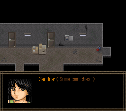

taro, on 2026-11-20, playing the build of the-advocate `7951af2a` and the
ports `42f70e8` in Mesen2, translated (captures in
`/shared/bug-reports-etc/dn/text-below-walls-*.png` and
`show-message-fadein-broken-*.png`):

> About the text showing up under parts of the walls: I was playing with
> showing/hiding layers in Mesen, and in some cases I can see that if I
> hide every layer except 2, the text is perfect. When I show layer 1,
> parts of that layer show up over the text. Sprite/object layer 1 also
> shows up, partly, over the text.

> Careful: not the whole layer shows up over the text. Parts of the same
> layer show up over it or under it.

That parts of one layer go over and parts under points at the tiles'
priority bit: the upper layer's cells drawn above the hero, and the
characters with high priority.

The second one, the same day: while a message fades in, the frame of its
window shows as lines across the whole screen (`show-message-fadein-
broken-1` to `-8`, over map 18's office).

## Log

### 2026-11-20, Calandria: what it is

From the-advocate `7951af2a` and the ports `42f70e8`. Reproduced in snes9x
on the warehouse's corridor (map 22, the switches, event 5): the message
comes out clean on a new game, and **cut only after the menu has been
opened and closed** —the wall's column and a crate right of x 80 over the
letters, as in taro's capture—.

**Which layer**: map 22 is painted, so mode 1 with the painting on BG1 and
its cells in front of the hero BG1 priority 1. The window is BG2 —with a
face it always has its frame, `msg_face_begin`—, and in mode 1 BG2 never
goes in front of BG1 priority 1. Since 2026-10 that is solved by hiding BG1
on the window's lines with PPU window 1, edge to edge (`pano_ppu`, channel
6 into `W12SEL`), as the objects always were (channel 3 into `WOBJSEL`).

**Why only after the menu**: Mulita's ShowWindow (`7951af2a`) is the only
other user of window 1, and it moves `WH0`/`WH1` to its windows' edges —the
options' window, x 8 to 79—. It puts them back only in `sw_hide`, which runs
when the windows go off by themselves; `sw_lost` —a big picture's load, as
the menu's burning face, or a map's— turns them off without it. From then on
every message hid BG1 and the objects only between x 8 and 79: that is the
"parts over, parts under" taro saw in Mesen. ABL never shows it because it
has no `@window`: window 1 stays where the reset put it.

**Blame**: the layering is on purpose and old —the BG1 mask for the
flattened maps' cells in front of the hero, `7f62dcdb` (2026-10-05), and
for the painted maps', `40cbad47` (2026-10-11)—; what broke it is today's
`8a073efe`, ShowWindow drawing in the message window's bank, the first
change that moves window 1.

**The fix**: `msg_hdma_build` puts window 1 edge to edge every time it
points the masks, which is what they take for granted. Two writes in the
vblank a window opens in.

**The options asked for, measured against that**:

* BG3's priority bit (mode 1, `BGMODE` bit 3): BG3 is 2bpp, four colours a
  palette, and the System's gradient letters and the face do not fit; and
  the maps that are not painted are mode 3, which has no BG3. Not
  applicable without redoing the composer.
* Dropping the priority bits while a message is up: rewriting BG1's tilemap
  (a painted map's, 64x32 entries) when it opens and putting it back when it
  closes, several vblanks each way, and the objects still need the mask.
  The mask already does it for nothing.
* Windows / masking: what was already there; it only needed its edges.
* The text on another layer: no free layer in mode 3, and BG3 as above.

**The second bug, the frame as lines during the fade-in**: not the layer
stack. It is common event 2 showing `TextboxInnen` and `TextboxRahmen`, its
own frame, 320x84 each, fading them in before the message; on the maps where
they fit they go as 93 objects (map 24, the office: "93 objects in 273
tiles" in the converter's log). Measured on map 24 during the fade: up to 40
objects and 56 slivers on a line, over the PPU's 32 and 34 on 39 lines
from line 145 down, so the PPU drops what goes past and what is left are
lines; and 320 wide on a 256 screen, so its right edge is never seen. When
the message opens the window's mask hides them. That is
`desert-nightmare-own-message-frame`, where it is written down now: the
pictures turned into the game's System so the console's window draws the
frame; not taken here.

### 2026-11-20, Calandria: verified

* `tests/test_desert_nightmare_message_over_the_map.py`, new in the ports:
  the same message on map 22 with the menu opened and closed before it and
  without; the window's lines have to be equal. **Red** at `7951af2a`
  (column 128, the wall), **green** with the fix, and a new golden,
  `desert-nightmare-message-after-the-menu`, in its own commit. Side by
  side in `/shared/captures/2026-11-20-dn-message-over-the-map/`.
* ABL's suite with the branch's tools: 1723 passed, 2 skipped. `just boot`
  at the root of the ports: 179 passed.
* The comment's rewording after the suite left Desert Nightmare's ROM byte
  for byte equal.

**What no test covers**: only snes9x is compared, not bsnes nor Mesen2,
where taro saw it; a message opened over windows still up —the message
puts `sw_hide` off until it closes, so the same edges were there too; the
fix covers it, nothing plays it—; other games with `@window`, none today.
The fade-in's lines are not fixed: they are in
`desert-nightmare-own-message-frame`, and in the port's known issue in the
book.

**Merging**: the-advocate's branch `calandria-dn-message-over-map` is the
runtime only, no Rust, so nothing to reinstall; the ports' and the book's
branches have the same name. Opcode 0x5D not used.

### 2026-11-22, Carpintero: what to look at

The golden of the test that covers this,
`desert-nightmare-message-after-the-menu` in the ports' `tests/golden/`,
which today's main still matches:

**What to look at**: the message window's text and frame whole, with no
piece of the map or of a character drawn over them, **after the pause
menu has been opened and closed** —that was the trigger; before the
menu it was always clean—.

**How to get there**: day 1, the warehouse's corridor (map 22). Open the
menu with B and close it, then walk to the switches on the corridor's
wall (event 5, at (12, 5); stand below it, at (12, 6), facing up) and
press A. Any message after the menu on a painted map works the same; the
corridor is where it showed most.

Not covered here: the frame drawn as lines across the screen while a
message fades in, the second capture of the report: that one went to
[`desert-nightmare-own-message-frame`](desert-nightmare-own-message-frame.md),
done since.
