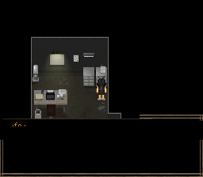
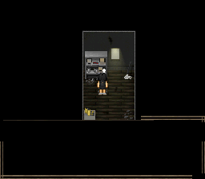
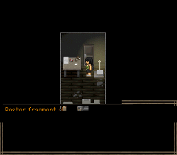
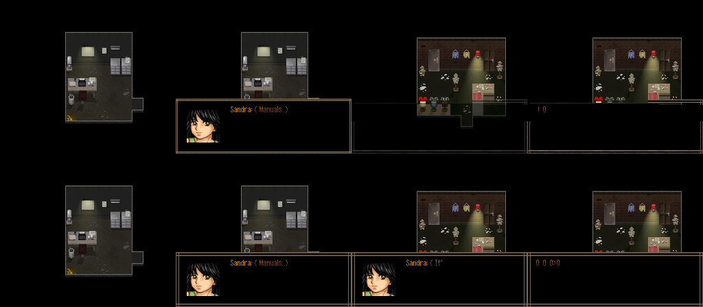
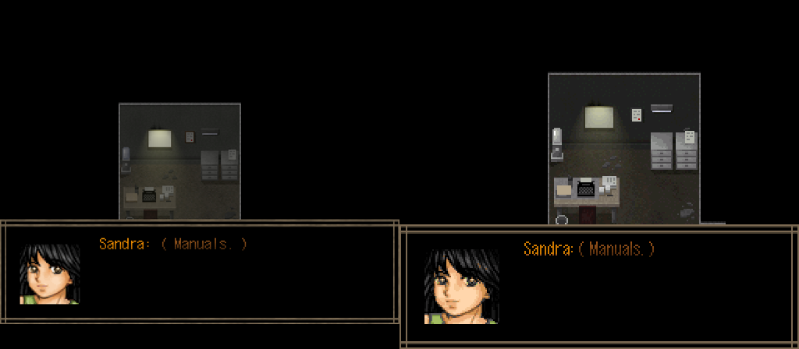

Seen by Calandria on 2026-10-11, in passing
(`rescue-the-findings.md`), tools `fc6f7456`, ports
`a85b7e3`: the Desert Nightmare release build warns that in 157
maps it does not draw the pictures `TextboxInnen` and `TextboxRahmen`, which are
its messages' own frame.

**How to see it**: `just cartridges` in `desert-nightmare/` of the ports, and
search for those names in `build/release/converter.log`. What is seen on the
console in place of the frame was not looked at.

The port's page in the book already said, more generally, that "136 maps
don't draw some of their pictures" (from 2026-10-10); which of those 157
maps they are was not compared.

## taro's decision (2026-10-20)

To todo, with Tijereta's recommendation: the frame becomes the game's window look —its System graphic— through the port's manual patches, so that the console's own window draws it, instead of drawing `TextboxInnen` and `TextboxRahmen` as pictures.

**Done**: Desert Nightmare's messages are drawn in a window with its own frame on every map, and `degradations.json` no longer lists those two pictures as not drawn. **First step**: how the common events show the two pictures around a message, and whether a System made from them fits RM2k's window layout.

taro, on 2026-11-21, translated (captures in
`/shared/bug-reports-etc/dn-broken-text-window/`):

> dn-broken-text-window: what the folder says. they're 3 different cases.
> I think there are more

The game's own box as it shows today: its frame cut into lines across
the screen and the text missing or cut, over map 24's office and two
other rooms —the frame's 93 objects over the PPU's 32 a line, measured by
Calandria on 2026-11-20 (see the log)—.

## Log

### 2026-10-20, Tijereta: checked

Still so in Desert Nightmare's release build of the ports `68bf55b`
(the-advocate `8f290c39`), on fewer maps than the draft says and for
another reason: `degradations.json` lists `pictures-not-drawn` with
`TextboxInnen`, `TextboxRahmen` on about a hundred maps, most "with their
320 tiles the map fits no VRAM layout", and on some the common events'
copy "the map has no room for them besides its own". As pictures they
will rarely fit; what to do needs a decision —for instance the frame
turned into the game's window look through the port's manual patches, so
that the console's own window draws it—.

### 2026-11-19, Hurón: seen again

At the-advocate `62b6e5cb` and the ports `1ea90bf`, played on the motel
(map 16): the converter says the two pictures, as the commons' set, "fit
on 14 of the 189 maps". A message with a face gets the System's frame;
one without gets none, and the map's upper layer cuts its letters
(`/shared/captures/2026-11-19-desert-nightmare/messages.png`). Ranked
fourth in the book's research
`ports/desert-nightmare/research/2026-11-19-what-it-takes-to-be-playable.md`.

### 2026-11-20, Tijereta: seen again

At the-advocate `0d7ab7ed` (branch `tijereta-number-locks`) and the ports
`a93ca63`, on the tailor's (map 123), one of the maps where the two
pictures **do** fit: they go as objects —92 of them, the converter says—
**over** the text layer, so a box with no face is covered by
`TextboxInnen` and only a few letters show through where a line runs out
of slivers. Seen with the tailor's number lock, whose digits go in a box
of no lines and no face: of `0 0 0 0` only `| 0` shows, and the frame's
picture is left half-drawn around it
(`/shared/captures/2026-11-20-number-locks/contact-sheet.png`, second
row). The lock works —the right code opens it, a wrong one does not—; it
cannot be read. On the maps where the pictures do not fit (28, 42) the
same digits go over the map with no box, as any faceless message there.

### 2026-11-20, Calandria: seen again

At the-advocate `7951af2a` and the ports `42f70e8`, on the office (map 24),
another map where they fit, with a face: taro saw the frame "as lines
across the whole screen" while a message fades in
(`/shared/bug-reports-etc/dn/show-message-fadein-broken-*.png`). It is
common event 2 fading the two pictures in before the box: counted in the
OAM during the fade, up to 40 objects and 56 slivers on a line, over the
PPU's 32 and 34 on 39 lines, so what goes past is not drawn and lines are
what is left; and 320 wide on a 256 screen, so their right edge is never
seen. When the box opens, the window's mask hides them. Looked at from
task `desert-nightmare-message-text-cut-by-the-map`, and left to this one.

### 2026-11-21, Hurón: the box is the message window

At the-advocate `a537d967` (tools as installed, untouched) and the ports'
branch `huron-dn-frame`, from `a36d80b`.

#### How the game draws it

Common event 2 sets the message transparent at the bottom, shows the two
pictures at transparency 100 at (160, 198) and moves them to 0 in 0.3 s,
waiting on the second; common event 3 moves them back to 100 in 0.3 s and
erases them. 1,648 calls to 2 and 1,681 to 3; of the game's 2,354
`ShowMessage`, 2,332 sit between a 2 and a 3 in the same list —the rest
are in a branch after a 3 of the other branch—. Every `MessageOptions` of
the game is transparent. `TextboxRahmen` is a double frame 5 pixels thick,
`TextboxInnen` a black panel with one brown line under the top frame: a
9-slice of RM2k's frame holds it, corners and edges in 8x8 cells.

#### The options, measured on the release

| | objects a line | sprite VRAM | BG2 VRAM | vblank | ROM |
|---|---|---|---|---|---|
| today: pictures as objects | 35-40 objects, 56 slivers, on 39 lines while it fades; drawn on 58 maps, not on 102 (92 for VRAM, 10 for palettes) | 272 tiles, 8.5 KB, and a palette, where drawn | — | the pictures' fade | the pictures' tiles, per map that carries them |
| (a) the frame as the window's | 0 | 0, and the 272 tiles back | the window's own 256 tiles, as every map | the window's, as any message | the window's frame tiles, in the System the cartridge already carried |
| (b) objects within the limits | the frame cut to 256 as 8x8 objects: 32 a line on the top and bottom rows, 34 slivers there with nothing else: the hero or any character on those lines is cut | ~84 tiles, 2.7 KB, every map | the panel as the window's background | ~84 OAM entries each frame | per map |
| (c) a converter rule picture → window | as (a) | as (a) | as (a) | as (a) | as (a), plus the rule |

(b) and (c) were not built: (b) is still the per-line limit on two rows
and the panel already is the window's background, so it is (a) with the
frame in the wrong place; (c) is (a) found by the converter, and the
pattern is not DN's alone —Zounds' `sign` (27 times near a transparent
message), Sunset's `UpsideDownTextBox` (17)— but each one is different and
DN takes no tool change to do it by hand, so it is left for when a second
game asks.

#### What I did: (a), as the port's patches

* `commonevents/0002.json`: only `MessageOptions` with the window on,
  bottom; `0003.json`: transparent again, as it was after the original's 2.
* `System/Systemset_Spiel.png`: the game's, with its frame cut from the
  two pictures one over the other —corners the box's four 8x8, the edges
  its 16x8 at x 152 and 8x16 at y 34—, each pixel the nearest of the
  colours Spiel's own frame had. The first version brought the pictures'
  39 colours, and the converter merged the text's colours by one step
  to fit them: the menu's letters moved in the goldens.

No new System: a file of ours has to replace one that exists, and
`ChangeSystemGraphics` on the console only moves the message window,
which is what this wants. Spiel is used only by the message window and
`ShowWindow` —the title, the slots and the menus start with
`Systemset_Intro`—, so the menu's windows take the box's frame too. No
opcode, no runtime: nothing of the-advocate changes.

`degradations.json`: `pictures-not-drawn` from 198 to 45. With the 272
tiles free, the map cursor of common event 14 fits on more maps
(`Kartencursor` not drawn on 35 maps, 96 before), which is why the ROM's
gaps go from 57,229 to 38,881 bytes: same 79 banks. Map 95 now trades two
dressed events for the cursor: draft
[`desert-nightmare-map-95-trades-two-events-for-the-map-cursor`](desert-nightmare-map-95-trades-two-events-for-the-map-cursor.md).
And `painted_events` left 42 interiors out for these pictures: draft
[`desert-nightmare-interiors-painted-now-that-the-box-is-a-window`](desert-nightmare-interiors-painted-now-that-the-box-is-a-window.md).

Before (main) above, after below: the office a few ticks into the fade
and up, the tailor's message and the lock's digits.

The original under EasyRPG, left, and the console, right: the same double
frame and panel; the original's box is 4 lines taller, from 156.

#### What is lost

The fade, 0.3 s each way (could be a later step: a window that fades in
is runtime work); the box's 84 lines are the window's 80; and between two
messages with something else in between the window closes and opens,
where the pictures stayed up.

#### Tests

`tests/test_desert_nightmare_own_message_frame.py`, in the ports: the
office and the lock, every tick checked against the PPU's 32 objects and
34 slivers, the frame equal on both maps and not the map under it, and
the lock's line with ink for four digits. Red on main: 39 lines over on
map 24 (35 objects, 56 slivers), 6 columns of ink on the lock. Goldens in
their own commit, two new and ten moved —the menu's eight, frame only;
the message after the menu; the intro's first message, which now has its
box—, side by side in `/shared/captures/2026-11-21-dn-own-box/`.

Run on the branch, with the tools as installed: ABL's suite, 1728 passed
and 2 skipped; `just boot`, 187 passed and 2 red, the menu's goldens
behind the first ones, then accepted —frame only—; the Desert Nightmare
tests again, 21 passed. `just lint` is the-advocate's, which this does not
touch, and was not run.

To merge: nothing to install —the change is the ports' patches and
tests, and the book's known issue and decision (branch `huron-dn-frame`
in both)—.

What no test covers: the box closing and opening between messages, the
`ShowChoice` in the box, and any of the other 1,646 calls; the fork run by
RPG_RT with the new System (EasyRPG was started on the map, without
common event 1, so it showed the title's System: not a check).
