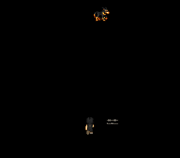
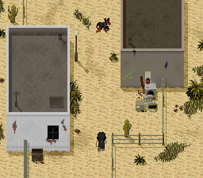
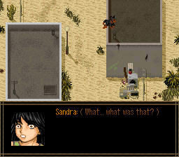

taro, on 2026-11-21, translated (frames in
`/shared/bug-reports-etc/dn-dog/`, repeated ones trimmed, with
`runs.txt`; `obj-layer-only/` is the same, cropped, with only the
sprites):

> It is in the dog scene, quite early in the game: the second time you
> meet the dog, when it seems to die.
>
> The dog runs off, runs *over* the building instead of passing behind
> it, and its graphic is left duplicated, and half broken.
>
> frame-32260 is the first frame where I see an error. All the earlier
> ones look fine. At a glance, in that frame the dog already seems
> duplicated, overlapping by 1 pixel.
>
> Up to the frame before this one, the dog is drawn *behind* the
> building, as it should be. From this frame on its "clone" is drawn
> *over* the building, and the other one stays where it was, still, for
> a single frame, and then disappears.
>
> Up to 32355 the dog keeps running, over the building, but "normal":
> its animation and colours look right.
>
> In 32356 another dog appears, with other colours (I assume the same
> graphic, another palette, though it looks a bit smaller…) and at other
> coordinates, one or two tiles down and to the left. Up to 32388 this
> new dog moves to the right, but without animation, and also *over*
> the building. In 32389 the text window appears, and the rest of the
> frames, up to 32466, are the window drawing its text, normally, with
> the odd dog stuck where it was left, not moving.
>
> I find it interesting that between 32237 and 32259 there are so many
> frozen frames, too. It is right before the cloned dog appears (or is
> it a monkey?). Maybe it is just the moment the runtime is
> recalculating some graphic or uploading to VRAM.
>
> I also left dup-frame-without-bg1.png: the frame where the dog shows
> "duplicated" for an instant (it is literally one frame, I think).
>
> Something odd is that, turning layers on and off, I find no visual
> change in any layer at the moment the dog goes from behind the
> building to in front of it. Almost as if only the priority bit
> changed.

## What the event does

Map 11, EV0080, its autostart page (a first reading by Hornero; not
measured on the ROM). Until the dog runs it is EV0073, a sprite. Then
the script:

1. shows picture 2, `Hundeszene_Haus`, at 160,120, scrolling with the
   map: a picture of the building, to cover the dog;
2. waits 25, gives EV0073 a blank graphic, and puts its screen
   position in variables 14 and 15;
3. in a loop, shows picture 1 at those variables —`Hund_Animation1`,
   `2`, `1`, `3`…—, adds 2 to variable 14 and waits 1 (6 frames: the
   runs of six in `runs.txt`), then waits 10 (the run of 60);
4. plays `Hund_getroffen`, shows picture 1 as `Hund_Animation4` —the
   hit dog: the other colours and the other size are its own—, adds 32
   to variable 14 and moves picture 1 there (the slide to the right
   without animation), and never erases it.

In RM2k a higher picture number is drawn over a lower one, so picture
2, the building, covers picture 1, the dog, all along. That the dog
shows over the building, the hit one too, with no layer changing, fits
picture 2 drawn into the map and picture 1 as objects over it. The one
frame with two dogs fits EV0073's sprite going away one frame after
picture 1 shows. The 23 still frames are probably the script's own
wait.

## Log

### 2026-11-21, Aguará: measured on the ROM, and the cause

Played on the ROM from the-advocate b18e4d4f and the ports 05e7de6, with
`convert` and `mapdata` of that commit: map 11 entered by map 4's door,
(8, 12), every tick's screen and OAM looked at.

* **The cause is the one Hornero read.** The converter logs `map 11:
  drawn into the map: 'Hundeszene_Haus' at 100 %`: picture 2 is opaque,
  with its transparent colour, never erased, so the `map_pictures` rule
  draws it into map 11's painting and raises its cells —a 80x80 roof at
  (160, 0), on whole cells— above the hero. The dog's four pictures are
  small ones, objects of priority 3, over everything. Map 11 is painted
  —mode 1, every object a step up—: the hero and the dog's event are
  objects of priority 2, behind the raised cells; on the tick picture 1
  shows, two objects of 2 and two of 3. So the dog goes from behind the
  roof to over it with no layer changing, only the priority, as taro saw.
* **The 23 still frames are the script's `Wait 25`**: the dog's route
  (up three, right one) starts on the same tick, ends 23 ticks before the
  150 of the wait, and nothing moves until picture 1.
* **The frame with two dogs is the event's graphic going a tick late**:
  the `SetMoveRoute` that blanks it runs on the event's next update, and
  picture 1 is already up. In RM2k both are behind the roof's edge then,
  and they overlap: with the dog behind the roof again, the second one
  only shows on the sand, for that tick.
* **The hit dog lands to the left and down** because `Hund_Animation4`
  goes with the screen (`ShowPicture` with `p[4]` at 0), unlike 1 to 3:
  the console scales a picture that goes with the screen —four fifths
  across—, and the variables are RM2k's screen place, so it lands some
  sixteen pixels left of where a map one would.
* **The two dogs for one tick are RM2k's too**, by easyrpg-player's order
  (`Game_Map::Update`: the events' routes before the foreground
  interpreter): the route that blanks the event runs on the next frame,
  and picture 1 is already up. In RPG_RT both are behind the roof's edge
  and only their tails on the sand show; the port does the same now. Not
  checked against RPG_RT itself.

### 2026-11-21, Aguará: a picture under a drawn-in number goes behind it

The fix, on the-advocate's branch `aguara-dn-dog`: **a small picture under
a lower number than one its map draws opaque goes at the characters'
object priority**, behind the cells that one raised, as RM2k shows the
higher number over the lower.

* The converter marks such keys `behind_map` (`maps.rs`, from
  `map_pictures.of(map)` with transparency 0) and passes it in the image
  (`pictures.rs`); `rm2k-snes-mapdata` sets `PICTURE_BEHIND`, $10, in the
  entry's palette byte; the runtime builds the attribute byte with it,
  `and #PIC_BEHIND | 7`, `eor #7`, `asl`, `eor #$30` —priority 1 with the
  bit, 3 without, in as many cycles as before—. `emit_object` already
  steps it up on a mode 1 map, as the characters.
* What it loses: such a picture goes behind the ChipSet's layer above the
  hero too, and the events above the hero go over it. In the book's
  divergence "Pictures drawn into the map".
* On Desert Nightmare it marks the dog's four pictures on 11 and
  `SchreinSturz` on 161, of the carried ones.

A new test in the ports, `test_desert_nightmare_dog_behind_the_warehouse.py`:
the roof's pixels on the screen do not change from the tick before the
dog's picture to the message after the hit. Red before the fix —run with
the box less its edge cells: 2 pixels changed 19 ticks in; the test then
took the whole box, which only adds pixels—, green after.

Left as a draft, and in DN's Known issues: the hit dog, `Hund_Animation4`,
goes with the screen and the console scales it, so it lands left of the
roof and leaves a sliver at its edge —
[`desert-nightmare-the-hit-dog-lands-beside-the-roof`](desert-nightmare-the-hit-dog-lands-beside-the-roof.md)—.

### 2026-11-21, Aguará: verified, merged with main, to testing

Run with `convert`, `mapdata` and `cartridge` installed from the branch
(`just install-local .local-tools cartridge convert mapdata`):

* `just crate-test mapdata` and `just crate-test convert`, and `just test`
  in the-advocate: green.
* The ports' `just boot`, every game: 196 passed, no golden moved.
* ABL's `just tests`: 1728 passed, 2 skipped, no golden moved; `abl.sfc`
  `8b14d2d7a38aa366` (sha256, first 16).
* After merging main —Cardón's runtime change, `cache_slots.s`— into the
  branches: the ports' `just boot -k desert`, 38 passed.

Before and after of the scene, not goldens, in
`/shared/captures/2026-11-21-dn-dog/`.

Branches `aguara-dn-dog` in the-advocate, the ports and the book. To
install when merging: `convert` and `mapdata` (the runtime's change goes
in with `~/the-advocate`'s checkout, which the global `cartridge` already
assembles from).
