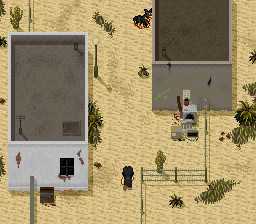

taro, on 2026-11-21, translated (frames in
`/shared/bug-reports-etc/dn-dog/`, repeated ones trimmed, with
`runs.txt`; `obj-layer-only/` is the same, cropped, with only the
sprites):

> It is in the dog scene, quite early in the game: the second time you
> meet the dog, when it seems to die.
>
> The dog runs off, runs *over* the building instead of passing behind
> it, and its graphic is left duplicated, and half broken.
>
> frame-32260 is the first frame where I see an error. All the earlier
> ones look fine. At a glance, in that frame the dog already seems
> duplicated, overlapping by 1 pixel.
>
> Up to the frame before this one, the dog is drawn *behind* the
> building, as it should be. From this frame on its "clone" is drawn
> *over* the building, and the other one stays where it was, still, for
> a single frame, and then disappears.
>
> Up to 32355 the dog keeps running, over the building, but "normal":
> its animation and colours look right.
>
> In 32356 another dog appears, with other colours (I assume the same
> graphic, another palette, though it looks a bit smaller…) and at other
> coordinates, one or two tiles down and to the left. Up to 32388 this
> new dog moves to the right, but without animation, and also *over*
> the building. In 32389 the text window appears, and the rest of the
> frames, up to 32466, are the window drawing its text, normally, with
> the odd dog stuck where it was left, not moving.
>
> I find it interesting that between 32237 and 32259 there are so many
> frozen frames, too. It is right before the cloned dog appears (or is
> it a monkey?). Maybe it is just the moment the runtime is
> recalculating some graphic or uploading to VRAM.
>
> I also left dup-frame-without-bg1.png: the frame where the dog shows
> "duplicated" for an instant (it is literally one frame, I think).
>
> Something odd is that, turning layers on and off, I find no visual
> change in any layer at the moment the dog goes from behind the
> building to in front of it. Almost as if only the priority bit
> changed.

## What the event does

Map 11, EV0080, its autostart page (a first reading by Hornero; not
measured on the ROM). Until the dog runs it is EV0073, a sprite. Then
the script:

1. shows picture 2, `Hundeszene_Haus`, at 160,120, scrolling with the
   map: a picture of the building, to cover the dog;
2. waits 25, gives EV0073 a blank graphic, and puts its screen
   position in variables 14 and 15;
3. in a loop, shows picture 1 at those variables —`Hund_Animation1`,
   `2`, `1`, `3`…—, adds 2 to variable 14 and waits 1 (6 frames: the
   runs of six in `runs.txt`), then waits 10 (the run of 60);
4. plays `Hund_getroffen`, shows picture 1 as `Hund_Animation4` —the
   hit dog: the other colours and the other size are its own—, adds 32
   to variable 14 and moves picture 1 there (the slide to the right
   without animation), and never erases it.

In RM2k a higher picture number is drawn over a lower one, so picture
2, the building, covers picture 1, the dog, all along. That the dog
shows over the building, the hit one too, with no layer changing, fits
picture 2 drawn into the map and picture 1 as objects over it. The one
frame with two dogs fits EV0073's sprite going away one frame after
picture 1 shows. The 23 still frames are probably the script's own
wait.
