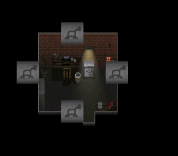
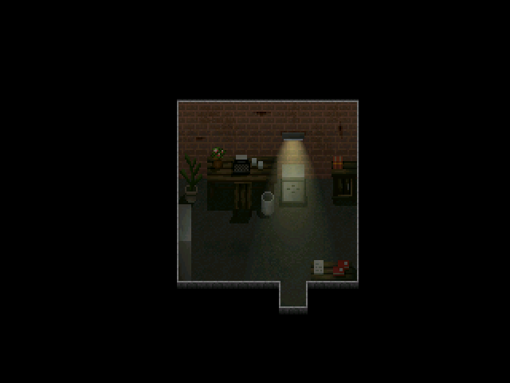
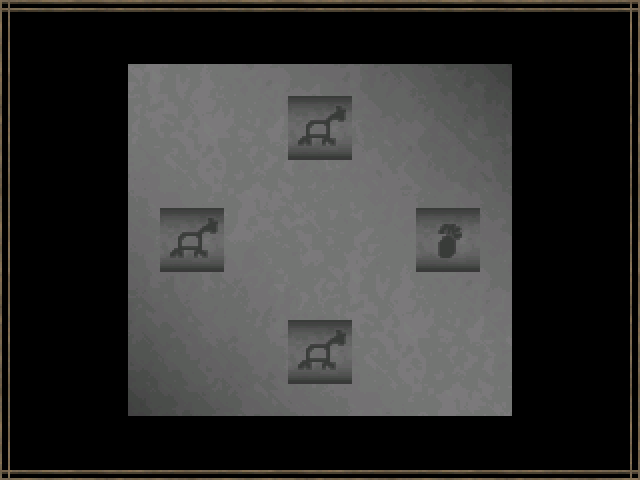
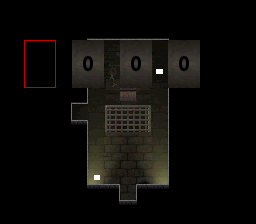
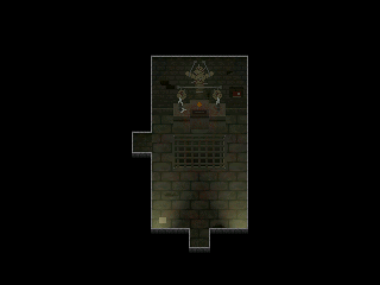
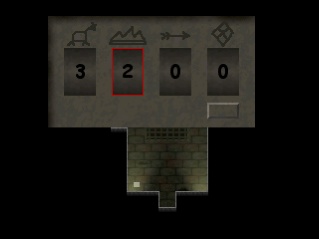

Seen by Aguará on 2026-11-20, at the-advocate `d1972f68` and later
(branch `aguara-dn-intro-menu`, with Cardón's scene rule merged) and the
same on main before it, against the 2015 RPG_RT under Wine.

**What is seen**: in the mine office (map 115) and the shrine's cellar
(161), the lock's symbols —the safe's four (`Tresor_Bild1` to `6`) and
the shrine's four digits (`Schrein_Zahl0` to `9`)— are part of the room
from the start, frozen on one frame each, floating over the map. Looking
at the lock shows its instruction and nothing more: no plate
(`Tresor`, `Schrein_Hintergrund`), and the arrows and the key turn
nothing on the screen. In RPG_RT the room is clean, and looking at the
lock opens its screen: the plate and four wheels, the chosen one framed,
each turning with the keys.

The ROM's come from the-advocate `d1972f68` (branch
`aguara-dn-intro-menu`; `e4bbee1e` draws these maps the same), the
original's from the 2015 RPG_RT under Wine. The safe, 115: the room, then
the lock after the keys, on the ROM and in RPG_RT —

The shrine, 161, the same four —

**Why**: the lock's pictures are shown by an action-key page (event 18 on
115, 16 on 161, called by the lock's event) and erased by another page
when the lock closes; `map_pictures` takes them as still pictures of the
map —Cardón's scene rule only counts erases from the show's own page,
and these come from another— and draws the one shown most under each
number into the map, accepting every command of them without doing it.
The parts rule (`Parts` in `map_pictures.rs`) leaves numbers shown on
demand out since 2026-11-20: split, the safe's 24 parts did not fit the
map's VRAM (341 tiles) and its symbols were never seen.

**To reproduce**: the ROM's captures come from a throwaway script that teleports to (11, 8) on 115, or to
(10, 7) on 161 with switch 585 on, and presses up and A; the original's
from a copy of the game whose LMT starts there (and on 161, event 2's
page 3 without its switch).

What to decide: whether `map_pictures` should leave out a number some
page of the map shows on demand (the action key, a touch) or erases from
another page; and then how the lock's screen is drawn, which is a
320x240 plate with four small pictures over it, a big picture with small
ones over it.
