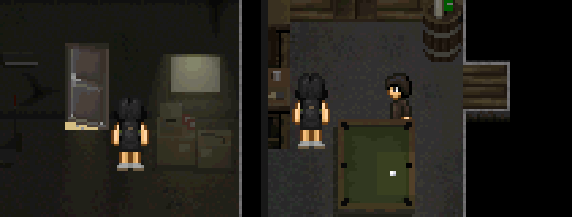
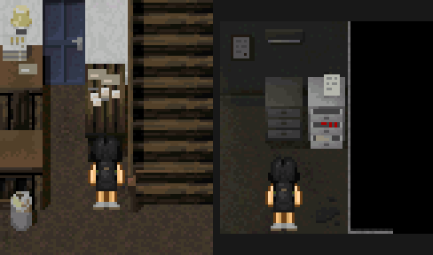

taro, on 2026-11-20, playing the build of the-advocate `7951af2a` and the
ports `42f70e8` in Mesen2, left captures named after what they show, in
`/shared/bug-reports-etc/dn/`:

- `wall-over-hero-1.png` and `-2.png`: the hero covered by a wall.
- `jake-over-pool-table-map-bar-innen.png`: Jake drawn on top of the pool
  table, in the bar's inside.
- `missing-graphic-1.png` and `-2.png`: a graphic shown as a white
  rectangle, by the stairs and beside the hero in a dark room.

## Log

### Cardón: what each capture is

None of the three comes from the painted still pieces. Each one was matched
against the panoramas and played again in the ROM and in EasyRPG:

- **`wall-over-hero-1/-2`: map 21, the warehouse (`Lager1`)**. Its
  autostart scene shows `Lagerhaus_Szene1` —a piece of wall over the door,
  opaque, with holes— and erases it when the scene ends. The map pictures'
  rule (`[graphics] map_pictures`, `convert/src/map_pictures.rs`) never read
  `ErasePicture`, so it drew it into the map for good, in front of the hero:
  his head disappears under it on cells (10..14, 4..6). Same with the scene's
  second light, picture 5, also erased: the room was darker than RM2k's.
- **`jake-over-pool-table`: map 19, the bar inside, after the scene where
  Jake invites Sandra** (V201 = 3, S227). The table's top edge is the
  ChipSet's layer above —upper tiles 27 and 28 with the star— drawn over
  Jake, who stands at (15, 8). Jake's row walks (his later pages have
  routes), and a walking row kept the OAM priority of its first page,
  which is "above the hero": `page_graphic` set a still row's attributes
  from the page, and only the palette of a walking one. RM2k: the star tile
  over every character on the hero's layer; the ROM put Jake on priority 2,
  over BG2.
- **`missing-graphic-1`: map 16 (motel), the map of Dusty Creek taken**
  (S223); **`missing-graphic-2`: map 24 (`Lager4`, warehouse room 2), not
  map 18**, with S250. Both are an item that spins while it waits to be
  taken and stands still, another CharSet character, on the page after.
  The spinning makes the row carry one character's twelve poses, and the
  later page's character had no pose bank: the row drew the page's pose of
  the spinning character, which on those CharSets is a white cell.

#### The fixes

Three commits in the-advocate, branch `cardon-dn-walls`:

- `map_pictures`: a picture its own page erases further on —from the
  show's branch or one further out— is a scene's, and is not drawn into
  the map; its commands stay accepted without being done. A picture shown
  again under the same number is **not** taken as erased: tried, it turned
  the shrine's lock (161), the safe (115) and Sunset's flags to their last
  frame. What it takes out: DN 21, 28, 95 and 171, Sunset 51 (a floor hole
  a parallel page shows for 20 frames).
- runtime: `page_graphic` gives a walking row its page's layer priority,
  as it already gave a still one; the two priorities and `LAYER_ABOVE`
  come from mapdata.inc.
- Wally: every graphic of a page of an event that walks or animates gets
  its pose bank, last in the list. With every facing if the event turns
  toward the hero: Vampires Dawn's map 376 did not build otherwise.

The book: the divergence "Pictures drawn into the map" says it.

The ports' `tests/test_desert_nightmare_scenes_and_items.py` plays each
capture's state and was red on main on all three.

#### Measured

- ABL's suite with the branch's tools: 1723 passed, 2 skipped; no golden
  moved, although every ROM changes (the runtime). `abl.sfc` sha1
  `140c2b68…`; Desert Nightmare's `1746064…`.
- The ports' `just boot`: 181 passed, the new test among them.
- the-advocate: `just test` 29 passed; `crate-test` of convert, mapdata and
  wally green. `just lint` fails on main already, not on this branch's
  lines: rustfmt on `chipsets.rs`, `events/compile.rs`,
  `events/windows.rs`, `mapdata/layer_text.rs` and `mapdata/tests/python.rs`,
  clippy on `layer_text.rs:274` and `screens/message_window.rs:1173`.
- the-advocate's `just test-game`: 4 failed, 74 passed, the same four as
  on main with main's tools —the text layer and the renamed menu—: draft
  [`the-test-game-is-red-on-main-at-the-text-layer`](the-test-game-is-red-on-main-at-the-text-layer.md).
- Every game's converter log, main against the branch: the pose banks
  grow on maps of ABL, Desert Nightmare, Dooms 2, El Dorado, Frozen World
  (45 characters with their poses to 64) and Sunset; the pictures change
  only on the maps named above. Every cartridge of the nine games builds.
- Captures, taro's against the ROM before and after and EasyRPG, in
  `/shared/captures/2026-11-20-dn-walls/`.

#### What no test covers

- The pictures taken out of Desert Nightmare's maps 28, 95 and 171 and
  Sunset's 51: read in the converter's log and the maps' commands, not
  looked at in the ROM.
- The pose banks added on the other games' maps: only ABL's suite and the
  boot tests ran over them.
- A walking row's priority on any map but Jake's: ABL's suite and the
  boot tests.
- Jake under the table's edge is tested on his row's priority, not on
  pixels; the capture shows it.

#### Found and not fixed

- [`desert-nightmare-the-warehouse-is-darker`](desert-nightmare-the-warehouse-is-darker.md):
  map 21's light is the scene's, not the room's; a line in the port's
  "Known issues".
- [`the-test-game-is-red-on-main-at-the-text-layer`](the-test-game-is-red-on-main-at-the-text-layer.md).

#### Merging

Install `wally`, `mapdata` and `convert`; the runtime changes too
(`runtime/event_pages.s`). Branches `cardon-dn-walls` in the-advocate, the
ports and the book.

### 2026-11-22, Carpintero: what to look at

Shot on today's main (the-advocate `a30ca61d`, the ports `22c7559`),
snes9x, with the states `tests/test_desert_nightmare_scenes_and_items.py`
sets up, cropped and enlarged 3x.

**What to look at, and where**:

* **Map 21, the warehouse (`Lager1`)**, after its opening scene: stand
  below the door, at (10, 7), and walk around under it. No piece of wall
  covers the hero's head. The room is darker in the original: the draft
  [`desert-nightmare-the-warehouse-is-darker`](desert-nightmare-the-warehouse-is-darker.md).
* **Map 19, the bar inside**, after the scene where Jake invites Sandra:
  Jake stands at (15, 8) by the pool table, and the table's top edge goes
  over him, as in the original.
* **Map 16, the motel**, once the map of Dusty Creek is taken (where
  taro's `missing-graphic-1` was), and **map 24, the warehouse's second
  room**, once its item is taken (`missing-graphic-2`): the spot where
  the item was shows its own graphic, not a white rectangle.
