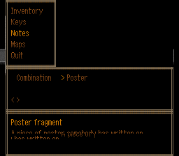

taro, on 2026-11-21, left frame-by-frame captures of the new menu (Mulita's
ShowWindow screens) in `/shared/bug-reports-etc/dn-new-menu-partial-updates/`,
named after what they show; the repeated frames were removed keeping the
two ends of each run, and `runs.txt` there says which frames each run
spans.

What the captures show, read by Hornero:

- **Notes**: with "Combination" chosen the description box says "Poster
  fragment" over "The combination for a safe"; moving to "Poster", the
  new text is written over the old one and both are left —"A piece of
  poster somebody has written on" twice, one line off—.
- **Maps**: the description box is gone and the room shows under the
  menu, with the burning face gone too (that part is the draft
  [`desert-nightmare-the-menu-loses-its-face-after-a-note`](desert-nightmare-the-menu-loses-its-face-after-a-note.md)).

