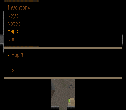
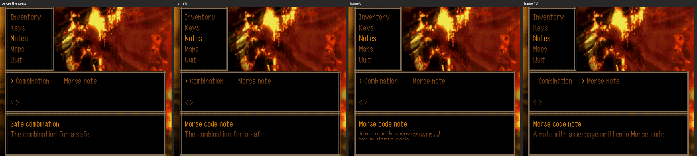
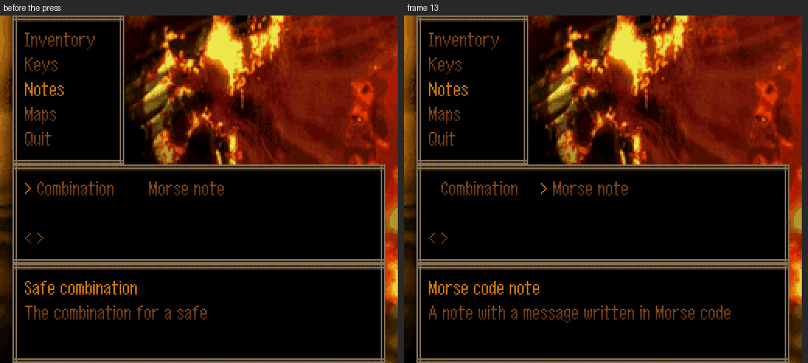

taro, on 2026-11-21, left frame-by-frame captures of the new menu (Mulita's
ShowWindow screens) in `/shared/bug-reports-etc/dn-new-menu-partial-updates/`,
named after what they show; the repeated frames were removed keeping the
two ends of each run, and `runs.txt` there says which frames each run
spans.

taro, the same day, translated:

> I don't know how to put it, beyond the name I gave the folder. Frame by
> frame, the screen updates _partially_. Eventually it looks fine, but it
> looks "broken" for moments, after each input, because the text and the
> menu take more than one frame to draw.

So the bug is the frames in between: after each press the windows are
redrawn over several frames, and what shows meanwhile is half the old
state and half the new one. What the captures show, read by Hornero:

- **Notes**: with "Combination" chosen the description box says "Poster
  fragment" over "The combination for a safe"; moving to "Poster", the
  new text is written over the old one and both are left —"A piece of
  poster somebody has written on" twice, one line off—.
- **Maps**: the description box is gone and the room shows under the
  menu, with the burning face gone too (that part is the draft
  [`desert-nightmare-the-menu-loses-its-face-after-a-note`](desert-nightmare-the-menu-loses-its-face-after-a-note.md)).

## Log

### 2026-11-21, Mulita: the windows' text in tiles the screen does not show

Worktrees from the-advocate `a537d967` and the ports `a36d80b`, branches
`mulita-dn-menu-atomic` in both and in the book.

#### What was measured

A throwaway script played the menu in snes9x with two keys, two notes and
a map held (as `test_desert_nightmare_menu.py` does), pressed each button
and captured every frame until the screen settled. Frames from the press
to the settled screen, and how many in between were neither the screen
before nor the one after, on main's runtime:

| change | settled | mixed |
|---|---|---|
| the notes' cursor, Combination to Morse note and back | 18, 17 | 13, 12 |
| the keys' cursor, right and left | 18, 16 | 12, 12 |
| the options, a line down or up | 3-4 | 1-2 |
| the keys' cursor to the page arrows, and back | 9, 17 | 0, 1 |
| a grid opened (keys, notes, inventory) | 22, 23, 19 | 0 |
| a grid closed | 3 | 0 |

**Where the frames went**, from `SW_CUR`, `SW_UPLOAD`, `SW_READ` and
`SW_PUT` frame by frame (the notes' cursor): ~7 frames composing the
description's two lines and the cursor —fifteen letters a frame, and a
vblank for each line to go up—, 4 reading the layer's 28 rows, 3
composing the screen over them (`sw_overlay`, all of it, on the CPU), 3
putting the 28 rows up. Every line went up into the tiles on the screen
the moment it was composed, and the rows a few a vblank: the new title
over the old layout, then the new description in the old layout —the two
texts over each other— until the rows caught up. Opening a grid did not
mix because the grid's windows were not on the screen and the rows past
the old span are not shown until the tables move.

**The vblank**: on the menu `sw_vblank` starts on line 233-234, and the
writes have to end by `VBLANK_WRITES_END`, 253: twenty lines. In snes9x a
line moved some 120 bytes by DMA (2,316 bytes from line 234 to 252), and
a scanline runs some forty instructions, so a loop over the 28 rows
costs lines of its own.

#### What was tried first: a stage

The new text of a window on the screen composed into a buffer at the top
of the load buffer, and that plus the changed rows put up in one vblank.
It cut the mixed frames to one per cursor move, and no more: the notes'
description is 36 cells, 2,304 bytes, plus 640 of rows, about 24 lines
for 20. The worst description box (id 9, 43 cells, 2,752 bytes) would not
fit even alone. Not kept.

#### What was done

the-advocate `694bacec`, `runtime/show_window.s` only:

- **`sw_place`**: when a window's text starts being composed it gets a
  run of text tiles the screen does not show and no other window up takes
  —each record keeps the run it is composed in (`R_BASE`), the run on the
  screen (`R_SBASE`, `R_SUSED`) and how many it takes (`R_USED`, counted
  by `sw_show`)—. So it is composed a line a vblank as before, but where
  nothing shows it. When no such run is free, one that may take its own
  tiles on the screen (it changes a line at a time, as before); when not
  even that, every window back to the compiler's tiles per id
  (`SW_HOMED`), which always fit together.
- **Only the rows a change touched**: `sw_show`, `sw_erase` and
  `sw_cover` mark the rows a window covered and covers (`SW_RDIRTY`); a
  span whose top moved takes all of them, one whose bottom moved the rows
  past the shorter one. Only those are read, composed over and put up.
- **`sw_commit`**: from the first of those rows to the last, as one DMA
  or two where they wrap in the window's tilemap, and the HDMA's tables,
  in one vblank: it waits until the vblank has the lines it needs
  (`SW_COST`), and after two vblanks without room it goes up a piece at a
  time, as before.
- A box that opens while a window is being composed or put up now starts
  it over when it closes (it used to resume a line in a `text_buf` the
  box had written over).

The bottleneck was the order, not the letters: the composing goes at the
same pace, but into tiles nobody shows, and what goes up in the vblank
that changes the screen is a few hundred bytes of rows.

After, the same presses:

| change | settled | mixed |
|---|---|---|
| the notes' cursor | 13, 12 | 0 |
| the keys' cursor | 13, 11 | 0 |
| the options | 9-10 | 0 |
| the keys' arrows, and back | 5, 12 | 0 |
| a grid opened | 18, 19, 15 | 0 |
| a grid closed | 2 | 0 |

The options take longer to change —nine frames instead of three— and do
it whole: before, their lit line was recomposed into the tiles on the
screen at once. The final screen of every press is the same, byte for
byte, as main's.

The other sheets, before and after: `/shared/captures/2026-11-21-dn-menu-one-frame/`.

**The test**: `test_a_press_changes_the_menu_on_one_frame` in the ports'
`tests/test_desert_nightmare_menu.py` (`195be58`): eleven presses —the
options, the keys' and notes' grids opened and closed, their cursors, the
page arrows— and every frame of the 90 after each compared with the screen
before and the one it settles on. Red on main's runtime on seven of them
(the cursors 12-13 frames, the options 2, the arrows' way back 1).

**Space** (Desert Nightmare's release): bank $C0 645 → 334 bytes free,
bank $C1 1,288 → 580, far RAM 114 → 42. No opcode. The ROM is the same
for every game without windows: all of it is under `SHOW_WINDOW_SLOTS`.

**Chajá's `sub_upload`** goes before the windows in the vblank; on a frame
with a tile substitution the windows' rows find less room and wait a
vblank, the old windows on the screen meanwhile.

#### Verified, and what no test covers

With main merged (the-advocate `bf7c4753`, the ports `6cd3951`) and
`cartridge`, `convert` and `mapdata` installed locally from the merge:
the ports' `just boot -k desert`, 35 passed —the menu's goldens did not
move, the new test green, and the menu the same in bsnes—; ABL's `just
tests`, 1,728 passed and 2 skipped, `abl.sfc` `87b217f9…`; Goombario
over Desert Nightmare's release, nothing found. No Rust changed: `just
lint` is untouched.

**Not covered by any test**: a full grid —six items— with a long
description, where no free run may be left and the box changes a line at
a time as before (`sw_place`'s second round), or every window goes back to
its own tiles (the third: never seen); the inventory's and maps' cursors
(only keys and notes are pressed); a window shown while the camera moves;
a box opened while a window is being composed or put up; a span whose top
moves with windows on the screen; real hardware, where DMA is faster than
snes9x's and the cost estimate errs on the safe side.

**To merge**: the-advocate, the ports and the book's
`mulita-dn-menu-atomic`. Only the runtime changed: nothing to reinstall
for it. The menu's goldens did not move, so Hurón's frame goldens stand
as he left them.
