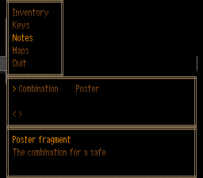

taro, on 2026-11-21, left frame-by-frame captures of the new menu (Mulita's
ShowWindow screens) in `/shared/bug-reports-etc/dn-new-menu-partial-updates/`,
named after what they show; the repeated frames were removed keeping the
two ends of each run, and `runs.txt` there says which frames each run
spans.

taro, the same day, translated:

> I don't know how to put it, beyond the name I gave the folder. Frame by
> frame, the screen updates _partially_. Eventually it looks fine, but it
> looks "broken" for moments, after each input, because the text and the
> menu take more than one frame to draw.

So the bug is the frames in between: after each press the windows are
redrawn over several frames, and what shows meanwhile is half the old
state and half the new one. What the captures show, read by Hornero:

- **Notes**: with "Combination" chosen the description box says "Poster
  fragment" over "The combination for a safe"; moving to "Poster", the
  new text is written over the old one and both are left —"A piece of
  poster somebody has written on" twice, one line off—.
- **Maps**: the description box is gone and the room shows under the
  menu, with the burning face gone too (that part is the draft
  [`desert-nightmare-the-menu-loses-its-face-after-a-note`](desert-nightmare-the-menu-loses-its-face-after-a-note.md)).

