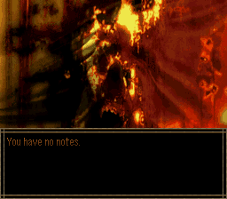

taro, on 2026-11-21, translated (captures in
`/shared/bug-reports-etc/dn-broken-menu-text-sometimes/`):

> the menu's text breaks, but not always. it seems related to things I
> do before, like opening another menu's detail (if I go into items,
> "you have no notes" stays broken, but going into something else, "you
> have no items" stays broken).

In the broken ones the box also has another frame, with a mark at the
bottom middle, and the text is split as if the box were much narrower
(Hornero, looking at the captures).

## Log

### 2026-11-21, Mulita: the cause, read in the runtime

"You have no items." and the others are plain `ShowMessage`s of common
event 6, after common event 2's `MessageOptions`: the message window, not a
`ShowWindow`. The menu's windows span more than twelve rows, so
`sw_commit` writes the screen over the message window's two planes
(`SW_PLANES`), and only `sw_hide` puts them back. `sw_hide` runs from
`sw_vblank`, which `flush_video` calls only while no message is open, and
which waits when the vblank has no room for the planes' 640 words. A box
that opens fast —one line, its upload taking the vblank's room— opens
before `sw_hide` found a vblank: the planes stay the windows' screen, and
the box shows its text in the cells some window's text run left there,
inside that screen's frame. What the box lands on depends on which windows
were up last, hence on what was opened before. `message_place.s` already
said that "a message over them puts off" `sw_hide` "until it closes".

### 2026-11-21, Mulita: the fix, and a test that shows it

`upload_line` (`runtime/messages.s`, the-advocate `34547dd6`) does not
put a box's line up while the windows are on the screen or on the
planes (`SW_SHOWN` or `SW_PLANES`): it counts a missed vblank, so
`flush_video` goes on to `sw_vblank`, whose `sw_hide` puts the planes
back; and from `WAIT_CEILING` misses on, the forced blank gives it the
room. Nothing of the box reaches VRAM before its first line —the face's
cells go up with the lines—, so nothing of it is lost.

The test, in the ports: `test_an_empty_screen_s_message_after_a_detail`
in `tests/test_desert_nightmare_menu.py` —the bulb held, the inventory's
grid opened and closed, Notes with none held— asks `SW_PLANES` and
`SW_HIDE` on the frame `msg_open` turns on, and the screen against a new
golden, `desert-nightmare-menu-no-notes`. Red before the fix (both 1, and
the box showed three scattered letters inside the windows' frame), green after.
Only the notes after the inventory is walked; "no items" after another
screen is the same path —any screen of the menu spans the whole screen—
and is not.

### 2026-11-21, Mulita: verified, to testing

With the-advocate `34547dd6`'s tools (`convert`, `mapdata`, `cartridge`
installed locally): `just boot -k desert` in the ports, 37 passed; ABL's
`just tests`, 1728 passed, 2 skipped, `abl.sfc` `87b217f91fcdb68d`
(sha256, first 16). The new golden goes beside the broken screen in
`/shared/captures/2026-11-21-dn-menu-text/`, not approved. Not walked:
"no items", "no keys" and "no maps", and "Really quit?" over the
options; they open the same box over the same windows.

To install when merging: nothing. The change is only
`runtime/messages.s`, which the global tools assemble from the main
checkout; `cartridge` was installed here only so that its compiled-in
runtime path pointed at this worktree's.
