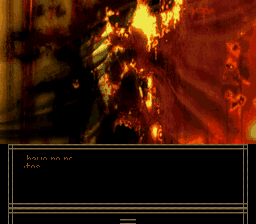
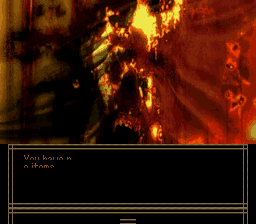

taro, on 2026-11-21, translated (captures in
`/shared/bug-reports-etc/dn-broken-menu-text-sometimes/`):

> the menu's text breaks, but not always. it seems related to things I
> do before, like opening another menu's detail (if I go into items,
> "you have no notes" stays broken, but going into something else, "you
> have no items" stays broken).

In the broken ones the box also has another frame, with a mark at the
bottom middle, and the text is split as if the box were much narrower
(Hornero, looking at the captures).
