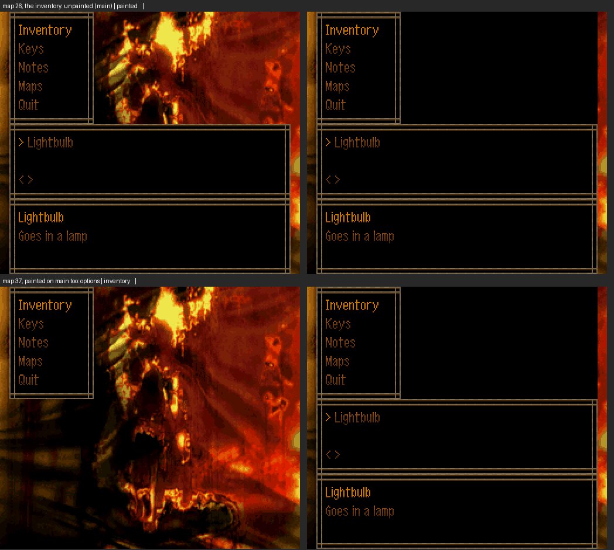

Seen by Hurón on 2026-11-22, at the-advocate `0ae40e0a` (tools as
installed) and the ports `89f77b4` —main— and the branch
`huron-dn-interiors` (`de7eeac`), doing
[`desert-nightmare-interiors-painted-now-that-the-box-is-a-window`](desert-nightmare-interiors-painted-now-that-the-box-is-a-window.md).

**What is seen**: B opens the menu over the burning face, as on any map.
A on Inventory (or Keys, Notes, Maps): on a map that is not painted the
face stays behind the windows; on a painted one the screen is black
around the windows, with only a sliver of the face at the right edge, and
the face behind the options already sits some 8 pixels off. On main it is
so on the 95 maps `painted_events` paints —the towns, apartment 37—; no
test saw it, because the menu test opens the menu in the warehouse's
room 4 (map 26), which was not painted. With the 42 interiors painted it
is, and its six goldens past the options move to this: they were not
blessed.

**To reproduce**: `tests/test_desert_nightmare_menu.py` in the ports on
`huron-dn-interiors`, red on `desert-nightmare-menu-inventory`; or on main
with `MENU_ROOM = 37`. All six captures, side by side, in
`/shared/captures/2026-11-22-dn-interiors/goldens-menu-not-committed.png`
and `menu-face-on-painted-maps.png`.

**Not looked at**: why. A painted map keeps its own layout of VRAM and
BG1 (`painted.s` in the runtime, "A painted map keeps only what the screen
shows" in the book's VRAM split); the face is a big picture and the grid's
windows go up after it, so the windows or the painting's column uploads
may be taking what the face had. `git blame` first.
