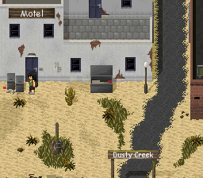
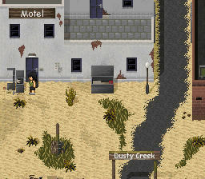
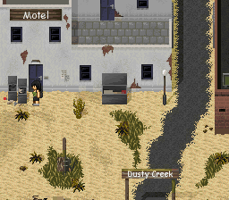
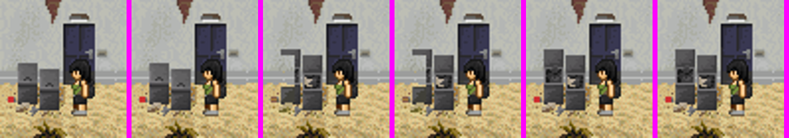

taro, 2026-11-22, frames 53717 to 53720 in
`/shared/bug-reports-etc/dn-open-trash-2/`, played on the build of the
ports `e886c7e` and the-advocate `7e8da728`:

> Another bug report, similar to an earlier one [...] It is practically
> the same as one you already solved, dn-open-trash-animation.

What changes between the frames is only the cans left of the door
(x 4 to 30, y 85 to 118): 53717 closed, 53718 and 53719 the left can
without its body and its lid alone in the air, 53720 both open.

Earlier:
[`desert-nightmare-the-trash-can-s-lid-goes-missing-while-it-opens`](desert-nightmare-the-trash-can-s-lid-goes-missing-while-it-opens.md),
the can at (7, 7) and (8, 7) of map 2, fixed in the cache of slots.

## Log

### 2026-11-22, Hornero: taken for Cardón

### 2026-11-22, Cardón: the cache's other branch, a full cache

**The cans are EV0104 and EV0105 on map 2, at (0, 7) and (1, 7)**: page 1,
on the action key, turns on switch 201; page 2 is the open can, and EV0106
and EV0107, at (0, 5) and (1, 5), appear with the raised lids. The same
shape as the can at (7, 7), with one difference: the press puts **four**
new looks up at once —two cans and two lids—, against the cache's free
slots.

**Why**: the fix of 2026-11-21 keeps a changed row's old look for **one**
`build_oam`, which is enough when the new pose gets a slot on that same
pass and is up on the next. When the cache has room for only three of the
four, the last row to ask —the left can, which `build_oam` reaches after
the lids and the right can— finds it full: it draws its old look that
frame, and on the next the old look is forgotten, the row still has no
slot, and it is drawn with nothing until its own old slot ages out (two
frames) and it takes it. That is taro's frames 53718 and 53719: the left
can missing, the right one already open, and what is left of the left one
is the painting under it. taro had more of the map in use than a new game
has —in a new game this screen has six free slots, and no blink—.

Reproduced by taking all free slots but three, every frame, as if someone
else on screen drew them: the left can goes missing on frames 5 and 6
after the key, as in taro's run.

**Test**: `test_a_can_the_full_cache_leaves_waiting_keeps_its_look`, in the
ports' `tests/test_desert_nightmare_trash_can.py` next to the first one.
Red on main (`frames [5, 6] after the key show can 0 neither closed nor
open`).

### 2026-11-22, Cardón: the kept look lives while the row waits

**Fix**, in the-advocate's `runtime/cache_slots.s`, branch
`cardon-dn-trash2`:

* A kept look carries a "shown" byte instead of the global
  `CACHE_WAS_FRESH`: `cache_was_note` and `cache_was_draw` set it, and
  `cache_age` forgets the ones a frame did not draw —their row showed its
  new look, or left the view—. So the row keeps its old look for as many
  frames as it waits, not one.
* Keeping it is not enough on its own: drawing the old look keeps its slot
  young, and a row waiting on a full cache would wait for ever if nobody
  else left. `cache_was_own`, from `cache_want` when the cache is full,
  lets the row take the slot of its own kept look for the new still pose,
  if nobody drew that slot yet in this pass, and be drawn from it on the
  same frame —the pose goes up in the vblank that shows it, with the
  attributes it had for that frame—.

With three free slots the left can now opens on the frame its old slot is
reused, a frame or two **before** the right one, whose pose waits a frame
in its new slot: each can shows closed or open every frame, nothing
missing. The test looks at each can on its own for that.

Four bytes a kept look instead of three, `CACHE_WAS_FRESH` gone: three more
bytes of FARBSS.

#### The other games

The pattern —still events on a map with a cache whose pages swap their
look— is in every game with cache maps but Dooms 2, which has none. What
blinks is not the pattern but the pattern on a full cache, so the
candidates are the maps the converter warns about (more events can be on
screen than slots): Desert Nightmare 2, 105, 137, 138 and 172; El Dorado
2, 4, 9, 11 and 12; Frozen World 1, where 28 of them swap on one switch;
Sunset over Imdahl 3; Vampires' Dawn 95, 168, 201, 222 and 240; Zounds
134; ABL 127. None of them was played: the fix is the same path for all.
A survey script, not kept, from each map's JSON and the converter's log.

#### What it does not cover

* More than `CACHE_WAS_MAX` (four) rows changing look at once and on
  screen: the rest wait with nothing drawn, as before. Desert Nightmare's
  map 71 has 24 still events that swap on one switch, and Frozen World's
  map 1, 28; whether they are on screen together was not looked at.
* A row further on in the pass that shows the same still pose as the one
  taking its old slot loses it and waits a frame.
* Rows that come into view with their new look —the lids— still wait for
  their slot with nothing drawn, as RM2k would not.

### 2026-11-22, Cardón: verified, to testing

#### What was run

With the tools of the-advocate's `cardon-dn-trash2` (`project` and
`cartridge` installed locally, for the runtime), on the ports'
`cardon-dn-trash2`:

* the-advocate's `just test`: green. `SOUNDFONT=… just test-game`: 208
  passed, 6 skipped.
* ABL's suite, `just tests` in `abl/`: 1686 passed, 2 skipped. No golden
  moved.
* The ports' `just boot`, every game: 202 passed. No golden moved.
* `just space` in Desert Nightmare: 18 bytes of far RAM left.

No golden moved, so there is nothing in `/shared/captures/` for this.

#### To install when merging

`cartridge`: the runtime changed. `project` was reinstalled in the
worktree only so that its tools assemble the worktree's runtime.

#### To play

Dusty Creek, map 2, with the motel's other can already open and whatever
else keeps the cache busy: open the two cans left of the motel's door.
Neither goes missing; the left one may open a frame before the right one.

### 2026-11-23, Hornero: done

taro closed it, with eight others:

> podemos cerrar estas, no?

(taro: "we can close these, right?")
