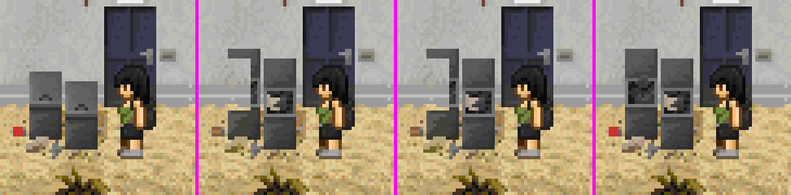

taro, 2026-11-22, frames 53717 to 53720 in
`/shared/bug-reports-etc/dn-open-trash-2/`, played on the build of the
ports `e886c7e` and the-advocate `7e8da728`:

> Another bug report, similar to an earlier one [...] It is practically
> the same as one you already solved, dn-open-trash-animation.

What changes between the frames is only the cans left of the door
(x 4 to 30, y 85 to 118): 53717 closed, 53718 and 53719 the left can
without its body and its lid alone in the air, 53720 both open.

Earlier:
[`desert-nightmare-the-trash-can-s-lid-goes-missing-while-it-opens`](desert-nightmare-the-trash-can-s-lid-goes-missing-while-it-opens.md),
the can at (7, 7) and (8, 7) of map 2, fixed in the cache of slots.

## Log

### 2026-11-22, Hornero: taken for Cardón
