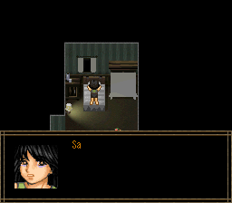
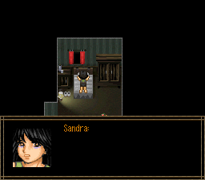
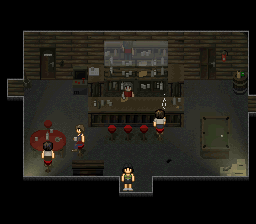
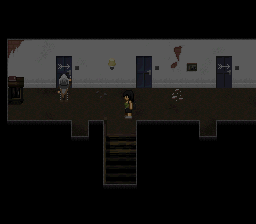

taro, 2026-11-22, playing on Mesen2, with frame-by-frame captures in
`/shared/bug-reports-etc/dn-black-screen-after-bar/` (`runs.txt` from
`dedupe_frames.py`):

> Another bug report (not a new one). [...] What happens: the whole scene
> of the Indian painting the door and all that is not seen. I can get
> through it because I hold Turbo-A, and eventually it reaches the next
> scene.
>
> Frames:
> - 41793: still in the bar
> - 41794-43660: black screen
> - 43661: in the hotel room

`runs.txt` reads "126 frames the same" for 41794-43660: those are the
files, not the frames. taro paused the capture over the black and started
it again just before the hotel, with Mesen2's rewind. `dedupe_frames.py`
now says such a run's files and the span they cover (the ports'
`769676f`).

## Log

### 2026-11-22, Hornero: taken for Carpintero

### 2026-11-22, Hornero: the hotel room comes in piece by piece

taro saw in the same captures, after the black:

> 43661: the hotel room appears, but some graphics are missing
> 43663: the little table with a flower loads
> 43664: part of the girl's body loads
> 43665: another part
> 43666: her body finishes loading (her head was missing), and the top
> of the table (next to the bed) and of the wardrobe load.
> 43667: another piece of the wardrobe loads, and some things to the left
> of the bed, which I think are sneakers
> 43668: the rest of the wardrobe and part of the curtains load
> 43669: the curtains finish loading
>
> The text shows while the room loads, starting at 43666 ("Sa") and, at
> 43681, the full line, "Sandra: (What is this city?)"
>
> I don't think it's related at all, but I happened to see it in these
> captures.

The still events' poses seem to go up after the screen is already shown,
a few a frame, where a map's first frame is meant to wait for them
(`build_oam_settled`). It may share a cause with the black —a screen
shown without the fade that would hide the uploads—, or not; if not, it
becomes its own draft.

### 2026-11-22, Carpintero: where the black comes from

The bar is map 31, 'Bar Nacht'. Its autostart, event 35, ends by fading a
black picture in —`Schwarz` under number 5, to transparency 0 in three
seconds, waiting—, erasing the screen and teleporting to map 32, 'Motel -
1.Stock Nacht', at (10, 11). Map 32's autostart, event 23 —no condition—
is the scene:

    ShowPicture 5 'Schwarz', transparency 0 (opaque)
    Wait 10, ShowScreen
    four messages over the black ("They didn't believe me...")
    MovePicture 5 to transparency 100 in 2.0 s, **without waiting**
    MoveEvent (Sandra), Wait 15
    the old man painting the symbol, seven messages
    EraseScreen, Teleport 33 (10, 8): the hotel room

`Schwarz` covers the screen, so the console carries it as a big picture,
on BG1 with the map hidden, where transparency darkens: at 100 it is still
black. Since 2026-11-20 the converter takes a big picture down after a
fade to nothing —`big_fade_outs` in rm2k-snes-events' `compile.rs`, the
fix for the intro, map 6—, but only when the `MovePicture` waits
(`p[15] != 0`). This one does not, so the picture stayed up until the
teleport, which erases pictures: the whole scene on a black screen. That
is why taro sees it as "not new": it is the intro's bug again, on a
fade that does not wait.

The same shape, a non-waiting fade to 100 of `Schwarz`, is on two more
pages: map 160, event 13, page 2 —which brings the picture back later
in the page, so the rule leaves it alone, as RM2k shows black again—, and
map 171, event 1, which shows another picture right after.

### 2026-11-22, Carpintero: the fix, its tests and the original

#### The fix

`big_fade_outs` takes a fade that does not wait down too, where the page
has waited the fade's time, or before the first command that may wait or
jump: it passes only `Wait`, `MoveEvent`, `PlaySound` and a switch set
that is not a toggle (`fade_waited` and `passes_a_fade`, next to it). On
map 32 the erase lands after the `Wait 15` that follows the move, before
the old man's first box, "Who...". Map 160, event 13, page 2 is still left
alone: a later move brings its black back. The-advocate's
`carpintero-dn-bar`, 7da5bf4a. To install when merging: `events` and
`convert` (the converter links the library, `rm2k-snes-events` is its own
binary and is the one that compiles the pages).

#### Tests, each seen red first

* rm2k-snes-events: `a_big_picture_faded_to_nothing_is_taken_down`
  gains map 32's shape, and where the erase goes. Red against the old
  function: no erase.
* The test game: the case `big-fade-on` —`Picture/Curtain.png`, 320x240
  of one plum, faded out without waiting— under the tester's "Boxes", and
  `test_big_fade_on.py`. Red with the global tools (7e8da728): 0 % of the
  meadow lit after the case, in both cores.
* The ports: `test_desert_nightmare_after_the_bar.py`, the corridor lit
  between the scene's fifth and tenth boxes. Red with the global tools:
  0 % lit, 442 ticks in. Green with the branch's.

#### Against the original

RPG_RT 2015 under Wine, on a copy of the game in my scratch whose start is
map 32 at (10, 11): the four thoughts over black, then the corridor with
the old man, lamps lit. The ROM now shows the corridor from the same
point, tinted as the fork tints the motel at night and without its lamps
—a known issue already—. Side by side in
`/shared/captures/2026-11-22-dn-after-the-bar/`. No golden moved.

#### The hotel room in pieces: another cause, not fixed

Map 33's autostart shows `Schwarz`, shows the screen and fades it out
*waiting*, so the converter already took it down there since 2026-11-20;
`big_erase` reloads the map, and the poses come back over the next
frames. Jumping to map 33 at (10, 8): the layer goes down on frame 240,
the room is up on 252 and its objects keep coming in until 260, the box
already typing. It is the draft
`the-map-comes-back-in-pieces-after-a-big-picture` (Aguará, 2026-11-21),
which I added these frames to, and not the black's cause; and since this
fix the corridor comes back the same way, halfway through its scene. A
fix would hold the brightness down after `big_back_far` until the pages'
refresh has run and the pose queue is empty, with a limit of frames: it
touches every game's erase of a big picture, so it is not in this change.
A line in Desert Nightmare's known issues in the book says it.

### 2026-11-22, Carpintero: the other games, and where the rule stops

The first version changed Sunset Over Imdahl's and Zounds' ROMs, so I read
every non-waiting fade to 100 of a big picture in the eight games (a
throwaway scan of the dumps and of each build's `events-request.json`):

* Zounds' notes, common event 40, fade their big background and erase it
  themselves two commands later: taking it down at the move cut the fade
  short for nothing.
* Sunset's intro, map 1, fades a title card out in eight seconds and
  shows the next one, also big, after six: a take-down in between would
  flash the map between two screen-off loads.

So a fade that does not wait is **held** —left up, as before— when what
stops the walk before the fade's time is a picture's command, a teleport
or an `EraseScreen`; and the walk passes a `TintScreen` (counting its time
when it waits), `PlayBGM`, `FadeOutBGM` and `WeatherEffects` besides
`Wait`, `MoveEvent`, `PlaySound` and a switch set. With that, Zounds is
byte for byte the same, and Sunset still changes on purpose: seven fades
that its pages wait out completely —a `TintScreen` or `Wait`s as long as
the fade— and then go on, on maps 4, 13, 34 and 35 (the credits); there
the map now comes back once the picture is at 100, as in RM2k, where
before it stayed black. Desert Nightmare: only map 32 changes; 9 and 171
are held.

### 2026-11-22, Carpintero: run, and to testing

With the tools of the-advocate's `carpintero-dn-bar` (85baccea), only
`events` and `convert` in its `.local-tools`:

* the-advocate: `just test`, 29 passed; `cargo test -p rm2k-snes-events`,
  219 passed, clippy clean; `just test-game` with FluidR3, 210 passed and
  6 skipped, the new case in both cores;
* the ports (`carpintero-dn-bar`, main merged): `just boot`, 202 passed
  —the corridor's test among them, and Sunset's GateStreet goldens, which
  go through map 13, unchanged—; ABL's `just tests`, 1686 passed and 2
  skipped. `abl.sfc` 908b95ae…, `desert-nightmare.sfc` e6dc0d1c….

No golden moved or was added. What the suite does not cover: Sunset's
seven fades that now come down (maps 4, 13, 34 and 35) are not played by
any test, nor looked at; Desert Nightmare's map 32 is tested by how lit
the screen is, not by a golden.

**To install when merging**: `events` and `convert`. The book's
`carpintero-dn-bar` goes with it: the divergence of large pictures, and the
rooms in pieces in Desert Nightmare's known issues.

### 2026-11-23, Hornero: taro, on merged main —the corridor is back, the four thoughts are not

taro played the delivery from ports 0699267 and the-advocate 1240ecc9 on
the FX Pak and on Mesen2, with captures in
`/shared/bug-reports-etc/dn-black-screen-after-bar-2/` (`runs.txt`):

> DN improved too, but I don't know if completely. [...] the scene after
> the bar seems to be there, but I don't know if complete. There were many
> black frames. [...] I confirmed that _something_ is wrong. I have to
> press A several times, with the screen black, to be able to go on, so
> there must be ShowMessages I am not seeing.
>
> - 30935: last frame inside the bar
> - 30936-32092: many frames in black.
> - 32093: first frame visible after the black screen.
> - 33350: first frame in the room. The graphics keep loading in parts,
>   for several frames. [...] maybe it is still in `todo`, in which case,
>   it's OK.
>
> Before the last fix, the first thing seen was the hotel room, so
> _something_ improved, but those ~1k black frames don't look good.

The black is pure black, with no message window: the four thoughts
Carpintero's log says play over `Schwarz` before the fade ("They didn't
believe me...") are not drawn, though they wait for A. The original shows
them over the black. The room in pieces is the `todo` one,
`the-map-comes-back-in-pieces-after-a-big-picture`, not this.

### 2026-11-23, Hornero: back to Carpintero

### 2026-11-23, Carpintero: why the thoughts are not drawn

Not the map: the picture. Map 151 zooms `Schwarz` —picture 3 to 20 %
while it fades—, so the converter carries it with a mode 7 texture, and
`number_big` (rm2k-snes-convert's `pictures.rs`) gave that texture to the
one layer every map shares: "still it looks the same", the-advocate's
c30ea5b0, 2026-10-03. It does not look the same: a picture with a texture
is shown still from VRAM's upper half, over the window's tiles, with BG2
off —`big_load_hybrid` in `runtime/big_picture_zoom.s`, whose comment
already said "that takes the message window while it is still"—. So
every message over Desert Nightmare's black screen was not drawn, on the
fifty-odd maps that show it, not only on 32. Seen in snes9x from a jump to
map 32: brightness 15, the layer up, `MSG_SC` at $48 as it should be, and
the window's tilemap at $4800 never stamped.

The original under Wine (the copy from the previous entry, which starts on
map 32): the four thoughts are orange text in the middle of the black,
with no frame —the page's `MessageOptions` asks for a transparent window
in the middle—.

### 2026-11-23, Carpintero: the fix

The layer a map zooms, with its texture, and the one the other maps show
still are now two layers; the emission points the second's `big_table`
entry at the first one's tiles, tilemap and colours when they are the
same (`big_shared` in rm2k-snes-mapdata's `emit.rs`), so only the texture
is extra. On map 151 itself the picture still hides a message while it is
still, as before; it shows none. The-advocate's `carpintero-dn-thoughts`,
853c13e1. To install when merging: `mapdata` and `convert`.

Tests, each seen red first:

* rm2k-snes-convert: `a_layer_has_a_texture_only_on_the_maps_that_zoom_it`,
  which replaces the test that asserted the old sharing; red against the
  old `number_big`.
* rm2k-snes-mapdata: `a_layer_with_the_same_tiles_tilemap_and_colours_shares_them`
  (new function: red is not compiling).
* The ports' `test_desert_nightmare_after_the_bar.py` plays the scene once
  for two checks: each thought's text lit with the black still up, and the
  corridor after the fade. Red with the global tools: 0.00 % of the screen
  lit on the first thought. Green with the branch's.

The ROM now shows the four thoughts as the original does.

