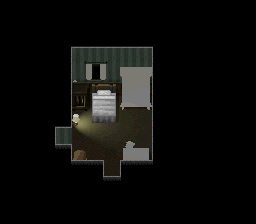
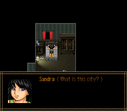

taro, 2026-11-22, playing on Mesen2, with frame-by-frame captures in
`/shared/bug-reports-etc/dn-black-screen-after-bar/` (`runs.txt` from
`dedupe_frames.py`):

> Another bug report (not a new one). [...] What happens: the whole scene
> of the Indian painting the door and all that is not seen. I can get
> through it because I hold Turbo-A, and eventually it reaches the next
> scene.
>
> Frames:
> - 41793: still in the bar
> - 41794-43660: black screen
> - 43661: in the hotel room

`runs.txt` reads "126 frames the same" for 41794-43660: those are the
files, not the frames. taro paused the capture over the black and started
it again just before the hotel, with Mesen2's rewind. `dedupe_frames.py`
now says such a run's files and the span they cover (the ports'
`769676f`).

## Log

### 2026-11-22, Hornero: taken for Carpintero

### 2026-11-22, Hornero: the hotel room comes in piece by piece

taro saw in the same captures, after the black:

> 43661: the hotel room appears, but some graphics are missing
> 43663: the little table with a flower loads
> 43664: part of the girl's body loads
> 43665: another part
> 43666: her body finishes loading (her head was missing), and the top
> of the table (next to the bed) and of the wardrobe load.
> 43667: another piece of the wardrobe loads, and some things to the left
> of the bed, which I think are sneakers
> 43668: the rest of the wardrobe and part of the curtains load
> 43669: the curtains finish loading
>
> The text shows while the room loads, starting at 43666 ("Sa") and, at
> 43681, the full line, "Sandra: (What is this city?)"
>
> I don't think it's related at all, but I happened to see it in these
> captures.

The still events' poses seem to go up after the screen is already shown,
a few a frame, where a map's first frame is meant to wait for them
(`build_oam_settled`). It may share a cause with the black —a screen
shown without the fade that would hide the uploads—, or not; if not, it
becomes its own draft.
