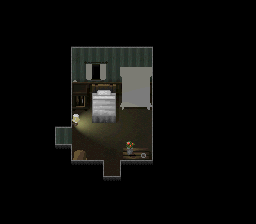

taro, 2026-11-22, playing on Mesen2, with frame-by-frame captures in
`/shared/bug-reports-etc/dn-black-screen-after-bar/` (`runs.txt` from
`dedupe_frames.py`):

> Another bug report (not a new one). [...] What happens: the whole scene
> of the Indian painting the door and all that is not seen. I can get
> through it because I hold Turbo-A, and eventually it reaches the next
> scene.
>
> Frames:
> - 41793: still in the bar
> - 41794-43660: black screen
> - 43661: in the hotel room

`runs.txt` reads "126 frames the same" for 41794-43660: those are the
files, not the frames. taro paused the capture over the black and started
it again just before the hotel, with Mesen2's rewind. `dedupe_frames.py`
now says such a run's files and the span they cover (the ports'
`769676f`).

## Log

### 2026-11-22, Hornero: taken for Carpintero
