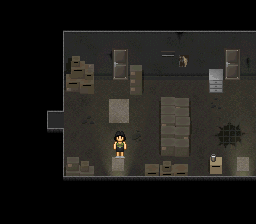
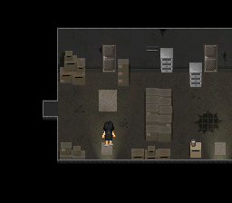
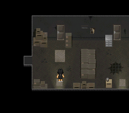

taro, on 2026-11-21, translated (captures one a frame, repeated ones
removed, the two ends of each run kept, in
`/shared/bug-reports-etc/dn-black-screen/`):

> In the first "dungeon", when the first monster shows up, frame by
> frame.
>
> * at 63333 the screen goes black until 63696, about 363 frames.
> * at 63698, 63699, 63700 and 63701 four different things show, as if
>   different parts of the screen were loading.
> * the next frames look OK [...]. At 63970 the text box "Sandra:
>   (What... what..." shows up.

The last frame before it, and the first black one:

The four frames it comes back in, and after:

To look at first: what the scene's page does at that moment —a big
picture, a tint or a flash, an `EraseScreen`/`ShowScreen`, a map
reload—, and what RPG_RT shows there. Since 2026-11-20 a big picture
faded to nothing is taken down and the map reloaded (Aguará's
`big_fade_outs`), and that reload is a suspect.
