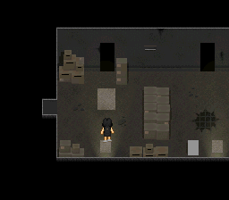
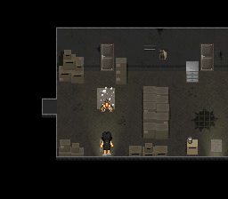
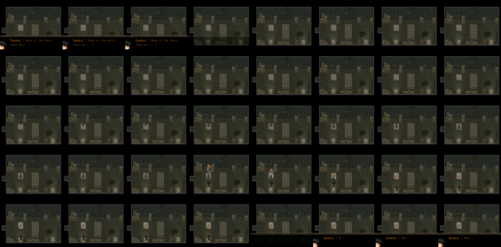
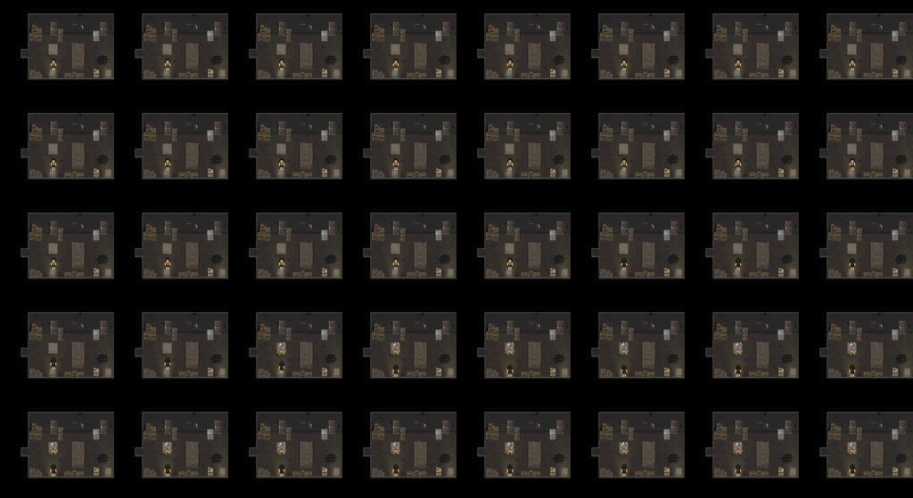

taro, on 2026-11-21, translated (captures one a frame, repeated ones
removed, the two ends of each run kept, in
`/shared/bug-reports-etc/dn-black-screen/`):

> In the first "dungeon", when the first monster shows up, frame by
> frame.
>
> * at 63333 the screen goes black until 63696, about 363 frames.
> * at 63698, 63699, 63700 and 63701 four different things show, as if
>   different parts of the screen were loading.
> * the next frames look OK [...]. At 63970 the text box "Sandra:
>   (What... what..." shows up.

The last frame before it, and the first black one:

The four frames it comes back in, and after:

To look at first: what the scene's page does at that moment —a big
picture, a tint or a flash, an `EraseScreen`/`ShowScreen`, a map
reload—, and what RPG_RT shows there. Since 2026-11-20 a big picture
faded to nothing is taken down and the map reloaded (Aguará's
`big_fade_outs`), and that reload is a suspect.

## Log

### 2026-11-21, Aguará: what the scene is

The room is **map 28, 'Raum 6'**, the warehouse's last one, and the scene is
**event 24's first page**, an autostart with no condition: "None of the
doors lead out...", then the roof scene, then "What... what...". In it:

* picture 5, `LagerhausDach_Szene1`: a piece of the cabinet, 20x67 pixels
  drawn in a 320x240 file that is all its transparent colour around them;
* picture 1, `LagerhausDach_Szene2`, `3` and `4` in turn, at 50 %: the
  monster's silhouette, 14x19 pixels in a 320x240 file, shown a few pixels
  lower every half second and then moved, about six seconds of waits;
* picture 6, `Lichteffekt_Lager8` at 55 %: the room's darkness, the same
  one the map's parallel event 11 shows under number 1, which the scene
  takes for the monster. The converter draws it into the map
  (`map_pictures`), and its shows are accepted without being done.

It is not `big_fade_outs`: nothing fades. The four `LagerhausDach_*` files
are RM2k's whole screen, so the converter took them for big pictures —the
background layer, the map hidden—, and what they draw over black is a few
dark pixels: the 363 black frames are the scene's waits. The pieces are
the `ErasePicture` of the big one, which reloads the map: the characters'
poses come back over the next frames. The degradations already said it, as
"the picture 'LagerhausDach_Szene2', at 50 % over the map, is shown over
black with the map hidden"; and the same for map 21's opening scene,
`Lagerhaus_Szene2`.

**RPG_RT does not go dark** (the 2015 runtime in Wine, the LMT's start
moved to map 28 at map 22's door, a capture every 0.2 s): the room stays as
it was, the silhouette appears over the cabinet's place and grows down,
and then the battle animation.

### 2026-11-21, Aguará: a picture that draws little is a small one

**Map 21's opening scene is the same bug**, event 8: a 6x7 shadow in a
320x240 file, with the map, at 50 %; and there the screen stayed black
after the scene too, while its messages played.

The fix, in the-advocate's `aguara-dn-black`:

* `sparse` in `rm2k-snes/convert/src/pictures.rs`: a picture bigger than
  the objects take by its file is a small one if, over its transparent
  colour, it is cut into **sixteen objects or fewer**, and what it draws
  is within an object's reach of its corner (as a part's). Sixteen
  because Desert Nightmare's game over, `GO_Text` —eight text lines of 45
  objects on forty maps— took 35 KB of `picture_data`'s 64 as small ones
  on the first try.
* **Neither room has room for them**: map 28's sprite bank takes 256 of
  its 256 tiles with its characters, and not even the 4 tiles of the green
  marks fit. So the pictures are left out, as any small one without room,
  and the room is seen: a few pixels are not worth hiding the map. The
  monster's silhouette and the shadow are lost: draft
  [`desert-nightmare-the-warehouse-monster-is-not-drawn`](desert-nightmare-the-warehouse-monster-is-not-drawn.md),
  and a line in the port's "Known issues".
* `map_pictures` no longer lists them as hiding the map.
* `picture_data`'s offsets are unsigned, in `rm2k-snes/mapdata`: they
  went through an `i16`, and the table stopped at 32 KB though the
  console reads up to 64. Desert Nightmare's is 31 KB.

What else changes in Desert Nightmare, against main's build: 111 big
layers to 61 —50 pictures shown over the map now, where there is room—;
and two maps lose a picture the layer showed over black: `Mondphasen` on
143, and the switchboard's needle and cursor on 144, where the board is a
big picture too and the console showed one of the three at a time.

**The pieces do not happen in these scenes any more**, since there is no
big picture to erase; the path is the same for every big picture erased,
and it is a draft:
[`the-map-comes-back-in-pieces-after-a-big-picture`](the-map-comes-back-in-pieces-after-a-big-picture.md).

**Tried and set aside**: rounds that convert again the maps whose
pictures do not fit, without the costliest name, so the map gets the ones
that fit. Map 28 gains nothing from them, and they changed 61 maps at once:
draft [`a-map-s-small-pictures-go-in-all-or-none`](a-map-s-small-pictures-go-in-all-or-none.md).

#### The test

`tests/test_desert_nightmare_first_monster.py` in the ports, two tests:
each scene played from the door the game enters by, every tick at least
half as lit as the room when the hero arrived. Red with main's tools: map
28 at 0 % 78 ticks into the scene, against 49.7 %; map 21 at 0 % at 370
ticks, against 10.5 %. Green with the branch's.

### 2026-11-21, Aguará: verified, to testing

On the branches merged with main (the-advocate `aguara-dn-black` over
`a537d967`, the ports `aguara-dn-black` over `8c73bdc`), with
`rm2k-snes-convert` and `rm2k-snes-mapdata` installed locally:

* ABL's `just tests`: 1728 passed, 2 skipped. `abl.sfc` byte for byte the
  same as main's (`b8e8248c…`): ABL has no picture this rule changes.
* The ports' `just boot`: 190 passed, with the two new tests. No golden
  moved.
* `just lint` and the crates' tests of `convert` and `mapdata` green.

Map 28 after the fix, up to "What... what...": the room all along, and no
pieces; the silhouette is the draft's.

**To install when merging**: `just install convert mapdata`.

**What no test covers**: that the 50 pictures of Desert Nightmare that stop
being big ones are drawn right over their maps —each is where its file puts
it, and only the two scenes are played—; maps 143 and 144 losing
`Mondphasen` and the switchboard's needle and cursor; and the offsets of
`picture_data` past 32 KB, which no cartridge reaches today.
