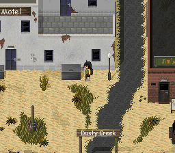

taro, on 2026-11-21, translated (frames 74805 to 74808 in
`/shared/bug-reports-etc/dn-open-trash-animation/`):

> the trash can's lid tile disappears for 2 frames while it opens

## Log

### 2026-11-21, Cardón: the cache of slots drew nothing while the new pose went up

**The can is EV0108 and EV0109 on map 2, at (7, 7) and (8, 7)**: page 1,
on the action key, plays `GrosseMetallTuer` and turns on switch 202; page
2 is the open can (`Eingang_Accessoires` facing left instead of up), and
EV0110 and EV0111, on the row above and above the hero, appear with the
raised lid. Map 2 is painted, and the can stays objects: its pages change
its look. Reproduced from a new game with the hero at (9, 7) facing it:
the can's two objects leave the OAM on the tick the page changes and come
back with the open can a tick later, two frames each there —the same 74806
and 74807 of taro's run—.

**Why**: map 2 has a cache of slots (`cache_slots.s`, bit 7 of
`SHARE_N`). The page writes the row's new key —its still pose—, the next
`build_oam` asks the cache for it, queues its pose and, by design, does
not draw the row until the frame after, "with the pose up". Waiting is
right for a row that comes into view; for one already on screen it took
it off for that tick. The bottom of the can that stayed in taro's frame
is the painting under it.

**Fix**, in the-advocate's runtime: `page_graphic` and `still_turn` call
`cache_was_note` before writing a still row's new key, which keeps —for a
drawn row whose key changes, in a map with a cache— the key and
attributes it showed; `place_npc`, when the cache does not draw a row,
asks `cache_was_draw`, which draws the kept look from the slot that still
holds it. That slot was drawn last frame, so nobody could take it. Kept
looks last one frame; four rows at a time, 13 bytes of FARBSS (Desert
Nightmare had 42 left, measured from the `.dbg`). The closed can now stays
until the open can and the raised lid show, together, on the same frame.

**Test**: `tests/test_desert_nightmare_trash_can.py` in the ports, frame
by frame: every frame the can's cells show the closed can or the open one.
Red before the fix (frames 4 and 5 after the key), green after.

### 2026-11-21, Cardón: verified, to testing

#### What was run

With the tools of the-advocate's `cardon-dn-trash` (`convert`, `mapdata`,
`cartridge` and `project` installed locally), on the ports'
`cardon-dn-trash`:

* ABL's suite, `just tests` in `abl/`: 1728 passed, 2 skipped. No golden
  moved.
* The ports' `just boot`, every game: 196 passed —`just boot -k desert`
  alone, 37—. No golden moved.

Every map with a cache of slots, in any game, goes through the same path;
none of the suites' captures changed.

#### What the suite does not cover

The test opens this can only. The route side —`still_turn`, a still row
that a route turns in a cache map— goes through the same `cache_was_note`
and no test plays it on screen. The cases the header of `cache_slots.s`
leaves out —a row whose look changes as it comes into view, more than
four at once— still wait a tick with nothing drawn.

#### To install when merging

`cartridge`: the runtime changed. `project` was reinstalled in the
worktree only so that its tools assemble the worktree's runtime.

#### To play

Dusty Creek by day, map 2: open the trash can to the right of the
motel's door. The closed can stays until the open can and its raised lid
show, on the same frame.
