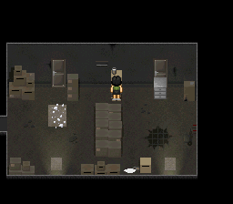

taro, on 2026-11-21, translated (three captures, in
`/shared/bug-reports-etc/dn-warehouse-key/`):

> "Warehouse key obtained". The event I interact with turns into
> something completely different after interacting with it.

It looks like map 28's safe (the number lock, Tijereta's), whose next
page shows another graphic. Since 2026-11-20 every graphic of a moving
event's pages gets its pose bank (Cardón's `6ec2fad8`, wally): a page's
graphic drawn from the wrong bank is a suspect, as is a page whose
graphic was never given one.

taro, the same day, added another case, in another place —the motel,
by the stairs—, translated:

> it's another case, in another place (the hotel), but I suspect the same
> bug

