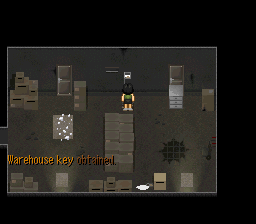
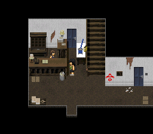
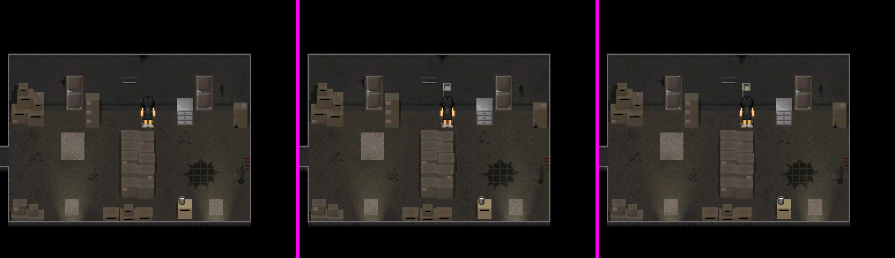
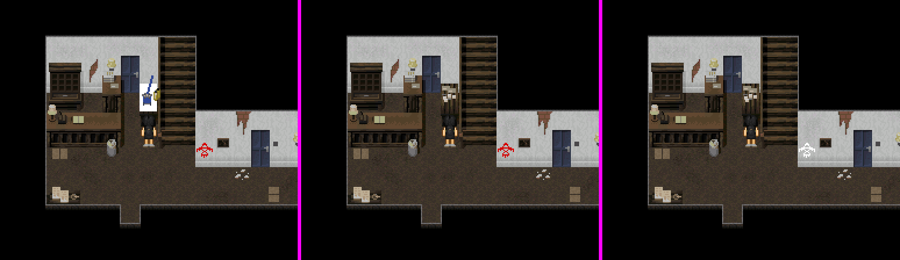
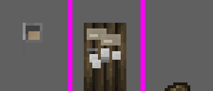

taro, on 2026-11-21, translated (three captures, in
`/shared/bug-reports-etc/dn-warehouse-key/`):

> "Warehouse key obtained". The event I interact with turns into
> something completely different after interacting with it.

It looks like map 28's safe (the number lock, Tijereta's), whose next
page shows another graphic. Since 2026-11-20 every graphic of a moving
event's pages gets its pose bank (Cardón's `6ec2fad8`, wally): a page's
graphic drawn from the wrong bank is a suspect, as is a page whose
graphic was never given one.

taro, the same day, added another case, in another place —the motel,
by the stairs—, translated:

> it's another case, in another place (the hotel), but I suspect the same
> bug

## Log

### 2026-11-21, Cardón: the page after a spin keeps the spin's facing

#### What it is

Both of taro's cases are an event whose page **spins**
(`AnimType_spin`) and whose next page **stands still** as another pose:

* **Map 28 (Raum 6), EV0012 at (11, 5)**, the safe. Pages 1–3 are the
  closed safe, `Lagerhaus_Accessoires3` #0; page 4 (switch 247, the safe
  open) is #1 spinning, the key; page 5 (switch 279, the key taken) is #0
  facing right, pattern 2, fixed graphic: the open safe.
* **Map 16 (Motel - Erdgeschoss), EV0011 at (8, 6)**, by the stairs.
  Pages 1 and 2 are `Motel_Innen` #2 spinning, the papers to take; page 3
  (switch 223) is #1 facing right, pattern 1, fixed: the board. It drew
  #1's pose 10, **the mop** —taro's blue diagonal—. The red figure on
  the right of that capture is EV0030, which blinks red and white in
  RM2k too (`Charakter1` #6 spins, and its rows alternate colours): it
  is not part of the bug.

A spinning page has a move route slot of its own since `89199e4f`
(2026-10-04, `load_page_into_slot`), so the spin turns on the console. When
the next page has no route, `apply_pages` only calls
`remove_page_from_slot`: the slot stays, with the spin's last facing at +8
and the fixed-graphic flag off, so `animate_ev_route` takes it to column 1.
The row then draws that pose of the new page's graphic. RM2k's
`Game_Event::RefreshPage` (easyrpg-player) faces the new page's direction
when the event is stopped and the direction or pattern changed, and shows
the page's pattern when its graphic is fixed or spins.

What `6ec2fad8` changed is the graphic, not the pose: before it, the new
page's graphic had no pose bank and the row drew the spinning character
instead; since it, the right character, with the stale pose. `0b985843`
(the layer's priority) is not involved: the row's +7 is the same with
and without the fix. Not bisected: read, and reproduced on the build of
`main` at `a537d967`.

#### The fix

`page_pose_into_slot` in `runtime/event_pages.s` (the-advocate): when a
page replaces the one the slot still names at +20 —with no route, before
`remove_page_from_slot`, or with one, before `load_page_into_slot`—, the
slot takes the page's fixed-graphic column and, stopped and with a pose
different from the old page's, the page's direction. A slot that no longer
names a page —a forced route, or a page-less page already applied— is left
as it was: the old page is not known there, and the routine runs on every
refresh. That last case is the one RM2k still does differently: an event
with no route of its own, whose forced route left a slot, keeps facing
where the route left it when its page changes.

#### Measured

`tests/test_desert_nightmare_page_after_a_spin.py` in the ports, three
cases (this map 28, map 16, and map 31's bar, the other task): the switch
turned on with the hero on the map, **while the spin faces another way**
than the new page, and the event's 24x32 box compared with the same box
when the map loads with the switch already on. Red before the fix on all
three (395, 346 and 145 of 768 pixels; without waiting for the facing,
the motel passed by chance), green with it.

Before the fix, with it, and loaded with the switch on, side by side:

What RM2k draws for each new page, cut from its CharSet (the safe, the
board, and the bar's empty cell):

Compared against RM2k by reading easyrpg-player and cutting the cells from
the CharSets, not by running EasyRPG or Wine to that moment: getting there
needs the day's scenes played. All the captures, in
`/shared/captures/2026-11-21-dn-page-after-a-spin/`.

### 2026-11-21, Cardón: verified, to testing

Run with the tools of the branch (`project cartridge wally convert
mapdata` installed locally, the runtime of `cardon-dn-page-graphics`):

* ABL's `just tests`: 1728 passed, 2 skipped; no golden moved.
  `abl.sfc` `87b217f91fcdb68d` (sha256, first 16).
* The ports' `just boot`: 191 passed, the three new cases included.
* the-advocate's `just test` (29 passed) and `just lint`, green.

Branches: `cardon-dn-page-graphics` in the-advocate (`5b4199d7`, the
runtime) and in the ports (`8e78c1b`, the test), both on `main` as it was
at the start (`a537d967`, `a36d80b`). **Nothing to reinstall when
merging**: no Rust changed; the runtime goes into the ROM from the
checkout the tools were installed from.

What no test covers: the same change on a page **with** a route that
replaces a spinning one (`load_page_into_slot`'s path): the facing is now
the new page's there too, when it is stopped and its pose differs, which
is RM2k's; no test was written for it, and ABL's suite and the ports'
`just boot` pass with it. And the slot a forced route
leaves, under a page with no route, still keeps its facing when the page
changes, unlike RM2k.

To play: map 28 after "Warehouse key obtained" (the open safe stays the
open safe), map 16 after taking the papers by the stairs (the board, not
the mop), and the bar at night after the first monster (no second smoker
above the one at the bar).
