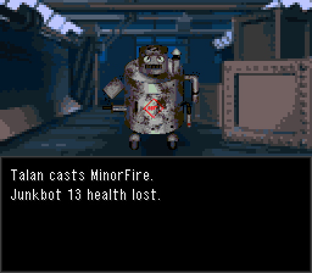

Seen by Cardón on 2026-10-14 (`what-the-compiler-ignores-silently.md`),
tools `14e200fc`, ports `f775b66`.

**What is seen**: not played. The battle model reads none of the enemies'
`attribute_ranks`, the skills' `attribute_effects` or the weapons'
`attribute_set`, so a Flame skill against a Flame-weak enemy, or a Sword
against one that resists swords, does the neutral damage. The only
mention is a comment in `rm2k-snes/battle/src/simulate.rs` ("what is
missing: attributes, rows and the double attack"); no page of the book
says it.

**How much ABL uses it**: of the 100 enemies the cartridge can fight, 74
have a rank other than neutral on an attribute the party's gear or skills
carry; 39 of the 134 skills the party learns and 153 weapons carry an
attribute; 11 of the 44 skills the enemies use do too. The other games with
the data: The Book of Three (66 of 80 enemies), El Dorado and Frozen World
(38 of 45 each), Vampires Dawn (141 of 163).

**How to see it**: no cartridge row to point at; count over the dump with
`enemies.json` (`attribute_ranks`, not all 2), `skills.json`
(`attribute_effects`) and `items.json` (`attribute_set`); the research has
the method.
[What the compiler ignores silently](https://lautarodragan.github.io/the-advocate-docs/research/2026-10-14-what-the-compiler-ignores-silently.html).

## Log

### 2026-10-15, Chajá: the work

Worktrees `chaja-attributes` in the three code repos, from the-advocate
`497be031`, ports `0ddf815`, docs `6ae64a9`.

**easyrpg's 2k path, read in `attribute.cpp`**: of the attributes a hit
carries, the best rate among the physical ones and the best among the
magical ones —a max, not a product, within a kind—; with both kinds the
effect goes through both, `magical * (physical * effect / 100) / 100`. A
negative rate counts for nothing in 2000. The normal attack carries the
`attribute_set` of the weapons in slots 0 and 1 (a shield carries
nothing), only an actor's; a skill its `attribute_effects`. Applied after
the base and before the critical and the variance —and a zero rolls no
variance—. The target's rank: an enemy's `attribute_ranks`; an actor's
own, **one step up** if any armor it wears carries the attribute. Field
heals go through `CalcSkillEffect` too, so the target actor's ranks count
there as well.

* Model: `rm2k-snes/battle/src/attributes.rs`, wired into
  `skill_effect` and `normal_damage`; `Db` reads `attributes.json`.
* ROM: `runtime/battle_attributes.s`, called from `ba_attack` and
  `ba_skill_effect`; tables from `emit.rs` (`attributes`), all in RODATA.
  No far RAM: the scratch is the zero page's `comp_*`.
* Test: `tests/rpgmaker/test_battle_attributes.py` with the case
  `battle-114-attributes` (Kersh, Talan, Manta against a Junkbot: Ray B,
  Cut D, Flame D). Red with main's tools (Manta's hit 81 where the
  attribute leaves 44; MinorFire 34 where it leaves 15), green with these.

#### Verified, and what to install

With the tools of `chaja-attributes` (`cartridge battle mapdata convert`
installed locally): `just test`, `just rust-test`, ABL's `just tests` and
`just boot`, all green; **no golden moved**, since no battle a golden case
fights has a non-neutral rank in what hits it. `just space`: bank 0 and
far RAM in `release` as before —the tables are in RODATA and the scratch
is the zero page's—.

What the suite does **not** cover, in so many words: the actor's rank
going one step up with armor, an enemy skill with an attribute on an
actor, and the physical-and-magical product run only in the model's tests
(`tests/attributes.rs`), not on the console; a healing skill from the menu
with an attribute (no healing skill of ABL carries one); a troop page's
`ChangeEquipment` changing ranks mid-battle.

Left as drafts:
[skills-that-shift-an-attribute-rank-do-not-shift-it](skills-that-shift-an-attribute-rank-do-not-shift-it.md)
and
[a-skill-with-a-physical-attribute-does-not-ask-for-the-weapon](a-skill-with-a-physical-attribute-does-not-ask-for-the-weapon.md);
both are in the book's divergence `what-attributes-do-not-model`.

**On merging, install** `cartridge battle mapdata convert`. Branches
`chaja-attributes` in the-advocate, the-advocate-ports and
the-advocate-docs.

### 2026-11-22, Cardón: what to look at

Today's golden `battle-skill-damage`, from the same case as this task's
test (`battle-114-attributes`: the Junkbot has Ray B, Cut D, Flame D).
Without the attributes, the console's MinorFire did 34 and Manta's hit 81.

**In play** it is a number, not a look: the Junkbot (Recycling Plant,
maps 59 to 62) takes noticeably less from cutting weapons and from fire,
and more from Ray. Any enemy with a weakness should take more from the
weapon or skill that carries it. In RM2k the difference is just as big.
