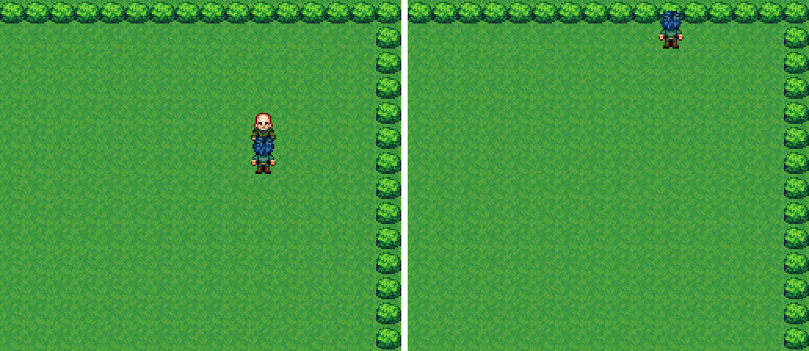
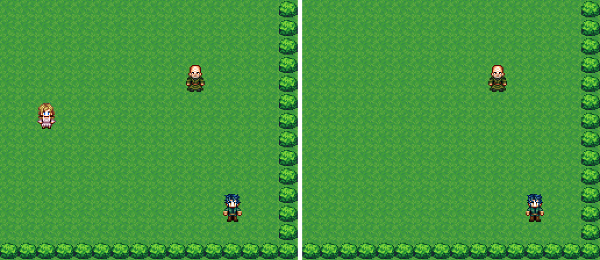

Hurón left it on 2026-10-06 in `eraseevent-for-real.md`: the
`EraseEvent` tests (three from the events crate and
ABL's `tests/rpgmaker/test_erase_event_for_real.py`, in
`test-special`) "do not cover that the event stops being drawn, that it stops
blocking or that the parallel is cut: the test event has no graphic
and is not parallel. That was looked at playing Desert Nightmare, no
test enforces it."

They are three runtime paths that exist only for this: `apply_pages`
hides the erased event's row and releases its route, `conditions_ok`
takes it off the list of parallels, and `pair_ev` cuts the parallel that
runs it (`op_erase_event`, `runtime/interpreter_movement.s`). ABL uses
`EraseEvent` in the quarry (map 150 and common event 36), and Desert Nightmare in
157 parallel pages without a graphic.

**How to see it**: in the cases of `test_erase_event_for_real.py`, an
event with a graphic and on the hero's layer that erases itself (that it is not drawn and
that its cell can be walked through), and a parallel that erases itself in the middle of
its page (that what comes after does not run).

## Defined

On 2026-10-16, by Carpintero.

A path no test executes is what bit most often (AGENTS.md). **Done**: the
cases of `test_erase_event_for_real.py` cover an event with a graphic on
the hero's layer that erases itself —not drawn, its cell walkable— and a
parallel that erases itself mid-page —what follows does not run—; each
new test shown red first by breaking its runtime path (`apply_pages`,
`conditions_ok`, `pair_ev`). **First step**: the two test pages, and
whether `test-special` has room for them or they belong in the test game.

## Log

### 2026-11-22, Hornero: to the test game, taken by Tijereta

taro, translated:

> Could we add a test for this to the test game?

So the two pages go in the test game in the-advocate, not in ABL's
`test-special`: it answers the "First step"'s question. Tijereta moved
the first ten tests there today.

### 2026-11-22, Tijereta: the erasure, map 14, and `test_erase_event.py`

`git blame` on the three paths: all from `4ff38fada` (2026-10-06, "EraseEvent
de verdad"), whose message says what each one is for and that no test
looks at what is drawn, what blocks or the cut parallel. The intent is
whole; nothing to fix, only to test.

**The map**, `test-game/src/maps/Map0014.json` ("Erasure"), 20x15 of bare
grass with bushes around:

* event 1, the statue, (14, 5): People1, the hero's layer, an action page
  `EraseEvent` + variable 201 = 1; a second page, automatic on switch 1452,
  variable 202 = 1 and 1452 off;
* event 2, the pacer, (6, 7): People1, the hero's layer, walking up and
  down, a parallel page on switch 1450: variable 200 += 1, `Wait` 1 s,
  `EraseEvent`, switch 1451 on;
* event 3, the loop, (1, 3): below, touched, `Teleport` to (14, 9) of this
  same map.

Numbers: switches 1450-1452, variables 200-202, map 14.

**The test**, `test-game/tests/test_erase_event.py`, three tests on both
cores:

* the statue blocks, A erases it, the hero walks through its cell up to
  the bushes, and it is not drawn;
* the statue's page goes on past the erase (201), its other page does not
  start with 1452 on (202 at 0), the loop's same-map jump keeps it erased
  and not drawn, and the clearing and back brings it back: the other page
  runs, it is drawn and it blocks;
* the pacer, with 1450 turned on on the map: drawn and started once, and
  two seconds later 1451 off, 200 still 1, not drawn, and still for a
  second more.

**What is drawn is a pixel region, not a golden**: the event's cell and
the one above it, four pixels wider each side, against the same region
three cells to the right —the field is one grass tile, measured equal cell
by cell—. Each test first checks the region does see the figure, so a
check that sees nothing is red. A golden would also freeze the hero's pose
and the pacer's step, which are not what this is about. So nothing to show
before merging; four captures for looking, not goldens, are in
`/shared/captures/2026-11-22-eraseevent-test-game/`.

The first try used the harness's `go_to_map` for the same-map jump and was
red: that loads the map, which is what brings the event back. Hence the
loop, a real `Teleport`.

#### Seen red

Each one a change in the worktree's runtime, the test game's cartridges
built with it (`.local-tools` with `project` and `cartridge`), the three
tests run on both cores and the file put back:

| broken | red, in both cores |
|---|---|
| `apply_pages`: no `hide_npc` for the erased | "the erased statue is still drawn", "the erased pacer is still drawn", "a jump to the same map draws the erased statue again" |
| `apply_pages`: no `remove_page_from_slot` | "the erased pacer is still walking: its move route was not let go" |
| `apply_pages`: the erased block skipped | statue drawn, same-map drawn, pacer walking |
| `conditions_ok`: the erased check skipped | "the hero cannot walk through the cell of an erased event", "a page of an erased event started" |
| `op_erase_event`: `pair_ev` ignored, the parallel goes on | "a parallel page went on past the EraseEvent of its own event" |
| `op_erase_event`: the foreground cut too | "a foreground page has to go on after erasing its event" |
| the map load keeps row 0's erasure (`enter_map.s`) | "after loading the map again the statue's other page did not start" |
| `apply_pages` block **and** `conditions_ok` | adds "the erased pacer's parallel page started again" |

The pacer not starting again is guarded twice —`apply_pages` leaves the
erased event out of the parallels it rebuilds, `conditions_ok` gives it no
page— so that assert is red only with both broken. A first try at the
load break kept `FLAG_ERASED` in `clear_waits` itself: the boot calls it
too, the WRAM's garbage (snes9x's $55 has the bit) left events erased from
the start, and the tests went red earlier than the assert they were for.

#### ABL's test, and the crate's three

The test game now asks everything ABL's `test_erase_event_for_real.py`
asks, of an event with a graphic, and the same-map jump its comment leaves
out. Moving it is not trivial —its two cases live in `test-special`, and
deleting them means ABL's suite again— so it is a draft:
[`abl-s-eraseevent-tests-leave-for-the-test-game`](abl-s-eraseevent-tests-leave-for-the-test-game.md).
ABL's `test_erase_event.py` (after a jump to another map, nothing) and the
ROM side of "in a common event it does nothing" are not in the test game;
the events crate's three are bytecode tests and stay.

The book: the divergence page says the test game enforces it now, and the
test game's progress page says what the erasure carries.

### 2026-11-22, Tijereta: merged with main, to testing

#### Verified

On the-advocate `tijereta-erase-event` at `e93c89ae` (from `6a8f4162`),
with `.local-tools` holding `project` and `cartridge` and the rest global:
`just test` 29 passed; `just test-game -rs` **170 passed, 6 skipped** —the
164 and 6 it had, and the six new—. No golden of the test game moved and
none is new. Then main merged in (`74c216b3`): it brings Rust changes to
the events crate, the converter, mapdata and Adeleine, and nothing in
`runtime/`, `test-game/` or the harness, so the suite was not run again on
the merge.

#### When merging

* the-advocate: only `test-game/` changes; nothing to install.
* the book, `tijereta-erase-event`: two pages, absolute links only.
* the draft
  [`abl-s-eraseevent-tests-leave-for-the-test-game`](abl-s-eraseevent-tests-leave-for-the-test-game.md)
  is the follow-up for ABL's test.

### 2026-11-22, Hurón: what to look at

Tijereta's captures from `/shared/captures/2026-11-22-eraseevent-test-game/`
(snes9x, before the hub: the keeper is not in them). They are not goldens:
the test compares the event's cells with plain grass three cells to the
right.

**How to get there from the hub**: on the meadow, talk to the guide, the
signpost left of where the hero starts, and choose "Erasure" (map 14). The
hero lands below the statue, facing it.

* **The statue**: walk up, it blocks. A on it: it disappears. Walk up
  through the cell where it stood, to the bushes. Take the Way Home (item
  3, from the pause menu) and come back with the guide: the statue is
  there again, and blocks.
* **The pacer**: talk to the keeper in the bottom-right corner, (14, 13),
  and wake the pacer. The girl at the left, (6, 7), walking up and down,
  is erased a second later and stays gone: nothing of her is drawn, and
  she does not come back while you stay on the map.
* **The statue's other page**: the keeper's other option turns on its
  second page. A same-map jump (the touch tile at the left edge, (1, 3),
  teleports to (14, 9)) keeps an erased statue erased; leaving the map and
  coming back runs that other page, and the statue is drawn and blocks.
