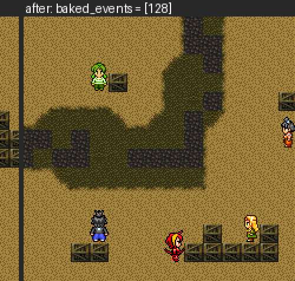
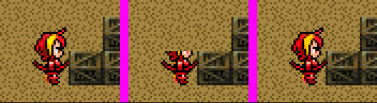

Seen by Mulita on 2026-11-17 with the ports' `just objects-per-line`, at
the-advocate `7dab7d82` and the ports `e87e936` (branch
`mulita-objects-per-line`), from
[`maps-with-more-objects-on-a-line-than-the-ppu-draws`](maps-with-more-objects-on-a-line-than-the-ppu-draws.md).

The console fetches at most 34 slivers of 8 pixels per line; every
character is a 32x32 object, four slivers, so **nine characters on a line
go over** and the ones with the highest OAM index —the ones further back—
are cut, a column or whole. The worst line of each map, under the camera
that shows the most, on a new game with every switch off, after entering
with a teleport:

* map 128: 11 characters and 44 slivers on cell row 12 (events 14, 15, 16, 17, 18, 19, 20, 21 Shopkeeper Stalls, 22 Shopkeeper Stalls, 23, 24); at the entrance too

How to reproduce: `tests/objects_per_line.py frozen-world` at the root of the ports,
which prints each map's worst lines and the camera X that shows them; the
full report of that day, with captures of a few maps in both cores, is in
`/shared/captures/2026-11-17-objects-per-line/`. Playing, the debug
screen's last page counts the map's frames in `Time over`.

What the report cannot say: whether a line is one the player sees with
everyone on it —a page another switch turns off, people a first scene
sends away—, and what a scene adds later.

## Log

### 2026-11-22, Chajá: still so, and `baked_events` on map 128 fixes it

Measured with `just objects-per-line frozen-world` in a worktree of the
ports at `89f77b4`, with the global tools (the-advocate `0ae40e0a`): map
128 is still the only one over, 11 characters and 44 slivers on cell row
12 at camera x 0 (events 14-20, 21 and 22 Shopkeeper Stalls, 23, 24), and
at the entrance too. Maps 1, 2, 3, 4 and 7 are not counted: the jump
does not arrive.

**What they are**, from the dump: of the 20 drawn, sixteen —8 to 20, 23,
24, 27— are a ChipSet tile (tile 108) on the hero's layer, still, with an
action page of three commands: the stalls' goods. The other four are the
shopkeepers, 7, 21, 22 and 25, CharSets with long action pages.

**No patch of the game's data is needed**: the generic `[graphics]
baked_events` takes them. With `baked_events = [128]` in the game's
`advocate.toml` (only in my worktree, not committed), the converter says
"16 still event(s) drawn into the background, a block per pose: 8, 9, 10,
11, 12, 13, 14, 15, 16, 17, 18, 19, 20, 23, 24, 27", keeps 7, 21 and 25 as
objects because they turn toward the hero and 22 because someone can
stand behind what it draws past its cell, and `just objects-per-line
frozen-world` finds no map over. `painted_events` would not do: it
refuses ChipSet tiles, and the map has no panorama of its own.

**Done** is that line in Frozen World's `advocate.toml` —or `true`, which
asks for every map and needs the game's suite and a look at every map
it changes—, the game's `just boot` green, map 128 looked at against the
original (a baked stall is under every character, an object was over
the ones behind it), and the Known issues line of the book's Frozen World
page removed. Not done here: no ROM was looked at and no test was run
with the change. To `todo`.

### 2026-11-22, Chajá: `baked_events = [128]`, measured and turned on

taro asked to turn it on if it has no negative impact. Ports branch
`chaja-tfw-market` from `238c90b`, global tools (the-advocate
`0ae40e0a`), the release built without and with the line.

#### What it costs

* `degradations.json`: equal, byte for byte.
* The converter's log: only map 128 changes —17 colours of 104 where it
  had 11, 0 merged; 28 unique tiles where 24; 17 blocks where 16; 5
  sprite characters where 6—. Of Adeleine's 415 images only map 128's
  two change, and only by a row of the poses' blocks below the map.
* `just space`: 57 banks used and 50 free, as before; 784 B less in the
  gaps, 936 of `$C1`, 27 of bank 0, 25 of bank 1 and 109 of far RAM
  (1,317 B left).

#### Layering, against RM2k

A ChipSet tile stays inside its 16x16 cell, so a character behind a
stall (the row above) never overlaps it: in RM2k it is drawn under, and
here too. The only change is a character on the stall's row to its
left, whose side RM2k draws under the stall and the console over it: the
divergence the book already states. Counted on the sprites, opaque
pixels in columns 20-23 of rows 16-31: Lutine up to 10 facing up, 1-2
facing right, 0 facing down or left; shopkeeper 21 (left of stall 14) 2
facing up or down; 7 and 25, 0. Nothing that shows in the captures.

#### Captured

A throwaway script (`~/scratch/chaja/tfw-market/scripts/`) plays the
intro to the beach, jumps to map 128 and takes the arrival, nine spots
around the stalls —behind, in front, left, right— with A pressed on what
the hero faces, and two walks along rows 14 and 12; against a render of
the map with RM2k's order (rm2k-render's layers and sheets). Before and
after are equal pixel for pixel everywhere except spots 02 and 03, the
hero on row 13 left of a stall: before, her head was cut; after, she is
whole. A opens the same message on every stall and crate, and control
comes back. In `/shared/captures/2026-11-22-tfw-market/`.

#### Applied

The line, with its why, in Frozen World's `advocate.toml` (ports
`chaja-tfw-market`, `9f13196`); the Known issues line out of the book's
Frozen World page, and the divergence page says Frozen World turns it on
for map 128 (docs `chaja-tfw-market`, `1080fc4`). Run with the change:
`just boot -k frozen`, 14 passed, no golden moved; `just objects-per-line
frozen-world`, 150 maps counted, 0 over (maps 1, 2, 3, 4 and 7 not
counted, as before: the jump does not arrive). Not run: the full `just
boot` of the other games, which the change does not touch, nor bsnes on
map 128 —no test of the suite goes there; the captures are snes9x only—.
Nothing to install when merging: no tools changed. To `testing`.

### 2026-11-22, Carpintero: what to look at

From Chajá's captures of the same day
(`/shared/captures/2026-11-22-tfw-market/`), taken on the branch that was
merged; the market's stalls have not changed since.

**What to look at**: on map 128, Desolation Plains 8e (the market), walk
along the lower stalls, rows 12 to 14, and stand left of a stall on row
13. Lutine is drawn whole —before, her head lost columns or vanished—,
and so are the shopkeepers behind the stalls. A on any stall or crate
opens its message and gives control back as before.

What differs from RM2k and is accepted: a character standing left of a
stall draws the few pixels of its side over the stall, where RM2k draws
the stall over it (up to 10 px of Lutine facing up).
