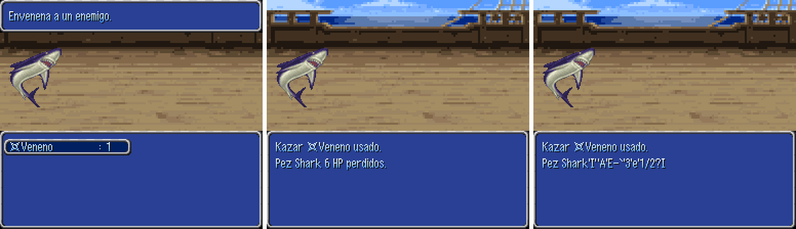

Seen by Tijereta on 2026-10-19, on the-advocate `54ec3daf` plus
[`special-items-cast-their-skill-in-battle`](special-items-cast-their-skill-in-battle.md).

No skill gives or takes a condition in battle —the book's
`divergences/what-battle-conditions-do-not-model.md`—, and a special item
casts a skill, so the items whose skill carries `state_effects` do only
the rest of what the skill does. Measured on each game's dump, the special
items the battle now lists whose skill gives a condition:

* Zounds: Ala Eléctrica (26), Pétalo Violeta (43), Paralizador (53),
  Veneno (67), Ácido (82) and Bola de Fuego (91) hurt and do not poison,
  paralyze or burn.
* The Book of Three: Poison Dart (102) and Sleeping Powder (103) hurt; Web
  Weaver (180), Rune of Sleep (181), Rune of Toxin (182) and Rune of
  Darkness (183) only give a condition, so they are spent and do nothing.
* Vampires Dawn: Ice Dust (116) and Holy Sand (120) hurt; Itching Powder
  (117) is spent and does nothing.
* A Blurred Line: only its placeholder "ABL 2.0 ITEMS" (328), which no
  event gives.

To see it: in Zounds, Kazar throws a Veneno at an enemy; the enemy loses
HP and is not poisoned.

## taro's decision (2026-10-20)

To todo, as Tijereta recommended: the fix is skills giving conditions to their targets in battle, which the runtime supports since `battle-conditions-for-real` —and with it these items do what they say—, not hiding the items.

**Done**: a skill with `state_effects` gives (or takes) its conditions to its targets in battle, with RM2k's hit chance, in the model and the console; Kazar's Veneno poisons an enemy in Zounds, in a test that is red before. **First step**: what `divergences/what-battle-conditions-do-not-model.md` in the book says is left, and how easyrpg's `Game_BattleAlgorithm::Skill` applies `state_effects`.

## Log

### 2026-11-01, Mulita: what was done

Within [`the-partys-conditions`](the-partys-conditions.md), its battle
half: a skill gives and takes its `state_effects` on its targets, on
either side, as `Skill::vExecute` —after the parameters, before the
attributes: already held against enemies says `message_already` and rolls
nothing; otherwise one roll against the skill's hit, then, against
enemies, one against the condition's odds on the target
(`GetStateProbability`: the rank's rate, and an actor's armor), and the
line `message_actor`/`message_enemy`; on its own side the hit takes it
away with `message_recovery`—. A special item casts its skill, so Veneno
and the rest do what they say. In the model (`skill_states` in
`simulate.rs`, `states.rs`) and the console (`ba_st_skill` in
`battle_states.s`).

Test: the ports' `test_zounds_veneno.py`, case `battle-veneno` of Zounds:
Kazar throws a Veneno at the Pez Shark with the battle's randomness set
so the poison takes hold, and the shark's HP and conditions are the
model's. Red with main's tools: the shark holds nothing.

Left, in the divergence `what-battle-conditions-do-not-model`: a weapon's
`state_set`, a medicine's in battle, and the AI weighing a skill on its own
side by the conditions it takes away.

### 2026-11-22, Hurón: what to look at

Shot from the ports' main (`22c7559`, global tools at the-advocate
`1b8825d8`) with the test's own case, `battle-veneno` (Kazar alone, one
Veneno, troop 23, the Pez Shark), and the seed `test_zounds_veneno.py`
sets so the poison takes. What to look for: after "Kazar ✕Veneno usado."
and "Pez Shark 6 HP perdidos.", **a second line about the shark**: that
is the condition given. Before the fix there was none and the shark kept
no condition. The line itself is garbage, `Pez Shark'I"A'E-~3'e'1/2?I`:
Zounds' states carry the editor's Japanese default messages, which is the
draft
[`zounds-condition-messages-are-japanese-defaults`](zounds-condition-messages-are-japanese-defaults.md),
not this task. RM2k draws no mark on a poisoned enemy, so the message and
the turns after are all there is to see.

**How to get there in play**: Kazar has to carry a Veneno (item 67). A
chest on map 117 (event 19) gives three; the case `battle-veneno`, which
only the tests choose, gives one. In any battle: Kazar's "Tirar-Usar", the
Veneno, an enemy. The poison can miss: the hit roll and the enemy's rank
decide (the shark's B gives it 70 %).
