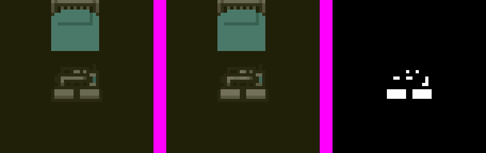

Found by Aguará on 2026-11-28, doing
[`posed-events-on-a-map-with-a-panorama`](posed-events-on-a-map-with-a-panorama.md),
with the-advocate `aguara-panorama-events` (5ae4b600) and the ports
`aguara-panorama-events` (5d5eb289), in A Blurred Line's `release`.

**What is seen**: map 3, *Emitter Room*, whose panorama goes in mode 1:
event 42, a ChipSet tile switch 19 shows, is now drawn into the 4-bit
background. Same place, same shape, but 46 of its pixels are one 5-bit
step lighter than the sprite drew them —(106,105,82) as (115,113,90),
under the scene's tint—. Left the sprite, middle the background, right
the pixels that changed:

**Why**: `posed_events` in Wally's `map.rs` keeps a pose only if the
background merges "the very colours it merged" —the same `(victim,
target)` pairs—. Map 3 already merges that grey into the next one up
([13,13,13] in the patch of map 3, `patches/auto/maps/0003.toml` in the
ports: it moved 876 pixels and now 1014), so the pose's pixels of that
grey merge too and the check sees nothing new. The book's divergence
"Still events drawn into the background" says this is what the rule is
for —"a switch that changes its colours when it moves into the background
is not the same switch"—, so the rule misses its own case. It is not new
with mode 1: a mode-3 or flattened map with merges can do the same; mode 1
merges more (map 3: 93 colours merged).

**How to reproduce it**: build ABL's `release` with both branches, go to
map 3 at (70, 21) with switches 1 and 4 off, turn switch 19 on and
capture; the same with main's tools draws the sprite.

**What a fix would look at**: the merges counted only on the pose's own
pixels —what the event draws over the copy of its cell—, refusing a pose
that has any pixel of a victim colour; the ground under the pose is the
map's and would not count. Whether it is worth it, against losing event
42 and the like from the background, is not clear.
