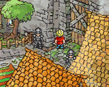
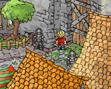
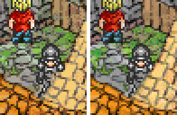
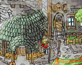
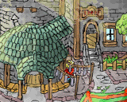
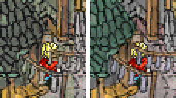
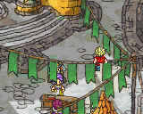
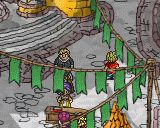
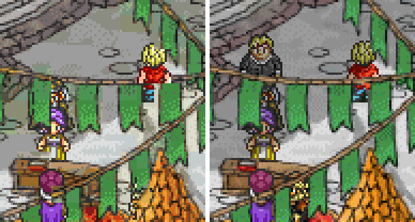

Measured by Mulita on 2026-10-11 (`sunset-in-mode-1-with-colour-math.md`):
on a painted map, the cells the roof partly covers go in BG2 with
only the roof's pixels; 127 tiles fit (`roofs(…, 127)` in
`rm2k-snes/wally/src/background/painted.rs`, the-advocate `fc6f7456`), and
"the edges that don't fit go by whole cell". Over the 60 painted
maps, 34,895 of 1,586,793 roof pixels end up on the wrong side
(2.2 %); in the spring plaza, 2,250 of 84,145. She left written
which way it could go: "256 could be given by moving the base of BG2 and
the window to index 256".

Cardón saw it while playing on 2026-10-11 (`other-games-build-and-boot.md`):
a normal-layer guard, event 8 at (36,13) on map 2, with its
legs over the edge of the orange roof; "probably one of the edges
that don't fit in the 127", not checked. The walks of the goldens in
`test_painted.py` were chosen so as not to show it.

**What you see while playing**: in the plazas and streets of Sunset Over Imdahl,
near the edge of a roof, a character is covered too much or peeks out above
where the original covers them.

**How to see it**: `just boot -k sunset` at the root of the ports builds the
release; go to map 2 and look at the guard at (36,13).

## Defined

On 2026-10-16, by Carpintero.

Cosmetic and measured (2.2% of the roof pixels): nothing stops. **Done**:
Sunset's painted maps carry every roof edge exactly, with the goldens of
`test_painted.py` moved on purpose to show the guard at (36,13) on map
2. **First step**: Mulita's suggestion —BG2's base and the window at
index 256, for 256 edges— and how many edges each painted map needs.

## Log

### 2026-11-22, Mulita: captures

taro asked for them:

> Would you add captures to roof-edges-that-dont-fit-in-the-127?

**It still reproduces.** Sunset's `release` built at the ports `001cfb7`
with the global tools (the-advocate `6a8f4162`); the converter still says
2,250 of 84,145 roof pixels on the wrong side for the spring square, map 2,
and 7,715 of 97,826 for the summer one, map 3, the worst of the 60 painted
maps. Recomputing `roofs` from the roof picture alone —the 127 edges that
save the most go exact, the rest by whole cell— gives the same totals, so
the cells named below are the ones that went by cell.

Each pair is the port —snes9x, the harness's `go_to_map` after playing the
intro, switch 76 on as in `test_painted.py`— and the same screen as RM2k
draws it, **composed, not captured from RPG_RT**: the panorama, the
characters by layer and row, then the square's pictures over everything
—the roofs opaque, the shadows and lights at the transparency the
converter logs, their tones left out—, from the original's files. Cropped
to the spot; the third image is the edge at x3, port on the left.

**The guard, event 8 at (36,13) on map 2.** In RM2k the orange roof hides
his legs; in the port they are drawn over it. The 8x8 cells under him that
went by whole cell put 59 pixels on the wrong side; (73,26) and (71,27),
under his feet, are covered 45 and 47 of 64 and went whole in front, but
the ones above them, 9 and 13 of 64, went whole behind: the roof's top
edge falls there and the legs show over it.

**The hero by the green tent on map 2, at (26,12)**, among the worst cells
of the square —(26,11) and (25,12) put 53 and 49 pixels on the wrong
side—. In RM2k the edge of the tent's roof cuts the hero's head and
shoulder; in the port the hero is whole over it: under the sprite, 96
pixels on the wrong side.

**The summer square's bunting, map 3, hero at (13,17)**, by the three
townsfolk at (10,16) to (10,18). There the roof picture also carries the
strings of pennants across the square: 661 edges for 127, so every edge
that saves fewer than 29 pixels goes by cell, and around the pennants
almost all do —896 pixels on the wrong side in the 88x64 box around
them—. In RM2k the rope and the pennants hang in front of the hero; in the
port the hero's head and body are drawn over
the rope, and the pennants are blocks of whole cells. The man at (10,16)
RM2k shows is not drawn in the port: not this task's, likely the crowd
waiting for a slot (`sunset-towns-crowds-wait-for-a-slot`); not looked at.

On the way, the guard at (13,23) of map 2 is still drawn over the roof
that should hide him; that one is
[`events-above-the-hero-over-the-painted-roofs`](events-above-the-hero-over-the-painted-roofs.md),
not this task.
