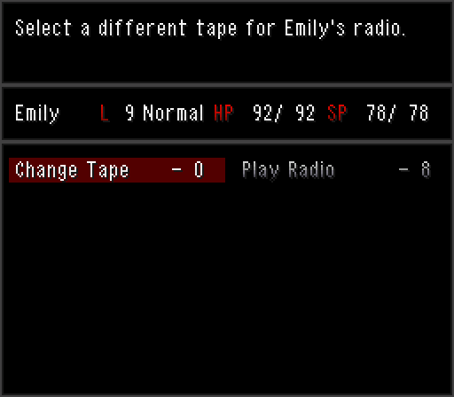
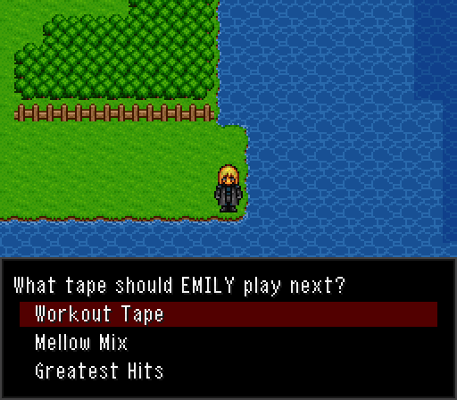

Phase 3.1 of [`the-skills-menu`](the-skills-menu.md), after
[`the-skills-screen`](the-skills-screen.md). In ABL no event turns on the
switches 734, 979, 859 and 805: Radin's Mix Formula and Field/Battery
Repair, Sern's Weapon Forging and Emily's Change Tape (common events 42,
50, 44, 43) are reached only from Tech Skill. See the research
`research/2026-10-12-the-skills-menu.md` in the book.

## Log

### 2026-10-12, Mulita: done, to testing, with two of ABL's four

On the same branches as [`the-skills-screen`](the-skills-screen.md), and
on top of it. A on an enabled switch skill does what easyrpg's
`Scene_Skill` does: the switch on, the SP spent, and straight to the map,
where the common event that waits for the switch runs. No new opcode, no
new RAM: `ba_switch` of the battle turns the switch on.

**Measured state of ABL's four**: Emily's Change Tape works —common event
43 asks which tape, as in the original—, and Radin's Field/Battery Repair
runs common event 50 (not played through). Radin's Mix Formula and Sern's
Weapon Forging turn their switches on and nothing runs: common events 42
and 44 do not compile, because their `MoveEvent` changes the hero's
graphic and a shared body has no map graphics table. Adding their maps,
298 and 321, to `release` was tried and does not help; it was undone.
Draft: [`radin-s-and-sern-s-menus-do-not-compile`](radin-s-and-sern-s-menus-do-not-compile.md).

**Verified**: ABL's suite, 1283 passed, with `test_switch_skills.py`
—Change Tape's question, Dig Ingredients spending its 4 SP and turning 811
on, a grey one and a heal doing nothing—, whose first two were shown red
against the phase 2 runtime; `just boot`, 9 passed.

**Not covered**: the skill's sound effect is not played (draft
[`switch-skills-from-the-menu-play-no-sound`](switch-skills-from-the-menu-play-no-sound.md));
no test uses a switch skill in another game. Heals (3.2) and items that
cast a skill (3.3) are not done.

### 2026-11-22, Cardón: what to look at

Shot today from main (ports `22c7559`) on the case `skills`, with Emily
first in the party.

**In play**: with Emily in the party, menu → Tech Skill → Emily → Change
Tape. The question with the three tapes has to come out on the map.
Radin's Dig Ingredients spends 4 SP. Mix Formula and Weapon Forging take
the party to their maps, now that their common events compile (see
`radin-s-and-sern-s-menus-do-not-compile`).
