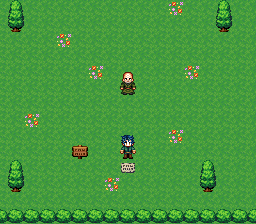
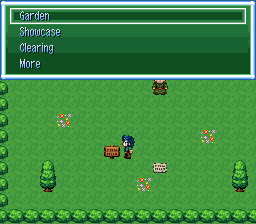
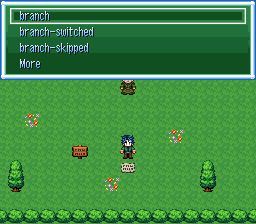

> Could you deliver me a playable build of the test game? If it needs
> things in the tests that don't exist at runtime, like starting on map X,
> could you modify it so it is entirely testable by hand?

taro, 2026-11-22.

## Log

### 2026-11-22, Hornero: taken for Tijereta

### 2026-11-22, Tijereta: taro's change of direction, and the plan

taro, through Hornero, the same day, over the assignment's "do not move
any golden" and its separate `play` cartridge: goldens moving is
preferred, the tests should be as close to real play as possible, and
modifying them is the plan, because

> mocking is a code smell

So a single `release`, which starts on the hub; the tests reach their map
and their case the way a player does, through the hub's menus, and keep
the harness's shortcut only where playing it is absurdly slow or
impossible, saying why on its line. Moved goldens go in a commit of their
own, with before and after in `/shared/captures/2026-11-22-test-game-playable/`
for taro to approve before the merge.

What the harness does that a player cannot, read at the-advocate
`1b8825d8`:

* **The cases.** `Session(core, case=…)` writes the case variable, 1000,
  and turns the test pages' switch off before the first frame: the
  converter puts one automatic page per case on event 0 of the map the
  cartridge boots on —page k asks for variable 1000 at least k— and a last
  empty one that asks for the switch, which each page turns on first.
* **Switches turned on from outside**: `test_conditional.py`'s 1420
  before the case, `test_jumps.py`'s dispatcher, 1430, before entering the
  lookout, and `test_erase_event.py`'s statue's other page and pacer.
* **`go_to_map`**, a door's fade asked of the ROM from outside: the
  erasure, the doors, the lookout and the clearing.
* **RAM poked**: `jumps_left` to zero, the hero's facing, and the hero's
  speed.

The hub is **the meadow itself**, map 1, so no new map: the test pages
live on the map the cartridge boots on, and half the cases run against the
meadow's events —the chain of calls, the switch past 1023, the boxes over
its grass—. A new start map would have carried the pages away from them.

### 2026-11-22, Tijereta: the hub, the tests playing it, and the delivery

the-advocate `tijereta-test-game-playable`: `a0e3c1b9` the hub and the
tests, `92f201d3` the moved goldens. The book, `tijereta-test-game-playable`
at `3356c2c`: the test game's page under "Project progress". No Rust
touched: nothing to install when merging.

#### What the hub is

* **The guide**, a signpost drawn at (7, 10), event 11: a teleport to each
  map, landing where its tests land, facing down; the lookout twice, the
  second with 1430 on, so its dispatcher sends the hero on.
* **The tester**, a board at (10, 11), right below the start, event 12:
  the hero boots facing it, so a case chosen there runs with the hero on
  the start cell facing down, as the harness ran it at boot, with no
  teleport. Five groups, nested `ShowChoice`s of four with a "More"; each
  case's commands go inline in its branch. `branch-switched` is `branch`
  with 1420 on, what `test_conditional.py` used to turn on from outside.
* **The Way Home**, item 3 —2 is Calandria's—: a switch item, 1600, whose
  automatic common event 5 teleports to the meadow. Both hand it out.
* **The keeper** on the erasure, event 4 at (14, 13): turns on 1452, the
  statue's other page, or 1450, the pacer.

Both hub events are drawn in the tiles and have no graphic: two NPCs were
tried first and the converter dropped the case `pictures`' pictures —the
meadow had five sprite palettes and they need five of the eight—.

**Why not keep the cases as test pages and let the tester choose them**:
the tester would have to turn the test pages' switch off, and a game that
names that switch moves it —`test_switch` in rm2k-snes-events— and a
`ControlSwitches` by variable does not compile. So the cases moved from
`cases/` to `tester/` and became the game's own; `cases/` keeps `nothing`
and `terrace`, which only `test-vblank` carries —release excludes it—.

**How a new case gets offered**: written by hand, not read from `cases/`.
A file in `tester/`, its name in a group of `hub.toml`, and `just hub`,
which rewrites the meadow's last two events from those; `test_hub.py` is
red until the meadow says what they say, and red if a file in `tester/`
is not offered. A new map: its line in `hub.toml`'s guide, and
`test_hub.py` is red until every map of `maps.json` is on it.

#### The tests

They boot and play, through `tests/play.py`: the signpost, the board,
`ShowChoice` as A Blurred Line's playthrough chooses —in frames, since a
case that opens the save screen has no ticks to wait for—, the Way Home
from the pause menu. `test_erase_event.py` asks the keeper and comes back
with the Way Home and the guide; `test_jumps.py` takes the guide's
"Lookout, sent on"; `test_own_action.py` and `test_same_door.py` walk
from the guide's landing on the doors instead of being put on a cell and
turned. What stays poked, each with its reason on its line: `jumps_left`
in `test_jumps.py`, which no map of this game spends, and the hero's speed
in `test_speed.py`, swept over five values that only a route sets.
`test_terrace.py`'s probe runs on `test-vblank`, which has no hub, with
the harness's case. `test_hub.py` is new: the meadow up to date, every
case offered once, every map on the guide, and each of the guide's
teleports walked and left with the Way Home, on both cores.

Run: `SOUNDFONT="$HOME/assets/soundfonts/FluidR3_GM.sf2" just test-game`
from the-advocate's root, 202 passed and 6 skipped, at `92f201d3`. Before
the change, 170 passed and 6 skipped.

#### The goldens

Eighteen move, all on the meadow, each by the same 319 pixels at 15 bits:
the two sign tiles. Nothing else moves —the cases run with the hero where
they ran before—. Before, after and difference, and a contact sheet, in
`/shared/captures/2026-11-22-test-game-playable/`, for taro to approve.

#### The delivery

`SHARED=<…> SOUNDFONT=<…> just deliver "<what to look at>"` in
`test-game/`: `test-game.sfc`, `.sfc.dbg`, the runtime of the checkout the
tools were installed from, and a `README.txt` with both commits, what to
look at and how to play. `SHARED` has no default: the test game has no
`machine.just`. Tried into a scratch folder: it builds, copies, writes the
README, and refuses with a change uncommitted in `test-game/`. Hornero
delivers from merged main.

#### Found and not fixed

[`an-event-with-no-graphic-stops-blocking-the-hero`](an-event-with-no-graphic-stops-blocking-the-hero.md):
the guide's graphic-less event stopped blocking the hero once the game
had idled thirty ticks. The sign tiles are impassable in ChipSet 1
because of it, so the hub does not depend on it.

#### What the suite does not cover

* The tester's cases in sequence, as a player chains them: each test boots
  fresh, and a case leaves its pictures, tint, party behind.
* The Way Home from the terrace, whose arrival scene takes presses, and
  from inside a case's page.
* The RM2k files `just game` makes, `build/game/`, were not opened in
  EasyRPG or in the editor to see the hub there.
