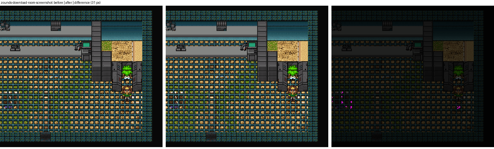

Seen by Hurón on 2026-11-22, doing
[`superfamiconv-as-an-oracle-for-palette-packing`](superfamiconv-as-an-oracle-for-palette-packing.md),
reading the-advocate at `6a8f4162`.

`try_pack`, in `snes/adeleine/src/pack.rs`, says "each into the group that
grows the least", and so did the Python it came from, from the first
version (`330708ae`, "al grupo que menos crezca"). But the code compares
`group.len() + colors.difference(group).count()`, the size of the union, and
takes the smallest. A tile that already fits in a big group with no new
colours goes to a small one where it adds three, because three plus a small
group is fewer than the big group's size. That is closer to worst fit than to
best fit. `git blame` gives no other intention: the comment and the code
have disagreed since that commit.

What it costs, measured with the pictures of `tests/superfamiconv.rs` in
`snes/adeleine/` (the-advocate, branch `huron-sfc-oracle`), over 500 seeds
with no limit on palettes. A throwaway copy of `try_pack` that minimises
growth, with ties going to the first group, needs fewer palettes than
`try_pack` in 362 pictures, the same in 136 and more in 2. Against
SuperFamiconv the copy ties in 364, loses in 90 and wins in 46. `try_pack`
as it is loses in 361. Ties going to the fuller group give the same numbers
within two pictures.

The smallest reproducer, cut down from seed 0: ten tiles, 36 colours,
numbered here in colour order. `try_pack` needs 4 palettes and the copy
needs 3, the least that 36 colours allow. SuperFamiconv also needs 3:

    [14, 25, 30]  [13, 32, 35]  [2, 15, 22, 24, 28]  [12, 26, 33]
    [4, 6, 17, 22, 26, 31, 33]  [6, 12, 31]  [1, 3, 5, 11, 33]
    [12, 20, 27, 34]  [10, 14, 16, 19, 23, 30, 34]
    [0, 7, 8, 9, 18, 21, 29]

The `try_pack` change belongs with
[`overload-and-remove-for-try-pack`](overload-and-remove-for-try-pack.md),
which is about the same function and has the same constraints: determinism,
and goldens that move without a pixel changing. The cheap fix is worth
measuring first, as the first step there: it might already turn the `None`s
that task is looking for into fits. In the oracle test, the seeds this would
fix are the first group in `KNOWN`.

## Log

### 2026-11-22, Hornero: taken by Hurón

taro, translated, on whether to take it on knowing it moves goldens in
every game:

> Yes!

### 2026-11-22, Hurón: growth first, smallest union on ties

Worktrees: the-advocate `huron-grows-least` from `90535658`, the ports
`huron-grows-least` from `001cfb7`.

#### The change

`try_pack`'s key is now `(growth, union)`: the fewest new colours, then
the group that ends smallest, then the first. `git blame` gives every line
of the loop and its comment to `c5e22f0b5`, the port of the Python, and the
two disagreed already there; nothing says the union was on purpose.

The tie-break, measured over the 500 pictures of `tests/superfamiconv.rs`
with no limit on palettes (`ADELEINE_ORACLE_SEEDS=500 cargo test --test
superfamiconv distribution -- --ignored --nocapture`, a temporary `TIE`
variable choosing the key):

| tie-break among equal growth | ties | try_pack fewer | SuperFamiconv fewer |
|---|---|---|---|
| smallest union (chosen)      | 363  | 54             | 83                  |
| fuller group                 | 367  | 44             | 89                  |
| first group                  | 364  | 46             | 90                  |
| `try_pack` before the fix    | 133  | 6              | 361                 |

Against the old `try_pack`, per picture: fewer palettes in 366, the same
in 133, one more in 1 —seed 198, 11 against 10—. Cut down by removing
tiles while the regression held, it is 17 tiles and 51 colours, 6 palettes
before and 7 now:

    [2, 3, 5, 14, 15, 19, 29, 32, 35, 36, 43]
    [2, 4, 14, 15, 18, 19, 21, 28, 32, 35, 36]
    [9, 11, 17, 25, 27, 31, 33, 38, 41, 46, 47]
    [2, 4, 5, 15, 16, 19, 21, 29, 43, 50]
    [8, 21, 22, 32, 34, 36, 40, 44, 48, 50]
    [0, 9, 11, 25, 27, 31, 33, 46, 47]
    [7, 11, 25, 27, 31, 33, 38, 46, 47]
    [6, 12, 18, 20, 27, 34, 42, 50]
    [14, 15, 19, 28, 29, 32, 36, 40]
    [1, 12, 23, 27, 34, 43, 49]
    [10, 13, 16, 26, 27, 42, 45]
    [4, 15, 21, 28, 37, 43]
    [9, 12, 27, 42, 50]
    [30, 39, 40, 48]
    [3, 22, 48]
    [8, 9, 24]
    [21, 33, 47]

Not kept as a test: a test asserting 7 would defend the worse answer, and
one asserting 6 is red until a placement can be undone, which is
`overload-and-remove-for-try-pack`'s; it goes there as a case.

The unit test `each_tile_goes_to_the_group_that_grows_the_least`, in
`pack.rs`, is the 10-tile reproducer: red against the old code (4
palettes), green after (3). `KNOWN` lost its first reason: its 32 seeds
all stopped being wins, and no new win appeared; the 10 of
overload-and-remove stay. `tests/python.rs`'s `tiles_into_eight_palettes`
changed hash: five palettes before and after, other tiles in each.

#### What it does to the games

Every game's `just cartridges` in the ports worktree, first with the
global tools (from `6a8f4162`) and then with this branch's `adeleine`,
`wally`, `rm2k-snes-screens`, `rm2k-snes-images`, `rm2k-snes-mapdata` and
`rm2k-snes-convert` first on the PATH; the runtime is the global one's in
both. Read from each `release`'s `converter.log` (the throwaway scripts
are in `~/scratch/huron/grows-least/measure/`). Totals of every map:

| game | layer above: colours merged | layer above: palettes | background CGRAM entries | sprite palettes | panorama colours merged |
|---|---|---|---|---|---|
| abl                | 585 → 584   | 429 → 429   | =               | =           | =         |
| book-of-three      | 247 → 242   | =           | =               | =           | =         |
| desert-nightmare   | =           | =           | =               | =           | =         |
| dooms2             | =           | =           | =               | =           | =         |
| el-dorado          | 134 → 117   | 36 → 33     | =               | =           | =         |
| frozen-world       | 898 → 896   | 213 → 213   | 8948 → 8955     | =           | =         |
| sunset-over-imdahl | =           | =           | =               | =           | =         |
| vampires-dawn      | 4863 → 4857 | 722 → 719   | 26031 → 26043   | =           | =         |
| zounds             | 772 → 760   | 268 → 264   | 9312 → 9340     | 603 → 601   | 4087 → 4083 |

The background's own merges do not move in any game (it does not reach
`try_pack` with tiles that fit). What moves is the layer above, and
through it the background: a layer above in fewer palettes leaves the
background more, so maps where tiles above the hero stayed above to save
colours now draw them below (Frozen World 11, Vampires Dawn 26, 54 and
160), and Zounds 110, 148 and 149 draw still events into the background
that were objects —149 then needs one sprite palette less, 110 too—.

Maps that changed most: El Dorado 3 and 6 (the layer above in 3 palettes
instead of 4, and 3 and 5 colours no longer merged), El Dorado 2 (6
colours back), Book of Three 45 (5 back), Vampires Dawn 379 (5 back),
Zounds 174 (12 back), Zounds 32's panorama (4 back).

**Worse**: Vampires Dawn 378 (the layer above merged nothing and now
merges 1 colour) and 391 (0 → 2), the real-game face of seed 198: best fit
with the new key misses a fit the old one found. Frozen World 62's layer
above takes 4 palettes instead of 3, with nothing merged either way (the
background still fits). Both go to
`overload-and-remove-for-try-pack` as cases.

Adeleine's images that change a pixel's colour (the rest change only
indices): ABL 145 above; Book of Three 45; El Dorado 2, 3, 4, 6; Frozen
World 4, 11, 21; Vampires Dawn 26, 54, 160, 183, 378, 379, 391, 393, 401;
Zounds 110, 148, 149, 174. ABL's test cartridges `msu` and `msu-rom`
change in map 312's layer above, only indices; the other nine come out
byte for byte equal, and so does Sunset's `release`.

#### Goldens and patches

One golden moves in all the suites: Zounds'
`zounds-download-room-screenshot`, map 32's second panorama, whose 4
merged colours come back (31 pixels). Committed on its own, NOT approved.
ABL moves no golden: what changes in its maps is palette indices, and map
145's layer above, whose one merged colour comes back, is not in any
golden. It does move ABL's versioned decision for map 145
(`patches/auto/maps/0145.toml`, the merge of `[6, 2, 1]` into `[6, 2, 0]`
no longer needed), regenerated with `just patches` in its own commit. The
test game moves nothing. Captures, with Adeleine's images of the maps
that change a pixel and a contact sheet per game, in
`/shared/captures/2026-11-22-try-pack-grows-least/`.

#### Suites, with this branch's tools first on the PATH

* `just test`: 29 passed. `just lint`: clean.
* `just crate-test` of `adeleine`, `wally`, `screens`, `images`,
  `mapdata` and `convert`: all green.
* `SOUNDFONT=~/assets/soundfonts/FluidR3_GM.sf2 just test-game`: 164
  passed, 6 skipped.
* ABL's `just tests`: first round 1 red, `test_patches` (map 145's
  patch); after `just patches`, 1686 passed, 2 skipped.
* The root's `just boot`: first round 1 red, the Zounds golden; after it,
  199 passed.

What no suite covers: the maps whose layer above changes and that no
golden shows (El Dorado, Vampires Dawn, Frozen World, Book of Three,
ABL 145): those are seen only in Adeleine's images and in playing.

#### To install when merging

`adeleine`, `wally`, `screens`, `images`, `mapdata` and `convert` (every
binary that links Adeleine).

### 2026-11-22, Hurón: what to look at

The only golden that moved, `zounds-download-room-screenshot`, from
`/shared/captures/2026-11-22-try-pack-grows-least/zounds/golden/`; the
"after" is pixel for pixel today's golden in the ports' main (`22c7559`).
The change is barely visible: the panorama kept 28 of its 30 colours and
now keeps all 30. The rest of the games' maps that changed (better on 13
maps, worse by one or two merged colours on Vampires Dawn 378 and 391)
are Adeleine's images, side by side, in the same folder; none is a
golden.

**How to get there in play**: the DownLoad Room is map 32, in the Hover
Tram's engine room. The first visit shows the desert behind the grate; the
screenshot panorama shows on a later visit, once the story has set
variable 14 to 2 and switch 50. Look through the grate's holes at the left
and at the bottom right, where the magenta marks are. Not worth a detour:
what this task is about is the packing, and the suites are its check.
