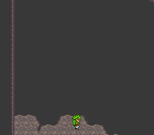
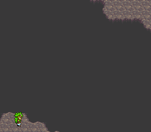
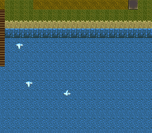
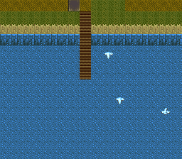
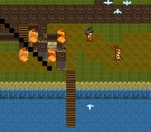

taro, on 2026-11-20, translated:

> In Zounds, map 97, the event that runs automatically, `AutoRun`, does a
> camera pan that, I think, should run diagonally.
>
> ```
> Pan Screen: Up 12 Tiles, Speed 4
> Pan Screen: Right 12 Tiles, Speed 4 (Wait)
> ```
>
> The second `Pan Screen` command has a `Wait` the first one doesn't. I
> imagine that, in RPG Maker, that made both pans run at the same time,
> resulting in a diagonal movement.
>
> On that map, it makes sense for the movement to be diagonal.
>
> A couple of commands later it does `Pan Screen: Reset Position, Speed 4
> (Wait)`, and that one does run diagonally.
>
> I think this also affects The Frozen World's intro, and it probably
> happens in other games.

EasyRPG agrees (`Game_Player::StartPan` in `src/game_player.cpp`): a pan
moves `pan_finish_x` or `pan_finish_y` by its distance, from the finish
the previous one left, and `UpdatePan` walks the current position toward
both finishes at once, at the last pan's speed. So a pan without a wait
followed by one on the other axis is one diagonal move, and two on the
same axis add up.








## Log

### 2026-11-20, Tijereta: a pan without a wait, and a pan at the edge

The runtime already had EasyRPG's model —a finish
per axis in `pan_dest_x`/`pan_dest_y`, `pan_tick` walking both at the last
pan's step, `pan_frames` as `GetPanWait`— but **every pan waited**:
`op_pan` read the wait byte, did `iny`, and branched on Z, which `iny`
sets from Y. Born with the pan on 2026-09-06 (`ae388b4e` in
the-advocate), so the second command was only read when the first had
finished. Measured on map 97: the first `OP_PAN`'s byte is 0 and the page
still sat on it for 96 frames.

And a second difference, which Frozen World's intro shows: RM2k's
`UpdatePan` moves the **screen**, clamped by the map's edge
(`Game_Map::AddScreenX`), and advances the pan only by what the screen
moved. The console added the pan to the hero and clamped the sum, so at an
edge part of it was hidden and a pan away from the edge spent it before the
camera moved. Map 10 leaves the hero on its bottom row and pans up 30 cells
and left 15 at half a pixel a frame. Before both fixes the camera stood
still for 240 frames, went up, and only after 960 went left; with only the
first one it went left alone for 240 frames before it began to go up.

Speed: one step per axis per frame, `2 << speed` sixteenths, so a diagonal
lasts as long as its longer leg —`UpdatePan` and `GetPanWait`—, which the
runtime already did.

#### How many games

A throwaway script over the eight dumps —every map page, common event and
troop page—, moves (`p[0]` 2 or 3) without a wait, and of those how many
are followed by another move:

    abl                  46 without a wait, 2 followed by another
    book-of-three         8, 2   (map 70 EV0004: three in a row)
    frozen-world          2, 1   (map 10 EV0045, the intro)
    sunset-over-imdahl    3, 0
    vampires-dawn         9, 3   (maps 116 and 125)
    zounds                8, 3   (maps 97 and 101)
    desert-nightmare, dooms2, el-dorado: none

Every move without a wait was affected, not only the pairs: the page held
everything after it for the pan's frames.

#### Done

* the-advocate, `tijereta-diagonal-pan`: the `cmp #0` in `op_pan`;
  `pan_at_edge` in `runtime/camera.s` with `CAM_WANT`, filled by
  `follow_camera` and `wrap_camera`.
* the-advocate-ports, `tijereta-diagonal-pan`: ABL's
  `tests/rpgmaker/test_pan_axes.py` and its cases `pan-diagonal`,
  `pan-adds-up` and `pan-edge`, the camera tick by tick against the model;
  `tests/test_zounds_map_97_pan.py`. All red before their fix.
* Two other tests moved with the timing, each in its own commit in the
  ports: the race's `EXTRA_FRAMES` goes from 7 to 8 per hundred (the
  race's events pan 7 cells left without a wait, so the stretch counted is
  another: 70 extra frames in 919 ticks, against 62 in 976 on main; the
  same 70 with only the wait fix, so it is not `pan_at_edge`'s cost), and
  Zounds' bed tests start from the debug room (the intro hands control
  over 81 ticks earlier with the hero still on a route, which carried over
  the jump and left him stuck a row above the bed). No golden moved.

#### Verified

On the merge with main (the-advocate `61ce3fc6`, ports `ba8a368`), with
the branch's `cartridge`, `convert`, `events`, `mapdata`, `screens` and
`wally`: ABL's suite 1726 passed, the other games' 188 passed, `just lint`
green. `abl.sfc` starts `94fb00befb10ba9b`. Captures side by side in
`/shared/captures/2026-11-20-diagonal-pan/`.

#### Not covered by any test

* Frozen World's map 10 pan: measured frame by frame with a throwaway
  probe, not held by a test.
* A locked camera at an edge (the hidden part goes to `PAN_ANCHOR`), a map
  that loops (left alone), and a pan slower than a pixel a frame reaching
  an edge (cut up to a fraction early).
* The frame the page goes on after a waiting pan: see the draft
  [`a-page-waiting-on-a-pan-goes-on-two-frames-late`](a-page-waiting-on-a-pan-goes-on-two-frames-late.md).

#### To install when merging

Nothing: only `runtime/` changed, which the installed tools read from the
checkout they were installed from. No Rust was touched.
