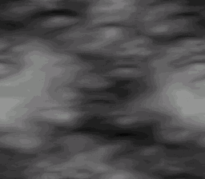

Seen by Carpintero on 2026-11-22, taking captures for
[`vampires-dawn-tradan-hangs-on-arriving-from-the-start`](vampires-dawn-tradan-hangs-on-arriving-from-the-start.md),
on the-advocate `a30ca61d` (global tools) and the ports `22c7559`,
Vampires Dawn's `release` with its `.msu`, in snes9x.

**What is seen**: on Tradan (map 170) the screen shows only grey clouds,
still, from the arrival on. The game runs underneath —`ticks` goes on,
and the hero walks from (49, 27) to (44, 27)— but nothing of the town,
its people or the hero is drawn.

**What the original does**: event 29, at (15, 44), has one parallel page
with no conditions, so it runs on every visit: a loop of `ShowPicture 19
'cloudsky'` at (0, 120), **transparency 40**, and `MovePicture` to
(320, 120) over 10 s with wait. In RM2k that is a translucent layer of
clouds drifting over the town, which stays visible under it.

**What the converter says**: `cloudsky` goes to the cartridge as a big
picture (`OP_BIG_SHOW`, the compiled loop read in the Tradan task's log),
and a big picture takes the map off the screen
([`what-large-pictures-do-not-model`](https://lautarodragan.github.io/the-advocate-docs/divergences/what-large-pictures-do-not-model.html)).
`degradations.json` lists only the move ("the move of picture 19 is not
done"), not that the picture hides the map. It cannot be drawn into the
map by `map_pictures` either: it moves.

**How to reproduce**: the ports' `tests/`, the steps of
`test_vampires_dawn_tradan.py` —`Session(build("vampires-dawn"), SNES9X)`,
`pass_the_title()`, `until_control(30000)`, `go_to_map(170, 49, 27)`—,
then 900 frames and `sess.image()`. Every visit to Tradan should show it,
since the page has no conditions; not played to Tradan by its own roads.

## Comments

### 2026-11-24, Cardón: a question for taro

**What to decide**: what Tradan (map 170) shows instead of a translucent,
drifting `cloudsky` the console cannot draw over the map. Still so: the
book's Vampires Dawn page has it in Known issues, and no commit since
2026-11-22 touches it.

**Options**: (a) the converter leaves out a big picture that is
translucent and moves over a map the hero walks —the town without clouds,
said in `degradations.json`—, as a rule for every game; (b) a VD patch
that drops the cloud loop on map 170 only; (c) the clouds drawn otherwise
(colour math over a background layer), which goes against mode 3 and needs
room; (d) as it is.

**Recommendation**: (a): today the town cannot be seen at all, and the
rule protects any game with the same picture. It changes what is seen and
adds a divergence, so it is yours.

## Log
