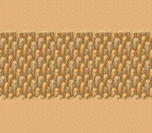
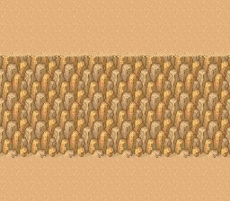

taro, 2026-11-22, frames in `/shared/bug-reports-etc/zounds-camera-pan-jump/`,
on the build of the ports `e886c7e` and the-advocate `7e8da728`:

> - up to 57168, it's the fade-in on map 27
> - 57169: a camera jump, disruptive, from the previous frame. I think it
>   moves a whole tile, vertically and horizontally
> - up to 57172: diagonal scroll
> - 57173 and following: horizontal scroll

## Log

### 2026-11-22, Hornero: taken for Hurón
