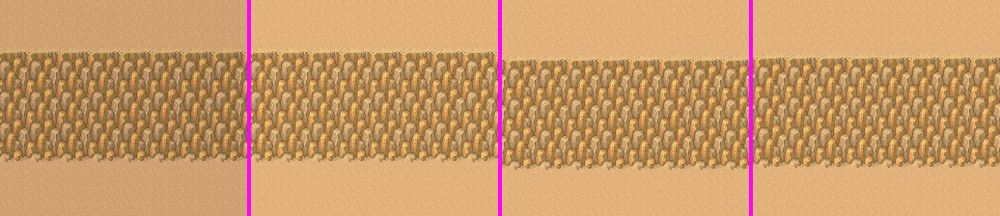

taro, 2026-11-22, frames in `/shared/bug-reports-etc/zounds-camera-pan-jump/`,
on the build of the ports `e886c7e` and the-advocate `7e8da728`:

> - up to 57168, it's the fade-in on map 27
> - 57169: a camera jump, disruptive, from the previous frame. I think it
>   moves a whole tile, vertically and horizontally
> - up to 57172: diagonal scroll
> - 57173 and following: horizontal scroll

## Log

### 2026-11-22, Hornero: taken for Hurón

### 2026-11-22, Hurón: the hero lands mid-step

#### What the frames say

Measured between consecutive frames of taro's run (best shift of the
whole picture): nothing moves during the fade-in, then 57168 to 57169
moves the map 8 px on both axes, 57169 to 57173 moves it back up 2 px a
frame on y and on 2 px a frame on x, and from 57173 on only x moves, 2 px a
frame. Half a cell, not a whole one, and no `PanScreen` involved.

#### The event

Map 26 and map 27 both loop, with the hero hidden. Each has a parallel
page that gives the hero a move route —26: down-right; 27: through on,
right, through off— and waits for it, so he walks without stop, and an
autostart page that waits for movement, shows a box and teleports (26 to
27 at (15, 9), 27 to 28). The box is closed whenever the player taps A,
so the teleport almost always lands with the hero halfway through one of
26's diagonal steps.

#### What RM2k does

`Game_Character::MoveTo`, which `Game_Player::MoveTo` calls on every
teleport, does `SetRemainingStep(0)`: the step in progress is dropped and
the hero stands on the destination cell. The route is not cancelled.

#### What the console did

`enter_map_no_events` set `tile_x`/`hero_x` to the entry cell but left
`step_left` (and `step_dx`/`step_dy`) as they were; only the harness's
door path (`FADE_DOOR`) and `move_hero_to` (same-map jump) cleared it. The
comment on the door path said "`advance_step` only triggers a teleport with
the step already finished", which holds for a touch, not for a page.
`advance_step` recomputes the hero's pixels from the destination cell minus
what is left of the step, so on the first live frame after the fade the
hero went back half a cell up-left and walked the rest of 26's diagonal on
map 27; the camera followed. Measured with the new ports test: the hero
landed with `step_left` 32 at (236, 140), and went (238, 142), (240, 144),
then right.

#### The fix

`runtime/enter_map.s`: `stz step_left` and `stz moving` where
`enter_map_no_events` places the hero, for every map load; the door path's
own copy goes, with its comment.

#### Tests

* ports, `tests/test_zounds_map_27_arrival.py`: from the debug room to map
  26 at (9, 8), its box closed with A until map 27, then 40 frames after
  the fade-in: the camera moves only right, at most 2 px a frame, and the
  hero stays on row 9. Red before: the camera moved (2, 2), (2, 2), then
  (2, 0).
* the-advocate, test game: the case `teleport-mid-step` (a hero route one
  cell right, a wait of a tenth, a teleport to the clearing (10, 7)), in
  the tester's "Events" group, and `tests/test_teleport_mid_step.py`: the
  hero arrives with `step_left` 0 and stands on (160, 112) for 120 frames.
  Red before on both cores: "arrived on the clearing with 32 of his step
  still to go".

### 2026-11-22, Hurón: suites green, to testing

Branches: `huron-pan-jump` in the-advocate (`e1bbec84`, from `7e8da728`)
and in the ports (`677fa09`, from `769676f`). With `.local-tools` of
`project` and `cartridge` from the-advocate's branch: the-advocate `just
test` green (29); the test game, the whole suite, 210 passed, 6 skipped;
ABL's `just tests` 1686 passed, 2 skipped; the ports' `just boot` 202
passed. No golden moved. When merging, reinstall `project` and
`cartridge`: the runtime is read from the checkout they were installed
from.

Not covered by any test: a teleport while the hero is in the air.
easyrpg's `SetJumping(false)` on a map change fixes an RPG_RT bug, and
this change does not touch `route_jump`.
