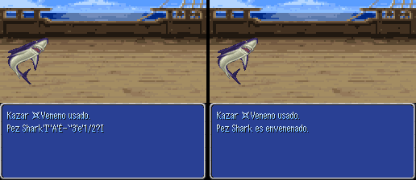

Seen by Aguará on 2026-11-22, while doing
[`zounds-skill-names-show-a-question-mark-for-an-accent`](zounds-skill-names-show-a-question-mark-for-an-accent.md),
on the-advocate `aguara-skill-accents` (from `6a8f4162`) and the ports
`001cfb7`. Found in the data and the cartridge's text, **not looked at on
the screen**.

**What it is**: the same as the nine battle terms of
[`zounds-battle-messages-cannot-be-read`](zounds-battle-messages-cannot-be-read.md),
but in the states. Zounds' `data/db/states.json` (a 2003 database) has the
editor's Japanese defaults, Shift-JIS read as Windows-1252, in the
messages of states 1 to 9 —`message_recovery` of state 1, the dead one,
is `‚Í—§‚¿\x8fオ‚Á‚½\x81I`, `は立ち上がった！`—. The battle's text block
takes them as the revival line (`revived`) and as each condition's five
messages. Until 2026-11-22 each letter was a `?`; since that task they go
through the plain stand-ins like the battle's other database texts, so
they read as other garbage, `'I-S'??a'a'A'1/2?I`.

Whether RPG Maker 2003's battle shows them at all is what to measure
first: the nine terms were never shown by it, and were given the project's
`[battle.terms]` with English stand-ins for a 2003 game
(`UNSHOWN_IN_2003` in `rm2k-snes/mapdata/src/emit.rs`).

**To reproduce**: `scripts/db_scan.py` of that task, in
`~/scratch/aguara/skill-accents/`, over the ports, lists them; on the
console, an actor revived in battle, or a condition given by a skill.

## Log

### 2026-11-22, Hurón: seen on the screen

Seen while shooting
[`items-that-give-a-condition-in-battle-only-hurt`](items-that-give-a-condition-in-battle-only-hurt.md),
on the ports' main `22c7559` with the global tools (the-advocate
`1b8825d8`): with the case `battle-veneno` and the seed of
`test_zounds_veneno.py`, Kazar's Veneno takes, and the line under "Pez
Shark 6 HP perdidos." is `Pez Shark'I"A'E-~3'e'1/2?I`. So the console does
put a condition's "given" message on the screen. Whether RPG Maker 2003's
battle shows it at all is still the first thing to measure. Added to
Zounds' "Known issues" in the book.

### 2026-11-24, Cardón: to todo

Seen on screen by Hurón (the poison's line as garbage), and it is
[`zounds-battle-messages-cannot-be-read`](zounds-battle-messages-cannot-be-read.md)
for the states: that one's fix —a 2003 database's unshown texts from
`[battle.terms]` or English stand-ins, `UNSHOWN_IN_2003` in
`rm2k-snes/mapdata/src/emit.rs`— is the pattern. First what the draft
says: whether RPG Maker 2003's battle shows a state's messages (easyrpg's
2k3 battle); shown or not, garbage goes.

### 2026-11-27, taro: a comment

> If we can tackle this one cheaply, by modifying Zounds and nothing else, let's do it.

### 2026-11-27, Hornero: taken, to Hurón, Zounds only

Within taro's bound: only `zounds/` in the ports changes —its patches or
its `advocate.toml`—, no tool. If it cannot be done that way, Hurón stops
and says what it would take, and it comes back to taro.

### 2026-11-27, Hurón: RPG Maker 2003 never shows them, and `zounds/` alone cannot reach them: a question for taro

#### Step 1: the 2003 battle does not show a state's messages

In easyrpg-player (`~/ref`, `9e67927`, 2026-09-01) the five messages
are read only by `BattleMessage::GetStateInflictMessage`,
`GetStateRecoveryMessage`, `GetStateAffectedMessage` and
`GetStateAlreadyMessage` in `game_message_terms.cpp`, and the only
place that calls them is `scene_battle_rpg2k.cpp`: lines 1083-1084 (a
condition that lasts or goes at the turn's end), 1399 (one that goes) and
1605-1611 (what a skill gives, takes away or finds already held).
`scene_battle_rpg2k3.cpp` reads none of them, so Zounds' author never saw
them. The revival line is the dead state's `message_recovery` (`revived_text`
in `rm2k-snes/battle/src/screen.rs`), so it is unseen too. It is the
same case as the nine terms: the console fights with the 2000 battle,
which writes them.

What `data/db/states.json` holds: states 1 to 9 (Muerto, Env., Ciego,
Mudo, Cansado, Confundido, Dormido, Paralizado, Stun) have the editor's
Japanese in their messages, except Paralizado, whose five are empty. From
10 on, every message is empty.

#### Why I stopped: nothing in `zounds/` of the ports reaches them

* `[battle.terms]` takes only the battle's terms (`check_battle_terms` in
  `rm2k-snes/mapdata/src/emit.rs` stops the build on any other name), and
  the states' five messages go straight from `db.states` to the cartridge
  (`emit.rs`, the loop over `message_affected` … `message_already`). No
  project setting stands in for them.
* The manual patches fork only maps, `ChipSet/` records and
  `commonevents/` (`fork.rs` in `rm2k-snes/convert`). They do not fork the
  database's states.
* `zounds/data/` is what the converter reads, but it is derived:
  `just dump` writes it again from the game. If it is edited by hand, the
  next dump undoes it without warning.

Nothing was changed. The ports' worktree and branch `huron-zounds-states`
were removed unused.

#### To decide

Shown or not by 2003, the garbage has to go. There are two cheap ways.
Neither one changes what any other game shows:

* **(a) In the game**, Zounds' own repository (`GAME_DIR`,
  `lautarodragan/zounds`, `master`): one commit that writes states 1-9's
  messages in Spanish, with `ditto` read/write the way `7e5c54d` (the
  chests) and `dfcbce0` (the spelling, which already edited the database's
  terms) were done. Then `just dump` in `zounds/` of the ports, so
  `data/db/states.json` follows. No tool changes, only Zounds. It is the
  game's repository and not `zounds/`, and that is why I did not take it:
  it is outside Hornero's bound. Cost: one commit there and the dump here.
* **(b) In the tools**, the terms' pattern: a 2003 database's state
  messages from a new `[battle.states]` in the project, or empty/English
  stand-ins without it (mapdata's `emit.rs`, plus its test). This helps
  any future 2003 game, but it changes the-advocate.

The texts I would write (each one goes after the name, like the
`[battle.terms]`; the accents go plain in battle):

| state | given (actor / enemy) | already | lasts | goes |
|---|---|---|---|---|
| 1 Muerto | ` cae.` / ` es derrotado.` | | | ` se levanta.` (the revival line) |
| 2 Env. | ` es envenenado.` | ` ya está envenenado.` | | ` ya no está envenenado.` |
| 3 Ciego | ` queda ciego.` | ` ya está ciego.` | | ` vuelve a ver.` |
| 4 Mudo | ` queda mudo.` | ` ya está mudo.` | | ` vuelve a hablar.` |
| 5 Cansado | ` se cansa.` | ` ya está cansado.` | | ` recupera fuerzas.` |
| 6 Confundido | ` se confunde.` | ` ya está confundido.` | | ` vuelve en sí.` |
| 7 Dormido | ` se duerme.` | ` ya está dormido.` | ` duerme...` | ` se despierta.` |
| 9 Stun | ` pierde el equilibrio.` | | ` se tambalea...` | ` recupera el equilibrio.` |

The empty cells are empty in the game's data too. (The Japanese "goes"
message of Stun says "is staggering…", like its "lasts" message. I would
write the recovery instead.)

**Recommendation**: (a). It is your game, it has already been retouched
this way, and it leaves the cartridge with what 2000's battle would
show if the author had written it. Once you pick one, it is a short task.

### 2026-11-27, Hornero: (a), back to Hurón

> Dale!

(taro, 2026-11-27, to option (a): the game's own repo, `~/juegos/zounds`.)

### 2026-11-27, Hurón: written in the game, and dumped

#### The game

In Zounds' repository, branch `huron-states` from `master` `d3e3647`:
`2853fc8`, the table above written into states 1 to 9 of `RPG_RT.ldb`
with `ditto read`/`write`, as `7e5c54d` and `dfcbce0` did. The given
message is the same for actor and enemy except the dead state's (` cae.`
/ ` es derrotado.`); only the messages that had text got one, so
Paralizado's five and the others' empty ones stay empty. `ditto write`
of the unedited file gave it back byte for byte, the edited one read
back equal to the JSON written, and only `states` changed in it. The
accents are Windows-1252 in the file (`est\xe1`), like the rest of the
game's text.

#### The ports

Branch `huron-zounds-states`, from main `60f1d0f`:

* `aa9ab5a`: `just dump` in `zounds/` with `GAME_DIR` on that commit.
  Only `data/db/states.json` changed, and the dump's round trip held.
* `8b3c55b`: the README and the `justfile` comment said the clone is on
  `snes-port`; it is on `master`, where `png-images` and `snes-port` are
  merged and the game's fixes since 2026-10-19 went.

#### The book

the-advocate-docs, branch `huron-zounds-states` from `40b0a62`:
`3be81ff` takes the line out of Zounds' "Known issues", says next to
the battle terms on the port's page that the conditions' messages were
the same case and were written in the game, and adds to the divergence
"A 2003 game's battle writes the 2000 lines" that the converter has no
stand-in for the conditions' messages: a 2003 game writes them in its
own data.

#### Seen

The case `battle-veneno` with the first seed that poisons as
`test_zounds_veneno.py` finds it (seed 1), before (ports main) and after,
global tools: the line under "Kazar Veneno usado." went from `Pez
Shark'I"A'E-~3'e'1/2?I` to `Pez Shark es envenenado.`. In
`/shared/captures/2026-11-27-zounds-states/`. Only that line was looked
at on the screen; the other messages —already held, lasting, gone, the
revival line— go the same way through the same table, but no capture
shows them.

#### To install when merging

Nothing: no tool changed. The game's branch goes into `master` of
`~/juegos/zounds`, which is the `GAME_DIR` the ports build Zounds with;
the ROM reads the messages from `zounds/data/`, so the ports' branch is
what changes it.
