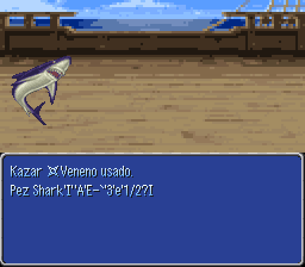

Seen by Aguará on 2026-11-22, while doing
[`zounds-skill-names-show-a-question-mark-for-an-accent`](zounds-skill-names-show-a-question-mark-for-an-accent.md),
on the-advocate `aguara-skill-accents` (from `6a8f4162`) and the ports
`001cfb7`. Found in the data and the cartridge's text, **not looked at on
the screen**.

**What it is**: the same as the nine battle terms of
[`zounds-battle-messages-cannot-be-read`](zounds-battle-messages-cannot-be-read.md),
but in the states. Zounds' `data/db/states.json` (a 2003 database) has the
editor's Japanese defaults, Shift-JIS read as Windows-1252, in the
messages of states 1 to 9 —`message_recovery` of state 1, the dead one,
is `‚Í—§‚¿\x8fオ‚Á‚½\x81I`, `は立ち上がった！`—. The battle's text block
takes them as the revival line (`revived`) and as each condition's five
messages. Until 2026-11-22 each letter was a `?`; since that task they go
through the plain stand-ins like the battle's other database texts, so
they read as other garbage, `'I-S'??a'a'A'1/2?I`.

Whether RPG Maker 2003's battle shows them at all is what to measure
first: the nine terms were never shown by it, and were given the project's
`[battle.terms]` with English stand-ins for a 2003 game
(`UNSHOWN_IN_2003` in `rm2k-snes/mapdata/src/emit.rs`).

**To reproduce**: `scripts/db_scan.py` of that task, in
`~/scratch/aguara/skill-accents/`, over the ports, lists them; on the
console, an actor revived in battle, or a condition given by a skill.

## Log

### 2026-11-22, Hurón: seen on the screen

Seen while shooting
[`items-that-give-a-condition-in-battle-only-hurt`](items-that-give-a-condition-in-battle-only-hurt.md),
on the ports' main `22c7559` with the global tools (the-advocate
`1b8825d8`): with the case `battle-veneno` and the seed of
`test_zounds_veneno.py`, Kazar's Veneno takes, and the line under "Pez
Shark 6 HP perdidos." is `Pez Shark'I"A'E-~3'e'1/2?I`. So the console does
put a condition's "given" message on the screen. Whether RPG Maker 2003's
battle shows it at all is still the first thing to measure. Added to
Zounds' "Known issues" in the book.

### 2026-11-24, Cardón: to todo

Seen on screen by Hurón (the poison's line as garbage), and it is
[`zounds-battle-messages-cannot-be-read`](zounds-battle-messages-cannot-be-read.md)
for the states: that one's fix —a 2003 database's unshown texts from
`[battle.terms]` or English stand-ins, `UNSHOWN_IN_2003` in
`rm2k-snes/mapdata/src/emit.rs`— is the pattern. First what the draft
says: whether RPG Maker 2003's battle shows a state's messages (easyrpg's
2k3 battle); shown or not, garbage goes.

### 2026-11-27, taro: a comment

> If we can tackle this one cheaply, by modifying Zounds and nothing else, let's do it.
